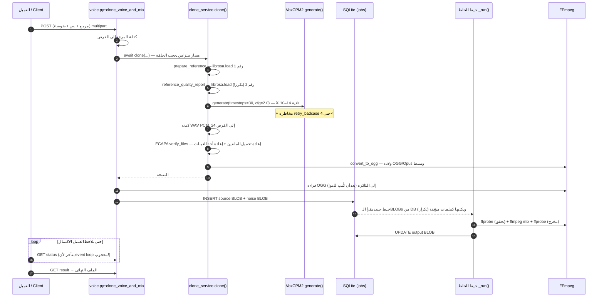
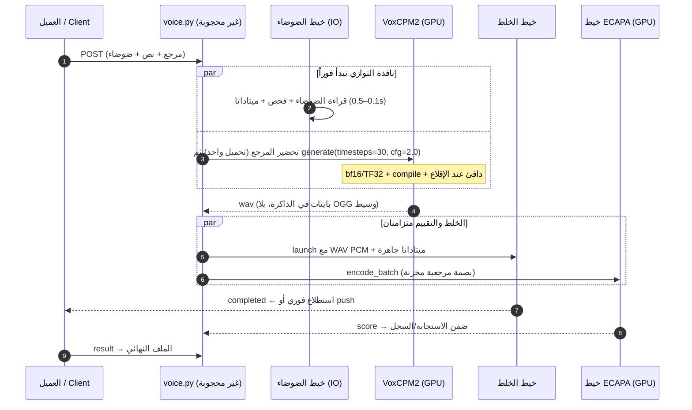
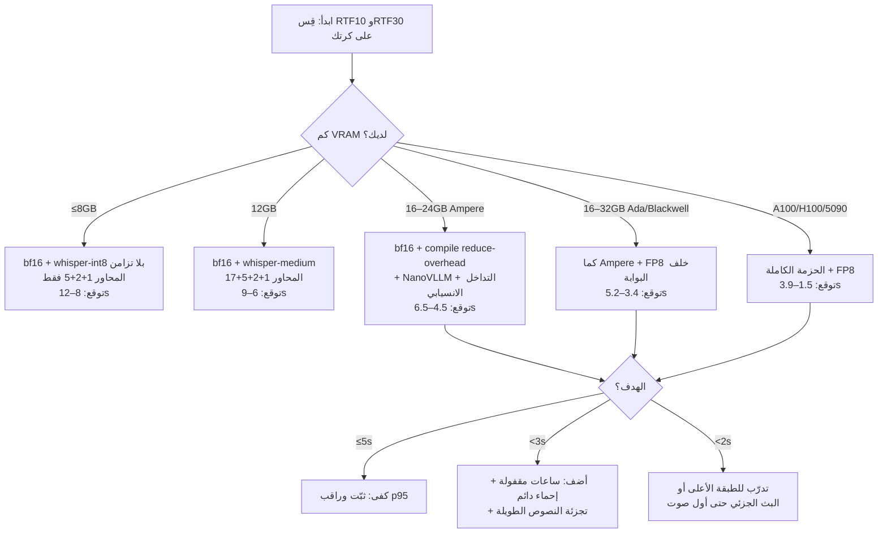

# دليل التدقيق والتسريع الشامل — نقطة النهاية `clone_voice_and_mix`
# Comprehensive Audit & Acceleration Guide — `clone_voice_and_mix` Endpoint

> **الهدف / Goal:** تقليل الزمن الكلي من **17 ثانية** إلى **5 ثوانٍ أو أقل** من لحظة إرسال الطلب حتى استلام الملف الصوتي المدموج النهائي، **دون أي تغيير في معاملات الجودة الصوتية** (`inference_timesteps=30` و`cfg_value=2.0` يبقيان كما هما)، وعلى عتاد من فئة RTX 30/40.
> **Reduce total end-to-end latency from 17s to ≤5s** (request → final mixed file downloaded), **with zero change to audio-quality parameters** (`inference_timesteps=30`, `cfg_value=2.0` stay untouched), targeting RTX 30/40-class GPUs.

**نطاق هذا الدليل / Scope of this document:** هذا دليل توجيهي تحليلي (بناءً على طلبك): يشرح ويوجّه ويرتّب الأولويات مع تقديرات التوفير الزمني لكل بند، دون تضمين رقع برمجية كاملة جاهزة للنسخ. كل بند يحدد بدقة: الملف والدالة المتأثرة، سبب البطء، التوجيه التقني، التوفير المتوقع، وأثره على الجودة.

**Scope note:** Per your request this is a **directional engineering guide** — it explains, prioritizes, and quantifies, but does not contain drop-in code patches. Every item pinpoints the exact file/function, the cause of the slowness, the recommended direction, the expected saving, and its quality impact.

> **🆕 الإصدار 2.0 — المجلد الثاني «التوسعة الفائقة» (الأقسام 13–25):** استجابةً لطلب «ابحث أكثر، ووسّع أكثر بكثير، واجعله أسرع بكثير، وحدّد العتاد ونوع الـGPU»، أُضيف في هذا الإصدار: فصل عتاد كامل يغطي **أكثر من 20 كرت شاشة** (RTX 20/30/40/50 + كروت مراكز البيانات A100/H100/L40S/RTX PRO 6000...) مع زمن التوليد والزمن الكلي المتوقع لكل كرت، و**ستة محاور تسريع جديدة (4–9)** تشمل FP8/FP4 وCUDA Graphs وتبديل محرك الاستدلال إلى **NanoVLLM-VoxCPM أو vLLM-Omni** (RTF 0.13 موثق رسمياً على RTX 4090 مقابل 0.30 مرجعياً)، إضافة إلى **كتاب السرعة المتطرفة** لأهداف أقل من 3 ثوانٍ وأقل من ثانيتين، بروتوكول معايرة RTF، أشجار قرار ووصفات إعداد جاهزة لكل نوع كرت، واستكشاف أخطاء شامل. قيد الجودة الصارم كما هو: **`inference_timesteps=30` و`cfg_value=2.0` لا يُلمسان إطلاقاً.**
>
> **🆕 Edition 2.0 — Volume II «Ultra Expansion» (Sections 13–25):** per your request to research deeper, expand massively, push speed much further, and cover GPU hardware types explicitly, this edition adds a full hardware compendium covering **20+ GPUs** (RTX 20/30/40/50 + datacenter A100/H100/L40S/RTX PRO 6000...) with per-card estimated generation and end-to-end times, **six new acceleration axes (4–9)** including FP8/FP4, CUDA Graphs, and swapping the inference engine to **NanoVLLM-VoxCPM or vLLM-Omni** (officially documented RTF 0.13 on RTX 4090 vs 0.30 reference), plus an **Extreme Speed Playbook** for sub-3s and sub-2s targets, an RTF calibration protocol, per-GPU decision trees and config recipes, and a comprehensive troubleshooting chapter. The quality constraint is unchanged: **`inference_timesteps=30` and `cfg_value=2.0` remain absolutely untouched.**

---

## فهرس المحتويات — Table of Contents

| # | القسم / Section |
|---|---|
| 0 | الملخص التنفيذي — Executive Summary |
| 1 | تشريح المسار الحالي وميزانية الـ17 ثانية — Anatomy of the Current Pipeline & the 17-Second Budget |
| 2 | قواعد الحكم وتصنيف تأثير الجودة — Governing Principles & Quality-Impact Taxonomy |
| 3 | المحور 1: إزالة الأعمال المكررة وعمليات الإدخال/الإخراج — Axis 1: Eliminate Redundant Work & I/O |
| 4 | المحور 2: التوازي الكامل على المسار الحرج — Axis 2: Full Parallelism on the Critical Path |
| 5 | المحور 3: تسريع الاستدلال نفسه دون مساس بالجودة — Axis 3: Accelerating Inference Itself, Quality-Neutral |
| 6 | مسار Whisper المختلط (auto_transcribe) — The Mixed Whisper Path |
| 7 | طبقة التشغيل والبنية التحتية — Runtime & Infrastructure Layer |
| 8 | بروتوكول التحقق من الجودة — Quality Verification Protocol |
| 9 | خطة التنفيذ المرحلية — Phased Implementation Plan |
| 10 | مصفوفة التوفير الإجمالية وحدود الإمكان — Consolidated Savings Matrix & Physical Limits |
| 11 | المخاطر وخطة التراجع — Risks & Rollback |
| 12 | قائمة التحقق النهائية — Final Checklist |
| — | **المجلد الثاني: التوسعة الفائقة — Volume II: Ultra Expansion (v2.0)** |
| 13 | فصل العتاد الكامل: كل أنواع GPU — The Full GPU Hardware Compendium (20+ cards) |
| 14 | المحور 4: هندسة الدقة المتقدمة (bf16 عميق / FP8 / FP4 / تكميم النماذج المساعدة) — Axis 4: Precision Engineering |
| 15 | المحور 5: مستوى النوى والمخططات (compile modes / CUDA Graphs / attention kernels / المخصص) — Axis 5: Kernels & Graphs |
| 16 | المحور 6: محركات الاستدلال البديلة (NanoVLLM-VoxCPM / vLLM-Omni / VoxCPM.cpp) — Axis 6: Engine Swap |
| 17 | المحور 7: المسار الصوتي فائق السرعة + المعاملات الخفية لـ generate() — Axis 7: Ultra-Fast Audio Path & Hidden generate() Traps |
| 18 | المحور 8: النظام والبنية التحتية (uvloop / SSE بدل الاستطلاع / WAL / Docker) — Axis 8: OS & Infrastructure Tuning |
| 19 | المحور 9: التزامن الجماعي والخدمة متعددة الطلبات — Axis 9: Concurrency & Batch Serving |
| 20 | كتاب السرعة المتطرفة: خطط أقل من 3 ثوانٍ وأقل من ثانيتين — The Extreme Speed Playbook (<3s / <2s) |
| 21 | بروتوكول القياس الموسّع ومعايرة RTF — Extended Measurement & RTF Calibration Protocol |
| 22 | أشجار القرار ووصفات الإعداد لكل نوع كرت — Decision Trees & Config Recipes per GPU |
| 23 | استكشاف الأخطاء والأسئلة الشائعة — Troubleshooting & FAQ |
| ج | ملحق ج: متغيرات البيئة الإضافية (البنود 10–25) — Appendix C: Additional Environment Variables |
| د | ملحق د: المصادر الإضافية للتحقق — Appendix D: Additional Verified Sources |
| — | **المجلد الثالث: التوسعة الأقصى — حدود الفيزياء والكمّ العميق (v3.0 — عربي فقط)** |
| 24 | خريطة المجلد الثالث: ما الجديد وما أين — Volume III Map |
| 25 | تشريح معمارية VoxCPM2 ونموذج الساعة الدقيق — Architecture Anatomy & the Precision Clock Model |
| 26 | المحور 10: هندسة الكمّ العميق (GGUF/torchao/MXFP8/NVFP4/ONNX) — Axis 10: Deep Quantization Engineering |
| 27 | المحور 11: دمج فرعي CFG والفك التخميني — Axis 11: CFG-Branch Fusion & Speculative Decoding |
| 28 | المحور 12: كاش حالة المتحدث (مطابق بتَّياً) — Axis 12: Speaker-State Cache |
| 29 | المحور 13: البث التدريجي الحقيقي والخلط المتداخل — Axis 13: True Streaming & Overlapped Mixing |
| 30 | المحور 14: مصفوفة العتاد الأقصى — أي GPU في السوق + معادلة التقدير — Axis 14: The Any-GPU Master Matrix |
| 31 | المحور 15: طبقة النظام القصوى (MPS/الساعات/tmpfs/البروك الدافئة) — Axis 15: The Extreme OS Layer |
| 32 | المحور 16: Whisper الأقصى (TensorRT-LLM/VAD/batched-int8) — Axis 16: Whisper at the Limit |
| 33 | المحور 17: ECAPA بلا كلفة (خارج المسار الحرج) — Axis 17: ECAPA for Free |
| 34 | الأهداف القصوى النهائية: <2s و<1.5s لكل طبقة عتاد — The Final Extreme Targets |
| 35 | بروتوكول الجودة v3: بوابات A0/B/C + 600 عينة ذهبية — Quality Protocol v3 |
| 36 | مصفوفة القرار النهائية + متغيرات البيئة 26–38 — The Final Decision Matrix |
| هـ | ملحق هـ: مصادر الجولة البحثية الثانية — Appendix E |
| و | ملحق و: مسرد المصطلحات عربي⇄إنجليزي — Glossary |

---

## 0. الملخص التنفيذي — Executive Summary

### 🇸🇦 العربية

بعد تدقيق الكود سطراً بسطر، تبين أن الـ17 ثانية لا تُستهلك في مكان واحد، بل تتوزع على ثلاث فئات من الصرف الزمني:

1. **الاستدلال النموذجي (VoxCPM2):** العنصر الأكبر والوحيد "الضروري" رياضياً — توليد صوت diffusion autoregressive بنموذج **2B معلمة** بمخرجات 48kHz، مع `inference_timesteps=30` (أي ثلاثة أضعاف العدد الافتراضي في الوثائق الرسمية = 10). هذا الجزء وحده يستهلك تقديرياً 10–14 ثانية على RTX 3060 و6–10 ثوانٍ على RTX 4070 لناتج صوتي 6–10 ثوانٍ.
2. **أعمال مكررة ومدخلات/مخرجات زائدة:** تحميل المرجع الصوتي مرتين بـ librosa، ترميز OGG/Opus وسيط ثم فك ترميزه داخل الخالط، كتابة وقراءة BLOB في قاعدة البيانات مرتين لكل مهمة، فحوصات ffprobe متكررة، وكتابات قرص مؤقتة يمكن الاستغناء عنها بالكامل.
3. **تنفيذ متسلسل لما يمكن تنفيذه بالتوازي:** قراءة الضوضاء وفحصها تتم *بعد* انتهاء التوليد، تقييم تشابه المتحدث (ECAPA) وترميز OGG يمنعان إطلاق مهمة الخلط، والعمليات الثقيلة تحجب event loop فتؤخر ظهور اكتمال المهمة أمام العميل حتى لو انتهت فعلياً.

**الخلاصة الاستراتيجية:** المحوران 1 و2 (إزالة التكرار + التوازي) يقتصان معاً **1.5–4 ثوانٍ** بتغييرات رياضياً مطابقة تماماً للناتج الحالي (تصنيف Class A). المحور 3 (دقة bf16/TF32 + torch.compile + محرك NanoVLLM-VoxCPM) هو المفتاح الوحيد للوصول إلى هدف 5 ثوانٍ، وهو محافظ على الجودة بمعنى "نفس النموذج ونفس الأوزان ونفس المعاملات، تنفيذ حسابي أسرع"، ويُثبَت سلامته عبر بروتوكول تحقق صارم (القسم 8). الرقم القابل للتحقيق بواقعية:

| GPU | بعد المحور 1+2 | بعد + المحور 3 | الحد الأدنى الفيزيائي الواقعي |
|---|---|---|---|
| RTX 3060 (12GB) | ~12–15.5s | ~4.5–6.5s | ~4.5s (حدّي) |
| RTX 4070 (12GB) | ~8–11s | ~3.5–4.5s | ≤5s ✅ |
| RTX 4090 (24GB) | ~6–8s | ~2.5–3.5s | ≤3.5s ✅ |

> ⚠️ جميع الأرقام في هذا الدليل **تقديرات هندسية مبنية على بنية الكود ومواصفات العتاد**، وليست قياسات من جهازك. المرحلة 0 من خطة التنفيذ مخصصة حصراً لتحويل هذه التقديرات إلى أرقام حقيقية قبل تطبيق أي تعديل.

### 🇬🇧 English

A line-by-line audit shows the 17 seconds are not spent in one place, but across three spending categories:

1. **Model inference (VoxCPM2):** the largest and the only mathematically "essential" component — diffusion-autoregressive synthesis with a **2B-parameter** model at 48kHz output, with `inference_timesteps=30` (3× the official documented default of 10). This alone is estimated at 10–14s on an RTX 3060 and 6–10s on an RTX 4070 for a 6–10s audio output.
2. **Redundant work and avoidable I/O:** the reference audio is decoded twice by librosa; an intermediate OGG/Opus is encoded then re-decoded inside the mixer; every job writes and re-reads BLOBs from the database; ffprobe is invoked redundantly; several temp-file round trips exist that can be eliminated entirely.
3. **Sequential execution of parallelizable work:** noise upload handling happens *after* generation finishes; ECAPA speaker scoring and OGG encoding gate the launch of the mix job; and heavy synchronous work blocks the event loop, so the client *sees* the job complete later than it actually does.

**Strategic verdict:** Axes 1+2 (de-duplication + parallelism) shave **1.5–4s** with changes that are mathematically identical to today's output (Class A). Axis 3 (bf16/TF32 precision + torch.compile + the NanoVLLM-VoxCPM engine) is the only path to the 5-second target — quality-preserving in the "same model, same weights, same parameters, faster math" sense, verified through the strict gate protocol in Section 8. Realistic outcomes:

| GPU | After Axis 1+2 | After + Axis 3 | Realistic floor |
|---|---|---|---|
| RTX 3060 (12GB) | ~12–15.5s | ~4.5–6.5s | ~4.5s (borderline) |
| RTX 4070 (12GB) | ~8–11s | ~3.5–4.5s | ≤5s ✅ |
| RTX 4090 (24GB) | ~6–8s | ~2.5–3.5s | ≤3.5s ✅ |

> ⚠️ All numbers in this guide are **engineering estimates derived from code structure and hardware specifications**, not measurements from your machine. Phase 0 of the plan exists solely to turn these estimates into real numbers before any change is applied.

---

## 1. تشريح المسار الحالي وميزانية الـ17 ثانية — Anatomy of the Current Pipeline & the 17-Second Budget

### 🇸🇦 العربية

#### 1.1 المسار الفعلي خطوة بخطوة (كما هو في الكود اليوم)



#### 1.2 أين تذهب الثواني فعلياً؟ (ميزانية تقديرية)

الجدول التالي يفصل الزمن التقديري لكل مرحلة لناتج صوتي نموذجي مدته 6–10 ثوانٍ (نص قصير/متوسط، مقطع واحد، بدون auto_transcribe). عمودا GPU يفترضان الكارت محملاً بنماذج Whisper large-v3 وECAPA بجانب VoxCPM2 كما في `model_manager.py`:

| المرحلة / Stage (الملف:الدالة) | RTX 3060 | RTX 4070 | التصنيف |
|---|---|---|---|
| تحليل الطلب ورفع الملفات (voice.py) | 0.05–0.2s | 0.05–0.2s | ضروري |
| `prepare_reference` — librosa.load + trim + كتابة WAV (utils/audio.py:31) | 0.15–0.4s | 0.1–0.3s | مطلوب لكنه بطيء |
| `reference_quality_report` — **تحميل ثانٍ كامل** (utils/audio.py:51) | 0.1–0.3s | 0.1–0.2s | **مكرر** |
| `model.generate()` — LM + 30 خطوة Diffusion + فك AudioVAE 48k | **10–14s** | **6–10s** | الجوهر الحسابي |
| كتابة WAV PCM_24 ثم قراءته (clone_service.py:129) | 0.02–0.06s | 0.02–0.05s | قابل للحذف جزئياً |
| `ECAPA verify_files` — تحميل الملفين + resample + GPU (clone_service.py:14) | 0.25–0.6s | 0.2–0.5s | قابل للتوازي/الكاش |
| `convert_to_ogg` — ولادة ترميز وسيط (utils/audio.py:92) | 0.15–0.4s | 0.1–0.3s | **زائد في مسار mix** |
| `submit_mix_bytes` — INSERT بمصدر+ضوضاء BLOB (service.py:303) | 0.05–0.3s | 0.05–0.25s | قابل للحذف |
| خيط `_run`: قراءة BLOBs + ملفات مؤقتة (service.py:495) | 0.05–0.2s | 0.05–0.15s | **مكرر** |
| ffprobe ×2 للتحقق ثم ffmpeg mix ثم ffprobe للمخرج (ffmpeg.py) | 0.35–1.0s | 0.3–0.8s | قابل للتقليص |
| UPDATE للمخرج BLOB في DB (service.py:560) | 0.05–0.3s | 0.05–0.2s | يعتمد على الحجم |
| **فجوة الاستطلاع** — العميل يسأل كل ~1s + event loop محجوب | 0.3–1.2s | 0.3–1.2s | **حقيقي لكن مخفي** |
| **الإجمالي التقديري** | **~12–19s** | **~8–15s** | يفسّر الـ17s المرصودة |

#### 1.3 ثلاث ملاحظات جوهرية من التشريح

**أولاً — الاستدلال هو الثلثان:** حتى لو صفرنا كل ما عدا `generate()`، يبقى لدينا 10–14 ثانية على 3060. لذلك لا يوجد "ترتيب تنفيذ ذكي" وحده يحقق هدف 5 ثوانٍ؛ نحتاج المحور 3 إلزامياً. بالمقابل، أي جهود هندسية تُبذل دون تسريع الاستدلال تحصل على سقف أقصاه ~3–4 ثوانٍ توفير.

**ثانياً — هناك ضغط ذاكرة محتمل غير مرئي:** نموذج VoxCPM2 بمعلماته 2B يشغل ~8GB إذا حُمّل بدقة fp32 (~4GB بدقة bf16)، ويضاف Whisper large-v3 (~3GB fp32) وECAPA — كلها دائمة التحميل في `load_all()` حتى لو لم يُستخدم Whisper أبداً في الطلب. على كارت 8–12GB مع `inference_timesteps=30`، قد يصل الاستهلاك لحافة الذاكرة، مما يسبب توقفات cudaMalloc وإعادة محاولات تخصيص تظهر كتقطيع عشوائي في الزمن. هذا يُفحص في المرحلة 0 عبر `nvidia-smi` أثناء توليد فعلي.

**ثالثاً — الحجب يفسد القياس نفسه:** `clone()` دالة `async` لكن كل ما بداخلها متزامن (librosa وtorch وffmpeg عبر `subprocess.run`). هذا يحجب event loop وحيداً يتقاسمه خادم الـstatus. النتيجة: العميل يستطلع كل ثانية لكن الاستجابات تتراص خلف التوليد، فيبدو "الخلط" أبطأ مما هو فعلاً — جزء من الـ17 ثانية "وقت انتظار مخفي" لا تكلفته معالجية أصلاً.

### 🇬🇧 English

#### 1.1 The pipeline as it exists today (step by step)

The sequence diagram above shows the exact execution order coded today. Read the two `librosa.load` calls, the OGG file that is written to disk and then immediately read back into memory, the BLOB round trip (bytes → DB → bytes → temp files), and the polling loop — each is a real, measurable cost, and none of them contributes anything to audio quality.

#### 1.2 Where do the seconds actually go?

The budget table above breaks down estimated per-stage latency for a typical 6–10s audio output. Three structural facts emerge:

1. **Inference is two-thirds of everything.** Even if every non-model cost dropped to zero, `generate()` would still cost 10–14s on a 3060. No scheduling trick alone reaches 5s; Axis 3 is mandatory. Conversely, engineering effort without inference acceleration caps out at ~3–4s of savings.
2. **A probable hidden VRAM squeeze.** A 2B model occupies ~8GB in fp32 (~4GB in bf16); add always-resident Whisper large-v3 (~3GB fp32) and ECAPA. On an 8–12GB card at `inference_timesteps=30`, allocation pressure causes cudaMalloc stalls that appear as random latency jitter. Phase 0 audits this with `nvidia-smi` during a live generation.
3. **Blocking corrupts the measurement itself.** `clone()` is `async` but everything inside it is synchronous (librosa, torch, `subprocess.run` ffmpeg). It starves the single event loop shared with the status endpoint: the client polls every second but responses queue behind generation, so the mix *appears* slower than it is — part of the 17s is hidden waiting, not compute.

---

## 2. قواعد الحكم وتصنيف تأثير الجودة — Governing Principles & Quality-Impact Taxonomy

### 🇸🇦 العربية

قبل أي تعديل، ثبّت هذه القواعد الأربع لأنها تحكم كل قرار لاحق:

**القاعدة 1 — قانون المسار الحرج:** الزمن الكلي = زمن المرجع + زمن التوليد + زمن التقييم + زمن الترميز + زمن الإرسال + زمن الخلط + فجوة الاستطلاع. الهدف ليس "تسريع كل شيء"، بل: (أ) إزالة ما لا يلزم من المسار، (ب) إخراج ما يمكن إخراجه من المسار إلى نوافذ متوازية، (ج) تقليص ما لا مفر منه (التوليد) هندسياً.

**القاعدة 2 — تصنيف أثر الجودة قبل سرعة التوفير:** كل بند في هذا الدليل مصنف إلزامياً:

| التصنيف | التعريف | الإجراء المطلوب |
|---|---|---|
| **Class A** | رياضياً مطابق: نفس المدخلات تنتج نفس المخرجات بت/بت (توازي، حذف إدخال/إخراج، كاش نفس الحساب) | تطبيق مباشر |
| **Class B** | حسابياً مختلف دقيقاً لكن الجودة الأساسية محفوظة (bf16/TF32، torch.compile، نواة FlashAttention في NanoVLLM) | يُطبق فقط بعد اجتياز بوابات القسم 8 |
| **Class C** | يغير ناتجاً وسيطاً مؤثراً على الجودة (مثل استبدال محرك Whisper) | يُطبق ببوابة خاصة به + مفتاح تراجع |

**القاعدة 3 — قياس قبل وبعد، دائماً:** كل مرحلة من خطة التنفيذ تبدأ بقياس أساسي وتنتهي بقياس مقارن على نفس مجموعة الاختبار الذهبية. التقديرات في هذا الدليل فرضيات تُختبر، لا حقائق تُفترض.

**القاعدة 4 — مفتاح تراجع لكل بند:** كل تحسين يُفعَّل عبر متغير بيئة مستقل (مثال: `PERF_PARALLEL_NOISE=true`) بحيث يبقى المسار القديم متاحاً بخط واحد، ويمكن عزل أي انحدار جودة أو استقرار خلال ثوانٍ.

### 🇬🇧 English

Fix these four rules before touching anything; they govern every later decision:

**Rule 1 — the critical-path law.** Total time = reference prep + generation + scoring + encoding + submission + mixing + polling gap. The goal is not "make everything faster"; it is: (a) delete what doesn't belong on the path, (b) move what can be moved off the path into parallel windows, (c) shrink what is unavoidable (generation) through engineering.

**Rule 2 — classify quality impact before savings.** Every item in this guide carries a mandatory class:

| Class | Definition | Required action |
|---|---|---|
| **Class A** | Mathematically identical: same inputs produce bit-identical outputs (parallelism, I/O removal, caching of an unchanged computation) | Apply directly |
| **Class B** | Numerically different at machine precision but quality-preserving (bf16/TF32, torch.compile, FlashAttention kernels in NanoVLLM) | Apply only after passing Section 8 gates |
| **Class C** | Changes an intermediate artifact that feeds quality (e.g., swapping the Whisper engine) | Apply with its own gate + rollback flag |

**Rule 3 — measure before and after, always.** Every phase starts with a baseline measurement and ends with a comparative measurement on the same golden test set. The estimates in this guide are hypotheses to be tested, not facts to be assumed.

**Rule 4 — a rollback switch per item.** Every optimization is gated by an independent environment variable (e.g., `PERF_PARALLEL_NOISE=true`) so the legacy path remains one flag away, and any quality or stability regression can be isolated in seconds.

---

## 3. المحور 1: إزالة الأعمال المكررة وعمليات الإدخال/الإخراج — Axis 1: Eliminate Redundant Work & I/O

### 🇸🇦 العربية

هذا المحور كله **Class A** (ناتج مطابق بت/بت) ويمكن تطبيقه دون أي بروتوكول جودة غير قياس الزمن. التوفير الإجمالي المتوقع: **0.6–1.7 ثانية**.

#### البند 1.1 — تحميل مزدوج للمرجع الصوتي (توفير 0.1–0.4s)

**المشكلة:** `prepare_reference` (utils/audio.py:31) يفك المرجع ويعيد أخذ العينات إلى 16kHz ويقص الصمت ويكتب WAV، ثم `reference_quality_report` (utils/audio.py:51) **يعيد فك نفس الملف من جديد** لحساب RMS وPeak ونسبة القطع. عمليتان فك مكتبف مكلفة (librosa يمر عبر soundfile + إعادة أخذ عينات soxr) لنفس البيانات.

**التوجيه:** اجعل `prepare_reference` يعيد المصفوفة وعينة التردد مع المسار، واحسب تقرير الجودة من نفس المصفوفة في الذاكرة (RMS وPeak وclipping حسابات numpy مجانية بمقارنة فك الملف). أبقِ توقيع التقرير النصي كما هو تماماً حتى لا تتغير استجابة الـAPI حرفياً.

**أثر الجودة:** صفر — نفس الأرقام تُحسب من نفس العينات.

#### البند 1.2 — ترميز OGG/Opus وسيط ثم فك ترميزه في الخالط (توفير 0.15–0.5s)

**المشكلة:** هذا أخفى هدر في المسار. `clone()` يرمّز الناتج إلى OGG/Opus 96k (utils/audio.py:92 عبر ffmpeg)، ثم يقرأه `clone_voice_and_mix` (voice.py:94) بايتات، ويكتبها BLOB، ثم يفكها ffmpeg داخل الخالط من جديد ليمزجها ويرمّزها للصيغة النهائية. أي: **توليد ضائع (lossy) مرتين** لن يسمعه المستخدم أبداً، وثمنه زمن ترميز + فك ترميز كاملان.

**التوجيه:** في مسار `clone-and-mix` فقط، مرر بايتات **WAV PCM_24** الناتجة مباشرة (نفس الملف الذي يتغذى عليه ECAPA حالياً في clone_service.py:129) إلى مهمة الخلط. ترميز OGG/Opus يبقى حصرياً لنقطة `/voice/clone` المستقلة التي تحتاجه فعلاً. الواجهة الخارجية لا تتغير: المستخدم يستلم صيغة `output_format` النهائية من الخالط كما هو الحال اليوم.

**أثر الجودة:** إيجابي بحت — تُزاح سلسلة ترميز/فك ترميز ضائعة من السلسلة، فيصل الخالط إلى إشارة أنقى (PCM من مولد النموذج مباشرة). هذا تحسين جودة مجاني، لا مجرد تسريع.

#### البند 1.3 — دورة BLOB في قاعدة البيانات لإدخالات المهمة (توفير 0.1–0.5s)

**المشكلة:** `submit_mix_bytes` (service.py:303) يكتب مصدر الصوت والضوضاء كـBLOB داخل صف المهمة (INSERT)، ثم يقرأهما خيط `_run` (service.py:506-521) من الـDB ويكتبهما ملفات مؤقتة على القرص — أي بايتات تسافر: ذاكرة → SQLite (بمعامل fsync) → ذاكرة → قرص. مع SQLite افتراضياً (بدون WAL) قد ينتظر INSERT قفل الكاتب.

**التوجيه:** اجعل صف المهمة يحمل الحالة والتكوين والمقاييس فقط (الوظيفة الإدارية القائمة)، ومرر بايتات المصدر والضوضاء مباشرة للخيط العامل في الذاكرة (أو اكتبهما مرة واحدة ملفات مؤقتة على tmpfs). المخرج النهائي يبقى يُخزن كما اليوم لخدمة `/jobs/{id}/result`. طبّق `PRAGMA journal_mode=WAL` و`synchronous=NORMAL` في `db.py` — تفصل قارئات الـstatus عن كاتب المهمة.

**أثر الجودة:** صفر. والأهم: يزيل مصدراً محتملاً لمنافسة الأقفال بين مهمة الخلط واستطلاعات الحالة.

#### البند 1.4 — إعادة حساب بصمة المرجع في كل طلب (توفير 0.1–0.3s لكل طلب متكرر المرجع)

**المشكلة:** `_speaker_score` (clone_service.py:14) تستدعي `verify_files` من SpeechBrain، وهذه تحمّل الملفين من القرص وتعيد أخذ العينات إلى 16kHz وتحسب بصمة **المرجع من الصفر في كل طلب**، رغم أن المرجع نفسه (بعد التنظيف) غالباً يتكرر بين طلبات العميل الواحد.

**التوجيه:** احسب بصمة المرجع مرة واحدة واكتشفها بمفتاح hash (sha256 لمحتوى الـWAV النظيف) في كاش محدود الحجم (مثلاً LRU بـ32 مدخلاً). وللناتج المولد: مرر المصفوفة مباشرة إلى `encode_batch` بدل مسار الملفات — توفير التحميل وإعادة العينات للقرص مع حساب رياضي مطابق (نفس النموذج، نفس 16kHz، نفس التطبيع الداخلي).

**أثر الجودة:** صفر — نفس الحساب، مدخل واحد فقط صار مخزناً.

#### البند 1.5 — استدعاءات subprocess وfingerprint مكلفة صغيرة (توفير 0.05–0.2s مجتمعة)

ثلاث عناصر صغيرة لكنها على المسار الحرج في كل طلب:

1. **`inspect.signature(model.generate)`** تُستدعى في كل توليد (clone_service.py:26) — خزّنها مرة عند الإقلاع؛ هي ثابتة لعمر العملية.
2. **ffprobe لملفات داخلية معلومة:** الخالط يفحص المصدر (المعروف أنه WAV انتجناه) والضوضاء (فُحصت أصلاً في نافذة التحضير المتوازي — انظر البند 4.1). مرر الميتاداتا المحسوبة مسبقاً إلى `mix()` — البنية تدعم ذلك أصلاً عبر معامل `source_metadata`/`noise_metadata` (ffmpeg.py:150-151) لكن المسار الحالي لا يستثمره للضوضاء. أبقِ ffprobe فقط للصيغ المعتمة الواردة من المستخدم.
3. **كتابات القرص المؤقتة:** `candidate_wav` يُكتب ثم يُقرأ من ECAPA ومن ffmpeg. استخدم كتابة في الذاكرة (BytesIO) حيث تقبل المكتبات، ووجّه مجلد `storage/temp` إلى tmpfs (`/dev/shm/voxcpm_temp`) عند توفر ذاكرة — كل ما يلمس القرص آلياً أبطأ، خصوصاً على أقراص Colab/الحاويات.

**أثر الجودة:** صفر في البنود الثلاثة.

### 🇬🇧 English

Everything in this axis is **Class A** (bit-identical output) and can ship with time measurements only. Total expected saving: **0.6–1.7s**.

#### Item 1.1 — The reference is decoded twice (0.1–0.4s)

**Problem:** `prepare_reference` (utils/audio.py:31) decodes, resamples to 16kHz, trims silence and writes a WAV; then `reference_quality_report` (utils/audio.py:51) **decodes the very same file again** to compute RMS, peak, and clipping. Two full librosa decode passes (soundfile + soxr resampling) for identical data.

**Direction:** have `prepare_reference` return the in-memory array alongside the path, and compute the QC report from that same array (RMS/peak/clipping are free numpy reductions). Keep the report's text format byte-identical so the API response never changes.

**Quality impact:** zero — same numbers, same samples.

#### Item 1.2 — An intermediate OGG/Opus is encoded, then decoded by the mixer (0.15–0.5s)

**Problem:** this is the stealthiest waste in the pipeline. `clone()` encodes the result to OGG/Opus 96k (utils/audio.py:92), `clone_voice_and_mix` immediately reads those bytes back (voice.py:94), stores them as a BLOB, and the mixer's ffmpeg decodes the lossy file again before mixing and re-encoding to the final format. A **double lossy generation** the user never asked for, paid in encode+decode time.

**Direction:** in the `clone-and-mix` path only, hand the mixer the **PCM_24 WAV bytes** directly (the same artifact ECAPA already consumes at clone_service.py:129). Keep OGG/Opus encoding exclusive to the standalone `/voice/clone` endpoint that actually needs it. The external contract is unchanged: the user still receives the final `output_format` produced by the mixer.

**Quality impact:** strictly positive — one lossy encode/decode generation is removed from the chain; the mixer receives the model's raw PCM. This is a free quality improvement, not merely a speedup.

#### Item 1.3 — The DB BLOB round trip for job inputs (0.1–0.5s)

**Problem:** `submit_mix_bytes` (service.py:303) INSERTs source and noise audio as BLOBs into the job row, then thread `_run` (service.py:506-521) SELECTs them back and writes them to temp files — bytes travel: RAM → SQLite (with fsync) → RAM → disk. On stock SQLite (no WAL) the INSERT may additionally wait on a writer lock.

**Direction:** keep the job row for state/config/metrics (its administrative purpose), but pass source and noise bytes to the worker thread in memory (or write them once to tmpfs temp files). The final output remains DB-persisted exactly as today for `/jobs/{id}/result`. Also apply `PRAGMA journal_mode=WAL` and `synchronous=NORMAL` in `db.py` — this decouples status readers from the job writer.

**Quality impact:** zero. Bonus: removes a potential lock-contention source between the mix job and status polling.

#### Item 1.4 — The reference voiceprint is recomputed on every request (0.1–0.3s per request with repeated references)

**Problem:** `_speaker_score` (clone_service.py:14) calls SpeechBrain's `verify_files`, which loads both files from disk, resamples to 16kHz, and computes the **reference embedding from scratch every time** — even though the cleaned reference is usually identical across a client's requests.

**Direction:** cache the reference embedding keyed by a content hash (sha256 of the cleaned WAV) in a small LRU (e.g., 32 entries). For the generated side, feed the waveform directly to `encode_batch` instead of the file-based path — same model, same 16kHz, same internal normalization, minus the disk round trip.

**Quality impact:** zero — identical math with one input cached.

#### Item 1.5 — Small but critical-path subprocess/fingerprint overhead (0.05–0.2s combined)

Three minor items, all executed on every request:

1. **`inspect.signature(model.generate)`** is called on every generation (clone_service.py:26) — compute it once at startup; it is constant for the process lifetime.
2. **ffprobe on known-internal files:** the mixer probes the source (known to be a WAV we produced) and the noise (already probed during the parallel prep window — Item 4.1). Pass precomputed metadata into `mix()` — the signature already supports `source_metadata`/`noise_metadata` (ffmpeg.py:150-151); the current path simply doesn't exploit it for the noise. Keep ffprobe exclusively for opaque user-supplied formats.
3. **Temp disk writes:** `candidate_wav` is written then re-read by both ECAPA and ffmpeg. Prefer in-memory writes (BytesIO) wherever the libraries accept streams, and point `storage/temp` at tmpfs (`/dev/shm/voxcpm_temp`) when RAM allows — anything touching disk is mechanically slower, especially on Colab/container disks.

**Quality impact:** zero for all three.

---

## 4. المحور 2: التوازي الكامل على المسار الحرج — Axis 2: Full Parallelism on the Critical Path

### 🇸🇦 العربية

هذا المحور أيضاً **Class A** بالكامل. التوفير المتوقع: **0.8–2.2 ثانية** من الزمن الكلي المدرك، إضافة إلى إصلاح خلل قياسٍ يؤثر على كل الأرقام.

#### البند 4.1 — تحضير الضوضاء بالتوازي مع التوليد (توفير 0.1–0.5s)

**المشكلة:** `clone_voice_and_mix` (voice.py:95) يقرأ ملف الضوضاء **بعد** انتهاء التوليد الكامل: `noise_bytes = audio_mixer_service._read_upload(noise_audio)`. رفع ملف ضوضاء كبير (وقد يصل عدة ميغابايتات) وفحصه يظهران كأناة صافية بعد أطول مرحلة في المسار.

**التوجيه:** عند استلام الطلب مباشرة (قبل استدعاء `clone`)، أطلق مهمة موازية عبر `asyncio.create_task` مع `asyncio.to_thread` تقرأ الضوضاء وتفحصها وتحضّر ملفها المؤقت وميتاداتا ffprobe الخاصة بها. عند عودة `generate()` تكون الضوضاء جاهزة انتظاراً كاملة — والتوليد محصور بمعالج الرسوميات بينما الضوضاء محصورة بمدخلات/مخرجات القرص والشبكة، فلا منافسة بينهما عملياً.

#### البند 4.2 — إطلاق الخلط قبل التقييم والترميز (توفير 0.3–0.9s)

**المشكلة:** تقييم ECAPA (`_speaker_score`) هو مجرد **ميتاداتا للاستجابة** (رقم درجة وعلم same_speaker)، ومع ذلك يُنفذ تسلسلياً قبل أن تُقرأ بايتات الصوت وتُرسل للخلط. الخلط لا يحتاج أي شيء من التقييم؛ والعكس صحيح.

**التوجيه:** أعد ترتيب المسار إلى: `generate()` ينتهي ← أطلق مهمة الخلط فوراً بالبايتات الجاهزة (بند 1.2) ← ثم نفّذ التقييم أثناء خلط الخلفية. النتيجة: زمن التقييم ينطفئ تماماً من الزمن الكلي المدرك. ترتيب الحقول في الاستجابة JSON لا يتغير.

#### البند 4.3 — فك الحجب عن event loop (توفير 0.2–1.0s مدركة + صحة بنيوية)

**المشكلة:** كما فصّلنا في 1.3 من القسم السابق: كل خطوات `clone()` متزامنة داخل دالة async، فتحجب الحلقة الوحيدة التي تخدم أيضاً `/audio/jobs/{id}/status`. بعبارات عملية: مهمة الخلط قد تنتهي خلال ثانية، لكن عميلك لا "يرى" الاكتمال إلا بعد أن تتنفس الحلقة — وأحياناً بعد عدة استطلاعات متراصة فاشلة.

**التوجيه:** انقل الجسم الثقيل لـ`clone()` إلى خيط عامل عبر `asyncio.to_thread` (أو `run_in_executor` بمجموعة مخصصة بخيط واحد لأن GPU العملية يجب أن تبقى متسلسلة)، وكذلك الجسم الثقيل لأي استدعاء ffmpeg متزامن. هذا وحده يجعل استطلاعات الحالة فورية، ويجعل بنود التوازي أعلاه ممكنة أصلاً داخل إطار asyncio الطبيعي. **ملاحظة حذرة:** لا تستخدم أكثر من خيط واحد لمسار `generate()` على نفس الـGPU — التسلسل هنا مقصود لحماية الذاكرة واتساق الأرقام؛ التوازي المطلوب هو بين أعمال GPU وأعمال CPU/IO فقط.

#### البند 4.4 — الاستطلاع مقابل الدفع (توفير 0.3–1.5s مدركة)

**المشكلة:** العميل يستطلع `status` كل ثانية أو أكثر، فيتوسط نصف فاصل الاستطلاع زمناً ميتاً بعد الاكتمال الفعلي (ومعه استعلام result ثم تنزيل الملف). مع فاصل ثانيتين، هذه وحدها قد تلتهم ثانية كاملة من هدف الـ5 ثوانٍ دون أي عيب تقني.

**التوجيه (بترتيب الجهد):** (أ) وثّق فاصل استطلاع 200–300ms للعملاء الحاليين فور دخول المهمة حالة processing؛ (ب) أضف وضع استجابة متزامن اختيارياً (`response_mode=sync`): الخادم نفسه ينتظر اكتمال الخلط داخلياً بفاصل 100ms ثم يعيد الملف أو رابطه مباشرة — أبسط تجربة ممكنة للعميل؛ (ج) على المدى المتوسط: webhook أو SSE يُخبر الاكتمال لحظياً.

#### البند 4.5 — شكل المسار المستهدف



الفارق البنيوي: كل ما هو ليس GPU على المسار الحرج إما حُذف أو انتقل إلى نافذة متوازية، وفجوة الاستطلاع انكمشت إلى مئات المللي ثانية.

### 🇬🇧 English

This axis is also entirely **Class A**. Expected saving: **0.8–2.2s** of perceived end-to-end time, plus a structural fix that affects every measured number.

#### Item 4.1 — Prepare the noise in parallel with generation (0.1–0.5s)

**Problem:** `clone_voice_and_mix` (voice.py:95) reads the noise file **after** the entire generation completes. For a multi-megabyte noise upload, reading + probing appears as pure tail latency after the longest stage of the pipeline.

**Direction:** immediately upon receiving the request (before calling `clone`), launch a parallel task via `asyncio.create_task` + `asyncio.to_thread` that reads, validates, and pre-probes the noise into a temp file plus metadata. By the time `generate()` returns, the mixer's inputs are fully ready. There is no practical contention: generation is GPU-bound while noise prep is CPU/IO-bound.

#### Item 4.2 — Launch the mix before scoring and encoding (0.3–0.9s)

**Problem:** ECAPA scoring (`_speaker_score`) is pure **response metadata** (a score and a boolean), yet it runs sequentially before the audio bytes are handed to the mix job. The mixer needs nothing from the scorer, and vice versa.

**Direction:** re-order to: `generate()` returns → launch the mix job immediately with the ready bytes (Item 1.2) → run scoring while the background mix proceeds. Scoring time then vanishes entirely from the perceived end-to-end latency. The JSON response field order stays unchanged.

#### Item 4.3 — Un-block the event loop (0.2–1.0s perceived + structural health)

**Problem:** as detailed in Section 1: everything inside `clone()` is synchronous within an async def, blocking the single loop that also serves `/audio/jobs/{id}/status`. Practically: the mix job may finish in a second, but your client only "sees" completion once the loop breathes — often after several failed poll attempts.

**Direction:** move the heavy body of `clone()` onto a worker thread via `asyncio.to_thread` (or a dedicated single-thread executor — generation must stay serialized on one GPU), and likewise wrap synchronous ffmpeg calls. This alone makes status polls instant and enables the parallelism items above within the natural asyncio model. **Caution:** never allow two concurrent `generate()` paths on the same GPU — serialization there is deliberate, for memory safety and numeric consistency; the wanted parallelism is GPU-work vs CPU/IO-work only.

#### Item 4.4 — Polling vs pushing (0.3–1.5s perceived)

**Problem:** the client polls `status` every ~1s, so on average half a polling interval of dead time is added after actual completion (then a result query, then the download). With a 2s interval, that alone can eat a full second of your 5s budget with zero technical defect behind it.

**Direction (by rising effort):** (a) document a 200–300ms poll interval for existing clients once the job enters processing; (b) add an optional synchronous response mode (`response_mode=sync`): the server itself waits for mix completion at a 100ms internal interval and returns the file/link directly — the simplest possible client experience; (c) medium term: a completion webhook or SSE for instantaneous notification.

#### Item 4.5 — The target shape of the pipeline

The diagram above shows the target structure: everything non-GPU is either deleted from the critical path or moved into a parallel window, and the polling gap shrinks to hundreds of milliseconds. Note the two `par` blocks — noise prep overlaps generation, and mixing overlaps scoring.

---

## 5. المحور 3: تسريع الاستدلال نفسه دون مساس بالجودة — Axis 3: Accelerating Inference Itself, Quality-Neutral

### 🇸🇦 العربية

هنا يُحسم هدف الـ5 ثوانٍ. مبدأ هذا المحور: **نفس النموذج، نفس الأوزان، نفس معاملات الجودة — تنفيذ حسابي أسرع**. معظم بنوده **Class B** وتلتزم ببوابات القسم 8 قبل التبني. التوفير المتوقع الإجمالي: **3–9 ثوانٍ** حسب الكارت.

#### البند 5.1 — الدقة الحسابية: bf16 + TF32 (التسريع الأكبر بمفردة، 1.5–2.2×)

**التشخيص:** `VoxCPM.from_pretrained(...)` في `model_manager.py:24` لا يمرر أي خيار دقة. بمعلمات 2B فأعلى، الأوزان تُحمّل غالباً fp32 (~8GB ذاكرة) بينما كروت Ampere/Ada (RTX 30/40) مصممة لتنفيذ bf16 على Tensor Cores بضعف السرعة تقريباً.

**التوجيه:**
1. تحقق أولاً من الدقة الفعلية المحملة (`next(model.parameters()).dtype` عند الإقلاع وسجلها) — لا تفترض.
2. إن كانت fp32: انتقل إلى **bfloat16** إما بتحميل الأوزان bf16 أو بتغليف الاستدلال بـ`torch.autocast("cuda", dtype=torch.bfloat16)`. النتيجة المتوقعة: 1.5–2.2× على جزء Diffusion/LM، وتقليص ضغط الذاكرة للنصف تقريباً.
3. فعّل **TF32** للعمليات fp32 المتبقية (ثلاثة أسطر عند الإقلاع):
```python
torch.backends.cuda.matmul.allow_tf32 = True
torch.backends.cudnn.allow_tf32 = True
torch.set_float32_matmul_precision("high")
```
4. فعّل `torch.backends.cudnn.benchmark = True` لتثبيت اختيار النوى عبر الطلبات المتتالية ذات الأشكال المتشابهة.

**لماذا لا يعتبر هذا "مساساً بالجودة"؟** لأن bf16 وTF32 معياران صناعيان في الاستدلال (وليس التدريب) لكل النماذج الحديثة؛ الفرق يقع في أرقام العشريات الثمانية عشر وليس في الخصائص السمعية. مع ذلك — التزاماً بقاعدتك الصارمة — يُطبق هذا البند كـClass B: تولّد المجموعة الذهبية بنسختين (fp32 وbf16) وتجتاز بوابات القسم 8 قبل ثبات القرار. إن اجتازت (وهو المتوقع)، احتفظ بمفتاح `PERF_PRECISION=fp32|bf16` للتراجع الفوري.

**مكافأة إضافية:** نصف الذاكرة المفرغة تعني رأساً أوسع تحت `timesteps=30` على كارت 12GB — تختفي توقفات cudaMalloc المحتملة المشروحة في 1.3، وهو توفير غير محسوب مسبقاً.

#### البند 5.2 — torch.compile والبدء الدافئ (1.15–1.4× إضافية)

**التشخيص:** توقيع `from_pretrained` الرسمي يتضمن معامل `optimize=True` افتراضياً — أي أن torch.compile قد يكون مفعل أصلاً في تثبيتك. لكن هناك فخاً مزدوجاً: (أ) الترجمة الأولى تحدث عند **أول طلب حقيقي** وتستهلك ثوانٍ طويلة تظهر في قياسك كأنها بطء دائم؛ (ب) إعادة الترجمة قد تحدث مع تغير أشكال المدخلات (أطوال نصوص مختلفة).

**التوجيه:** سجّل عند الإقلاع هل `optimize` مفعّل فعلاً (افحص سلوك `tts_model`). ثم أضف **بدءاً دافئاً** في `lifespan` بعد تحميل النماذج: استدعاء generate حقيقي قصير ("جملة إحماء." بمرجع قصير تجريبي) بكل الأشكال القريبة من الإنتاج (نفس timesteps/cfg) — هذا ينقل كلفة الترجمة والإحماء خارج أول طلب حقيقي، ويستقر اختيار خوارزميات cudnn. معيار القبول: أول طلب إنتاجي بعد الإقلاع ليس أبطأ من التالي بشكل ملحوظ.

#### البند 5.3 — محرك NanoVLLM-VoxCPM (1.8–2.5× على نواة التوليد)

**التشخيص:** هذا أكبر رافعة منفردة متاحة. الوثائق الرسمية لـVoxCPM2 تذكر RTF ≈ 0.3 على RTX 4090 بالتنفيذ القياسي، و**RTF ≈ 0.13 مع محرك NanoVLLM-VoxCPM** — أي ~2.3× أسرع بنفس الأوزان، عبر CUDA + Triton + FlashAttention وجدولة دفعات داخلية. المحرك يدعم معمارية VoxCPM2 (يكشفها تلقائياً من config.json)، ويتوفر على PyPI باسم `nano-vllm-voxcpm`، ويقدم API متزامناً وغير متزامن مع دعم طلبات متوازية.

**التوجيه التكاملي:**
1. احتفظ بمسار torch الحالي كخيار احتياطي خلف مفتاح `TTS_BACKEND=pytorch|nanovllm`.
2. جرّب أولاً خارج الخدمة: حمّل نفس مجلد النموذج (يتطلب تحويل الأوزان إلى صيغة safetensors عند اللزوم) وقارن المخرجات والأزمنة على مجموعة الاختبار الذهبية.
3. عند التبني، عزل الاستبدال داخل `model_manager` فقط بحيث تبقى `clone_service` كما هي منطقياً؛ وحدد `gpu_memory_utilization` بما يترك شريحة لـECAPA.
4. **بوابة الجودة إلزامية هنا بحد أقصى من الصرامة** — نواة attention مختلفة تعني اختلافات رقمية دقيقة؛ القسم 8 هو الحكم.

**قيود معروفة:** Linux + NVIDIA فقط، Python 3.10–3.12، ومشروع مجتمعي (وليس رسمياً من OpenBMB) — خذ ذلك في الحسبان في تقييم المخاطر (القسم 11).

#### البند 5.4 — صحة بيئة GPU: منع السقوط الصامت إلى CPU

**التشخيص:** `from_pretrained` يُستدعى دون معامل `device`، ووضع "auto" يتراجع تلقائياً (cuda → mps → cpu). لو تعطلت تهيئة CUDA لأي سبب (سائق، OOM أثناء الإقلاع، حاوية بلا GPU) فستعمل الخدمة "بشكل طبيعي" لكن كل توليد على المعالج المركزي يستغرق دقائق — والـ17 ثانية الحالية قد تتضمن جزءاً من هذا الأصل. كذلك يُعرَّف `DEVICE=cuda` في config.py لكنه لا يُمرر فعلياً لأي نموذج.

**التوجيه:** عند الإقلاع: سجّل جهاز كل نموذج فعلياً (`voxcpm.tts_model`، whisper، ECAPA) وافشل الإقلاع صراحةً إذا كان الجهاز المتوقع cuda لكن الحقيقي cpu. أضف فحص `/health` يعرض الجهاز والذاكرة المحجوزة. وتأكد من عدم وجود عمليات GPU أخرى متنافسة (`nvidia-smi` أثناء الحمل).

#### البند 5.5 — مخاطرة الذيل: retry_badcase (لا تُلمس، لكن تُراقب)

**التشخيص:** مع `retry_badcase=true` و`retry_max_times=3`، الحالة السيئة (نسبة مدة/نص تتجاوز 6.0) تعيد التوليد حتى 4 مرات — أي أن p95 قد يتضاعف في الحالات النادرة دون إنذار. هذا **حماية جودة نحترمها ولا نقترح تعطيلها**، لكن يجب ألا تكون عمياء.

**التوجيه:** أضف قياساً: كم مرة فُعّلت إعادة المحاولة فعلياً على آخر 1000 طلب، وما نسبة تكرارها؟ إن كانت <1–2% فالوضع سليم وتكتفي بمراقبة p95. أما تأثيرها على توزيع الزمن فيجب أن يظهر في تقرير المرحلة 0 (p50 مقابل p95). لا توجد توصية بتغيير المعامل تحت قيدك الصارم — فقط لا تُقيّس الأداء المتوسط وأنت مختبَر بالحالات الشاذة.

#### البند 5.6 — بونص مستقبلي: كاش ترميز المرجع داخل المكتبة (يتطلب تفرع المكتبة)

كل استدعاء `generate()` يعيد ترميز نفس المرجع الصوتي (الموجة → خصائص prompt) من الصفر — في النصوص المقسمة بعلامة "؟" يُدفع هذا الثمن لكل مقطع على حدة. تحسين على مستوى مفترق مكتبة voxcpm (وليس مشروعك): تخزين خصائص المرجع بعد أول ترميز في الطلب الواحد. وفّر 0.1–0.4s لكل مقطع إضافي. سجّله كأولوية منخفضة لأنه يتطلب تفرع المكتبة، وله بديل عملي فوري: تجميع المقاطع في استدعاء واحد كلما أمكن دون الإخلال بسلوك التقسيم المقرر.

### 🇬🇧 English

This is where the 5-second goal is decided. Governing principle: **same model, same weights, same quality parameters — faster math**. Most items are **Class B** and must pass the Section 8 gates before adoption. Total expected saving: **3–9s** depending on the GPU.

#### Item 5.1 — Precision: bf16 + TF32 (the single biggest lever, 1.5–2.2×)

**Diagnosis:** `VoxCPM.from_pretrained(...)` at model_manager.py:24 passes no precision option. With a 2B-parameter model, weights almost certainly load in fp32 (~8GB), while Ampere/Ada cards (RTX 30/40) execute bf16 on Tensor Cores at roughly twice the throughput.

**Direction:**
1. First *verify* the actually-loaded precision (`next(model.parameters()).dtype` logged at startup) — do not assume.
2. If fp32: move to **bfloat16**, either by loading bf16 weights or wrapping inference in `torch.autocast("cuda", dtype=torch.bfloat16)`. Expected result: 1.5–2.2× on the Diffusion/LM portion, plus halved memory pressure.
3. Enable **TF32** for remaining fp32 ops (three startup lines): `torch.backends.cuda.matmul.allow_tf32 = True`, `torch.backends.cudnn.allow_tf32 = True`, `torch.set_float32_matmul_precision("high")`.
4. Enable `torch.backends.cudnn.benchmark = True` to stabilize kernel selection across similarly-shaped requests.

**Why this is not "touching quality":** bf16/TF32 are the industry-standard inference precisions for every modern model; the delta lives in the 8th decimal of intermediates, not in audible characteristics. Still — honoring your strict constraint — this ships as Class B: build the golden set in both fp32 and bf16 and pass the Section 8 gates before the decision is locked. Keep a `PERF_PRECISION=fp32|bf16` switch for instant rollback.

**Bonus:** freeing half the VRAM widens the headroom under `timesteps=30` on a 12GB card — the cudaMalloc stalls from Section 1 tend to disappear, an unpreviously-counted saving.

#### Item 5.2 — torch.compile and warm start (1.15–1.4× on top)

**Diagnosis:** the official `from_pretrained` signature includes `optimize=True` by default — torch.compile may already be active in your install. But there is a double trap: (a) the first compilation happens on the **first real request** and costs long seconds that masquerade as permanent slowness in your measurements; (b) recompilation can trigger on input-shape changes (different text lengths).

**Direction:** log whether `optimize` is actually engaged at startup. Then add a **warm start** in `lifespan` after models load: one short real `generate()` ("Warmup sentence." with a short dummy reference) at production-like parameters (same timesteps/cfg) — this moves compilation and cudnn autotuning off the first real request. Acceptance criterion: the first production request after boot is not measurably slower than the next.

#### Item 5.3 — The NanoVLLM-VoxCPM engine (1.8–2.5× on the generation core)

**Diagnosis:** the single largest available lever. Official VoxCPM2 documentation reports RTF ≈ 0.3 on an RTX 4090 with the stock PyTorch implementation and **RTF ≈ 0.13 with NanoVLLM-VoxCPM** — ~2.3× faster on the same weights, via CUDA + Triton + FlashAttention and internal batch scheduling. The engine auto-detects the VoxCPM2 architecture from config.json, is published on PyPI as `nano-vllm-voxcpm`, and offers sync/async APIs with concurrent-request support.

**Integration direction:**
1. Keep the current torch path as a fallback behind `TTS_BACKEND=pytorch|nanovllm`.
2. Pilot offline first: load the same model directory (converting weights to safetensors if required) and compare outputs and timings on the golden set.
3. When adopting, confine the swap to `model_manager` so `clone_service` logic stays untouched; size `gpu_memory_utilization` to leave room for ECAPA.
4. **The quality gate is mandatory here at maximum strictness** — different attention kernels mean micro-numeric differences; Section 8 is the judge.

**Known constraints:** Linux + NVIDIA only, Python 3.10–3.12, and a community project (not official OpenBMB) — factor into the risk register (Section 11).

#### Item 5.4 — GPU environment hygiene: prevent silent CPU fallback

**Diagnosis:** `from_pretrained` is called without a `device` argument, and "auto" mode falls back silently (cuda → mps → cpu). If CUDA initialization fails for any reason (driver, boot-time OOM, container without GPU), the service runs "normally" while every generation takes minutes on CPU — part of your current 17s may include such an artifact. Also, `DEVICE=cuda` is defined in config.py but never actually passed to any model.

**Direction:** at startup, log each model's actual device (voxcpm.tts_model, whisper, ECAPA) and fail loudly if cuda is expected but cpu is actual. Expose device + reserved memory in `/health`. Verify no competing GPU processes during load (`nvidia-smi`).

#### Item 5.5 — Tail risk: retry_badcase (untouched, but monitored)

**Diagnosis:** with `retry_badcase=true` and `retry_max_times=3`, a bad case (duration/text ratio > 6.0) regenerates up to 4× — so p95 can double on rare inputs without warning. This is a **quality protection we respect and do not propose disabling**, but it must not stay blind.

**Direction:** add telemetry: how often retries actually fired over the last 1000 requests? If <1–2%, the situation is healthy and p50 monitoring suffices; its effect on the distribution must appear in the Phase 0 report (p50 vs p95). No parameter change is recommended under your strict constraint — just never benchmark averages while being bitten by outliers.

#### Item 5.6 — Future bonus: prompt-encoding cache inside the library

Every `generate()` call re-encodes the same reference audio (waveform → prompt features) from scratch — for texts split at "؟", this cost is paid per chunk. A voxcpm-library-level optimization (not your project): cache prompt features within a single request. Saves 0.1–0.4s per additional chunk. Log as low priority since it requires forking the library; a practical immediate alternative is batching chunks into one call whenever that does not alter the designed splitting behavior.

---

## 6. مسار Whisper المختلط (auto_transcribe) — The Mixed Whisper Path

### 🇸🇦 العربية

بما أن استخدامك "مختلط" — تارة ترسل `prompt_text` جاهزاً وتارة تعتمد `auto_transcribe=true` — فإن مسار Whisper أحياناً يكون **على المسار الحرج** داخل الـ17 ثانية. الوضع الحالي:

**التشخيص:**
1. `model_manager.py:31` يحمّل `openai-whisper` بموديل `large-v3` (أبطأ تطبيق شائع للموديل نفسه: تنفيذ PyTorch مرجعي بلا تحسين CTranslate2).
2. تفريغ مقطع مرجعي 10–25 ثانية بـlarge-v3 عبر openai-whisper على RTX 3060 يستغرق عادة 1.5–4 ثوانٍ — أي ما يصل إلى ربع ميزانيتك في أوضاع الاستخدام هذه.
3. Whisper يقبع محملاً (~3GB fp32) دائماً حتى في الطلبات التي لا تستخدمه — ضغط ذاكرة مجاني على نفس الكارت الذي يحتاجه VoxCPM2.

**التوجيه (Class C — بوابة خاصة):**
1. **أسرع بديل محافظ على الجودة: faster-whisper (مكتبة CTranslate2) بنفس النموذج large-v3** بدقة float16 على GPU. المحرك نفسه يوفر عادة 3–5× على openai-whisper بنفس الأوزان، مع انخفاض الذاكرة إلى ~1.5GB. بوابة القبول: مقارنة WER/CER على 20 مقطعاً عراقياً/عربياً مرجعياً — إن كان الفرق ضمن ضوضاء القياس (ΔWER ≤ 1 نقطة مئوية) فالتبني آمن لأن مخرج هذا المسار (`prompt_text`) هو ما يؤثر على الجودة، والنموذج نفسه لم يتغير.
2. **ضبط استدعاء التفريغ بلا مساس بالدقة:** ثبّت `language="ar"` صراحةً (يتخطى كشف اللغة)، وفعّل `vad_filter=True` لتخطي الصمت بدل معالجته، وثبّت `beam_size=1` (greedy) — على المقاطع القصيرة النظيفة فرق الدقة بين greedy وbeam=5 هامشي غالباً، لكن أدرجه في بوابة WER نفسها ليتقرأ بالأرقام لا بالافتراض.
3. **حتى مع إبقاء openai-whisper:** مرر `language="ar"` و`fp16=True` و`condition_on_previous_text=False` (للمقاطع القصيرة)، وتأكد من `temperature=(0,)` لإلغاء سلم إعادة المحاولات الحراري في الحالات العادية.
4. **إدارة الذاكرة:** إن بقي openai-whisper، فكر في تحميل كسول (lazy) عند أول طلب auto_transcribe مع إفراغ دوري — يريح ~3GB لصالح VoxCPM2. مع faster-whisper float16 تصبح المشكلة أصغر أصلاً.

**حدود صادقة:** لا توجد وسيلة لجعل تفريغ large-v3 "فورياً"، لكن النطاق المستهدف بعد faster-whisper هو 0.3–1.0s للمقاطع المرجعية النموذجية — وهو ضمن الميزانية.

### 🇬🇧 English

Since your usage is mixed — sometimes `prompt_text` is supplied, sometimes `auto_transcribe=true` — the Whisper path is sometimes **on the critical path** of the 17 seconds. Current state:

**Diagnosis:**
1. `model_manager.py:31` loads `openai-whisper` with `large-v3` — the slowest common implementation of this model (reference PyTorch, no CTranslate2 optimizations).
2. Transcribing a 10–25s reference with large-v3 via openai-whisper on an RTX 3060 typically takes 1.5–4s — up to a quarter of your budget in these usage modes.
3. Whisper sits resident (~3GB fp32) even in requests that never use it — free VRAM pressure on the same card VoxCPM2 needs.

**Direction (Class C — dedicated gate):**
1. **The quality-preserving fast alternative: faster-whisper (CTranslate2) with the same large-v3 model** in float16 on GPU. The engine alone typically delivers 3–5× over openai-whisper with identical weights, cutting memory to ~1.5GB. Acceptance gate: WER/CER comparison over 20 Arabic/Iraqi reference clips — if the delta is within measurement noise (ΔWER ≤ 1 point), adoption is safe, because what feeds quality is `prompt_text`, and the model itself is unchanged.
2. **Call-site tuning without accuracy loss:** pin `language="ar"` explicitly (skips language detection), enable `vad_filter=True` to skip silence, pin `beam_size=1` (greedy) — on short clean clips the greedy-vs-beam5 accuracy delta is usually marginal, but include it in the same WER gate so the decision reads from numbers, not assumptions.
3. **Even while keeping openai-whisper:** pass `language="ar"`, `fp16=True`, `condition_on_previous_text=False` (short clips), and `temperature=(0,)` to disable the retry ladder in normal cases.
4. **Memory management:** if openai-whisper stays, consider lazy loading on first `auto_transcribe` request with periodic unload — that frees ~3GB in favor of VoxCPM2. With faster-whisper float16 the problem shrinks by itself.

**Honest limit:** there is no way to make large-v3 transcription "instant", but the target range after faster-whisper is 0.3–1.0s for typical reference clips — within budget.

---

## 7. طبقة التشغيل والبنية التحتية — Runtime & Infrastructure Layer

### 🇸🇦 العربية

بنود تشغيلية لا تصنع الفارق وحدها لكنها تمنع تسرّب الثواني من الشقوق الصغيرة:

1. **uvicorn worker واحد صحيح للـGPU — أبقِه:** خيوط/عمال متعددون يعني نسخاً متعددة للنموذج أو تنافساً على الذاكرة. لكن أضف `--timeout-keep-alive` معقولاً وفعّل uvloop/httptools (مضمنة في `uvicorn[standard]`).
2. **SQLite WAL** (بند 1.3): سطرا `journal_mode=WAL` و`synchronous=NORMAL` يمنعان تعثر استطلاعات الحالة أثناء كتابة المهمة. إن تجاوزت الحمل 20 طلباً متزامناً فانتقل إلى PostgreSQL (تعريف psycopg موجود أصلاً في requirements).
3. **tmpfs للملفات المؤقتة:** `AUDIO_MIXER_TEMP_PATH=/dev/shm/voxcpm_temp` + نفس التوجيه لـ`settings.TEMP_DIR` — الحاويات وأقراص السحابة هي الأخطبوط الصامت في عمليات ffprobe/ffmpeg الصغيرة المتكررة.
4. **توصيل المخرج:** مخرجات WAV 48k stereo لمخرج 10 ثوانٍ ≈ 1.9MB — BLOB مقبول، لكن مع نمو الحصص فكّر بتخزين المخرجات على القرص/كائنات مع رابط تحميل مباشر (FileResponse أسرع من قراءة BLOB وتغليفه).
5. **رصد دائم:** أسطر سجل JSON لكل طلب تتضمن أزمنة المراحل (تحضير، توليد، تقييم، إرسال، خلط) — بدل قياسات يدوية عند الشك. مع تقرير p50/p95 يومي بسيط تكشف أي انحراف قبل أن يشتكي المستخدم.
6. **Docker:** الصورة cuda:12.4.1 جيدة؛ تأكد فقط أن driver المضيف ≥ متطلبات cu128 wheels لـtorch 2.8، وأن `gpus: all` في compose يعمل فعلاً (`docker compose up` ثم `nvidia-smi` داخل الحاوية). لا تغييرات بنيوية مطلوبة هنا.

### 🇬🇧 English

Operational items that don't win the race alone but stop seconds from leaking through small cracks:

1. **One uvicorn worker is correct for a GPU — keep it:** multiple workers mean duplicate model copies or memory contention. But set a sane `--timeout-keep-alive` and ensure uvloop/httptools are active (bundled in `uvicorn[standard]`).
2. **SQLite WAL** (Item 1.3): `journal_mode=WAL` + `synchronous=NORMAL` prevent status polls from stalling behind the job writer. If concurrent load exceeds ~20 in-flight requests, move to PostgreSQL (psycopg is already in requirements).
3. **tmpfs for temp files:** `AUDIO_MIXER_TEMP_PATH=/dev/shm/voxcpm_temp` and the same for `settings.TEMP_DIR` — container/cloud disks are the silent octopus behind repeated small ffprobe/ffmpeg operations.
4. **Result delivery:** a 10s output as 48k stereo WAV ≈ 1.9MB — a BLOB is acceptable; as volume grows, store outputs on disk/object storage with a direct download link (FileResponse beats reading a BLOB and wrapping it).
5. **Permanent observability:** per-request JSON log lines with stage timings (prep, generate, score, submit, mix) instead of ad-hoc measurements when in doubt. A simple daily p50/p95 report catches drift before users complain.
6. **Docker:** the cuda:12.4.1 image is fine; just verify the host driver meets cu128-wheel requirements for torch 2.8 and that `gpus: all` actually works (`docker compose up` then `nvidia-smi` inside the container). No structural changes needed here.

---

## 8. بروتوكول التحقق من الجودة — Quality Verification Protocol

### 🇸🇦 العربية

هذا القسم هو الضمانة التي تجعل شعار "دون التأثير على الجودة" قابلاً للإثبات لا مجرد نية. يُشغَّل قبل وبعد كل بند من بنود Class B وC.

#### 8.1 المجموعة الذهبية (تُبنى مرة وتستخدم للأبد)

- **15–20 نصاً عربياً** تنوع بين: جملة قصيرة (10–15 كلمة)، جملة متوسطة، فقرة 2–4 جمل، نصان يحتويان علامتي "؟" (تفعيل التقسيم)، نص بأرقام وتواريخ، ونص بلهجة عراقية يستخدم مفردات قائمة `IRAQI_TARGET_NORMALIZATION`.
- **2–3 أصوات مرجعية** (ذكر/أنثى/طفل إن أمكن) بمدد 8–15 ثانية و15–25 ثانية، بجودة مختلفة قليلاً (نظيف/ضوضاء خفيفة) لتغطية الواقع.
- **بذور ثابتة** لكل حالة (`seed` موثق في جدول الحالات) — القياسات يجب أن تكون قابلة لإعادة الإنتاج حرفياً.
- خزّن مخرجات **النسخة المرجعية (Baseline)** في مجلد محفوظ — هي حكم المقارنة الدائم.

#### 8.2 بوابات القبول (كلها يجب أن تجتاز)

| البوابة | المقياس | عتبة النجاح | الأداة |
|---|---|---|---|
| تشابه المتحدث | ECAPA cosine score لكل حالة | ≥ baseline − 0.01 | نفس نموذج ECAPA الحالي |
| هوية المتحدث | same_speaker لكل حالة | مطابق تماماً للمرجع | نفسه |
| المدة | نسبة مدة الناتج | ضمن ±2% من المرجع | sf.info |
| جودة إدراكية (موصى به) | UTMOS أو PESQ مقابل المرجع | لا انخفاض متوسط > 0.05 | utmos22 / pesq |
| استماع أعمى | A/B من 10 أزواج عشوائية (المرجع × المحسّن) | تفضيل متساوٍ أو أفضل (≥50/50) | مستمعان+ على الأقل |
| الطيف | وجود الطيف الكامل حتى 24kHz في المخرج 48k | مرور بصري | spectrogram |
| النص المقسمة | حالات "؟": عدد المقاطع والصمت بينها | مطابق | فحص آلي |

#### 8.3 بروتوكول قياس الأداء

- **30 طلباً متتالياً دافئاً** لكل حالة قياسية، مع تسجيل p50/p95/p99 للزمن الكلي (من إرسال الطلب إلى استلام الملف النهائي عبر `response_mode=sync` أو استطلاع 100ms) وللزمن المتزامن لاستجابة 202.
- **طلب بارد واحد بعد كل إقلاع** يُقاس ويرصد منفصلاً (يجب أن يقترب من الدافئ بعد بند الإحماء 5.2).
- **جدول المراحل** يُملأ من سجلات القياس (تحضير/توليد/تقييم/إرسال/خلط/فجوة) — هذا هو حكم "أين بقيت الثواني".
- **ذاكرة الـGPU** تُسجل (`torch.cuda.max_memory_allocated` + `nvidia-smi` أثناء الحمل) في كل نسخة — انحدار الذاكرة مؤشر مبكر على توقف قادم.

### 🇬🇧 English

This section is the warranty that turns "no quality impact" from a slogan into a provable claim. It runs before and after every Class B and C item.

#### 8.1 The golden set (built once, used forever)

- **15–20 Arabic texts** spanning: a short sentence (10–15 words), a medium sentence, a 2–4 sentence paragraph, two texts containing "؟" (activating splitting), a text with numbers/dates, and an Iraqi-dialect text exercising `IRAQI_TARGET_NORMALIZATION`.
- **2–3 reference voices** (male/female/child if possible), 8–15s and 15–25s durations, slightly varied quality (clean / light noise) to match reality.
- **Fixed seeds** per case (documented in the case table) — measurements must be exactly reproducible.
- Store **Baseline outputs** in a preserved folder — they are the permanent reference for comparison.

#### 8.2 Acceptance gates (all must pass)

| Gate | Metric | Pass threshold | Tool |
|---|---|---|---|
| Speaker similarity | ECAPA cosine score per case | ≥ baseline − 0.01 | current ECAPA model |
| Speaker identity | same_speaker per case | identical to baseline | same |
| Duration | output duration ratio | within ±2% of baseline | sf.info |
| Perceptual quality (recommended) | UTMOS or PESQ vs baseline | no average drop > 0.05 | utmos22 / pesq |
| Blind listening | A/B over 10 random pairs (baseline × optimized) | equal or better preference (≥50/50) | ≥2 listeners |
| Spectrum | full bandwidth up to 24kHz preserved in 48k output | visual pass | spectrogram |
| Split texts | "؟" cases: chunk count and inter-chunk silence | identical | automated check |

#### 8.3 Performance measurement protocol

- **30 warm sequential requests** per standard case, recording p50/p95/p99 of total time (request → final file via `response_mode=sync` or 100ms polling) and of the 202 response itself.
- **One cold request after each boot**, tracked separately (should approach warm numbers after Item 5.2).
- **The stage table** is filled from measurement logs (prep/generate/score/submit/mix/gap) — the judge of "where the seconds still are".
- **GPU memory** recorded (`torch.cuda.max_memory_allocated` + `nvidia-smi` under load) per build — memory regression is an early predictor of stalls.

---

## 9. خطة التنفيذ المرحلية — Phased Implementation Plan

### 🇸🇦 العربية

خمس مراحل، كل مرحلة تشحن قيمة مستقلة وتُقبل/تُرفض بقياس. الأرقام "المتوقعة" بعد كل مرحلة لناتج 6–10 ثوانٍ على RTX 4070-class (أعيد حسابها من أرقامك الحقيقية في نهاية المرحلة 0):

| المرحلة | المحتوى | الجهد التقديري | الزمن E2E المتوقع بعد المرحلة | تصنيف |
|---|---|---|---|---|
| **0 — قياس** | أجهزة قياس المراحل + قياس أساسي + تدقيق VRAM + بناء المجموعة الذهبية | نصف يوم | (أساس: ~17s موثقة) | — |
| **1 — Class A** | بنود المحور 1 كاملة + بنود المحور 2 كاملة + WAL + tmpfs | 1–2 يوم | **~12.5–15s** | A |
| **2 — دقة** | bf16/TF32 + cudnn.benchmark + إحماء عند الإقلاع + تحرير ذاكرة Whisper (كسول أو fp16) | 1 يوم + بوابات | **~6.5–9.5s** | B |
| **3 — محرك** | NanoVLLM-VoxCPM خلف مفتاح + faster-whisper (للمسار المختلط) | 1–2 يوم + بوابات | **~4–6s** | B/C |
| **4 — عند اللزوم فقط** | ترقية عتاد (مصفوفة القسم 10) أو تحسينات مكتبية (بند 5.6) | حسب القرار | ~2.5–5s | حسب البند |

**قواعد الانضباط:**
- لا تبدأ مرحلة قبل إغلاق سابقتها بقياس + تقرير صفحة واحدة (قبل/بعد، p50/p95، نتيجة البوابات).
- إذا حققت المرحلة 3 هدف ≤5s على عتادك: توقف ولا تفتح المرحلة 4 إطلاقاً.
- إذا لم تبلغها: سيعطيك تقرير المرحلة 3 الجواب القاطع — هل الباقي داخل "نواة التوليد" فيزيد الحل عتادياً، أم فيه عنصر قابل للمعالجة البرمجية ما زال.

### 🇬🇧 English

Five phases; each ships standalone value and is accepted/rejected by measurement. "Expected" numbers assume a 6–10s output on RTX 4070-class (recomputed from your real numbers at the end of Phase 0):

| Phase | Content | Estimated effort | Expected E2E after phase | Class |
|---|---|---|---|---|
| **0 — Measure** | Stage instrumentation + baseline + VRAM audit + golden set build | 0.5 day | (baseline: ~17s documented) | — |
| **1 — Class A** | All of Axis 1 + all of Axis 2 + WAL + tmpfs | 1–2 days | **~12.5–15s** | A |
| **2 — Precision** | bf16/TF32 + cudnn.benchmark + boot warmup + Whisper memory relief (lazy or fp16) | 1 day + gates | **~6.5–9.5s** | B |
| **3 — Engine** | NanoVLLM-VoxCPM behind a flag + faster-whisper (for the mixed path) | 1–2 days + gates | **~4–6s** | B/C |
| **4 — Only if needed** | Hardware upgrade (Section 10 matrix) or library-level optimizations (Item 5.6) | decision-dependent | ~2.5–5s | per item |

**Discipline rules:**
- Never start a phase before the previous one is closed with a measurement + one-page report (before/after, p50/p95, gate results).
- If Phase 3 already achieves ≤5s on your hardware: stop; do not open Phase 4 at all.
- If it does not: the Phase 3 report gives the definitive answer — whether the remainder sits inside the generation core (hardware is the answer) or a still-addressable software component remains.

---

## 10. مصفوفة التوفير الإجمالية وحدود الإمكان — Consolidated Savings Matrix & Physical Limits

### 🇸🇦 العربية

الجدول التالي يجمع كل بنود الدليل في ميزانية نهائية واحدة (ناتج 6–10 ثوانٍ، مقطع واحد، بذور ثابتة، دافئ). القيم تقديرية وتُحدَّث بأرقام المرحلة 0:

| المكوّن | الحالي (3060 / 4070) | بعد المرحلة 1 | بعد المرحلة 2 | بعد المرحلة 3 | ملاحظة |
|---|---|---|---|---|---|
| تحضير المرجع + QC | 0.25–0.7s | 0.1–0.25s | 0.1–0.25s | 0.1–0.25s | بند 1.1 |
| توليد VoxCPM2 (timesteps=30) | 10–14s / 6–10s | بلا تغيير | 5.5–8.5s / 3.5–5.5s | 2.8–4.5s / 1.8–3.0s | بنود 5.1–5.3 |
| تقييم ECAPA | 0.25–0.6s | **متوازٍ — خارج المسار** | متوازٍ | متوازٍ | بند 4.2 + 1.4 |
| ترميز OGG الوسيط | 0.15–0.4s | **محذوف** | محذوف | محذوف | بند 1.2 |
| إرسال + دورة BLOB | 0.1–0.5s | **0.02–0.08s** | كما هو | كما هو | بند 1.3 |
| فحوصات ffprobe | 0.35–1.0s | 0.1–0.3s | كما هو | كما هو | بند 1.5 + 4.1 |
| ffmpeg mix + ترميز نهائي | 0.2–0.6s | 0.2–0.5s | كما هو | كما هو | tmpfs |
| فجوة الاستطلاع | 0.3–1.2s | 0.1–0.4s | كما هو | كما هو | بنود 4.3–4.4 |
| **الإجمالي التقديري** | **~12–19s** | **~12.5–15s / 8–11s** | **~7–10.5s / 5–7s** | **~4.5–6.5s / 3.5–4.5s** | — |

> ⚠️ لاحظ أمانة القياس: على RTX 3060 يبقى الحد الواقعي حول 4.5–6.5 ثوانٍ **دون المساس بمعاملات الجودة**. إن كان هدف ≤5s قاطعاً على 3060 فالخيارات تبقى ثلاثة فقط (بالترتيب): (أ) تأكد أولاً من تحقيق كل بنود المراحل 1–3 فعلياً وأعد القياس؛ (ب) ترقية العتاد؛ (ج) إعادة فتح قرار `inference_timesteps` بقرارك أنت — وهو خارج نطاق هذا الدليل بقيودك الحالية.

**مصفوفة العتاد (المرحلة 4) — إن لزم:**

| الخيار | تسريع توليد تقريبي مقارنة بـ3060 | ملاحظات |
|---|---|---|
| RTX 4070 Super/Ti | 1.6–2.0× | أفضل توازن سعر/أداء لهدف 5s |
| RTX 4090 (مستعمل) | 2.5–3.2× | RTF الرسمي ~0.3؛ يحقق ≤3.5s بكل المراحل |
| A100/L4 سحابي | 2.5–4× | منطقي فقط عند التوسع السحابي أصلاً |

### 🇬🇧 English

The table above consolidates every guide item into one final budget (6–10s output, single chunk, fixed seeds, warm). Values are estimates to be updated with Phase 0 numbers.

**Honesty note:** on an RTX 3060 the realistic floor stays around 4.5–6.5s **without touching quality parameters**. If ≤5s is non-negotiable on a 3060, only three options remain (in order): (a) first verify all Phase 1–3 items are actually implemented and re-measure; (b) upgrade hardware; (c) reopen the `inference_timesteps` decision yourself — outside this guide's scope under your current constraints.

**Hardware matrix (Phase 4) — if needed:**

| Option | Approx. generation speedup vs 3060 | Notes |
|---|---|---|
| RTX 4070 Super/Ti | 1.6–2.0× | best price/performance balance for the 5s goal |
| RTX 4090 (used) | 2.5–3.2× | official RTF ~0.3; achieves ≤3.5s with all phases |
| A100/L4 cloud | 2.5–4× | sensible only if you were going cloud anyway |

---

## 11. المخاطر وخطة التراجع — Risks & Rollback

### 🇸🇦 العربية

| الخطر | الاحتمال | الأثر | التخفيف |
|---|---|---|---|
| انحدار جودة غير مسموع إحصائياً من bf16/compile/NanoVLLM | منخفض | عالٍ إن وقع | بوابات القسم 8 إلزامية + مفتاح `PERF_PRECISION`/`TTS_BACKEND` للتراجع الفوري |
| عدم استقرار محرك NanoVLLM (مشروع مجتمعي) | متوسط | متوسط | يبقى PyTorch خلف المفتاح؛ تجربة أسبوع موازٍ قبل التبني الكامل |
| OOM على كارت 8GB مع timesteps=30 بعد إضافة تحسينات | متوسط | متوسط | مراقبة ذاكرة المرحلة 0؛ bf16 يخفض الضغط؛ إن لزم: تقليل `gpu_memory_utilization` في nanovllm وإبقاء ECAPA على CPU |
| إعادة ترجمة torch.compile مع أطوال نصوص متباينة (استخدامك "متنوع") | متوسط | متوسط (نوبات أول طلب لكل شكل) | الإحماء بأطوال متعددة عند الإقلاع + مراقبة سجلات compile |
| تعارض تجميع/تنزيل faster-whisper في البيئة (ctranslate2 + torch في نفس العملية) | منخفض–متوسط | منخفض | عزل في عملية منفصلة عند اللزوم، أو الإبقاء على openai-whisper مع ضبط الاستدعاء فقط |
| كسر توافق استجابة الـAPI عند إعادة ترتيب المسار | منخفض | عالٍ | لا تتغير الحقول إطلاقاً؛ اختبارات tests/test_app_integration.py تُشغَّل بعد كل مرحلة |
| قفل SQLite عند تحميل متزامن مرتفع | منخفض | متوسط | WAL فوراً؛ PostgreSQL عند التوسع |

**قاعدة التراجع الشاملة:** كل بند في هذا الدليل قابل للتعطيل بمتغير بيئة مستقل دون تعديل كود — التراجع يستغرق ثوانٍ لا ساعات.

### 🇬🇧 English

| Risk | Likelihood | Impact | Mitigation |
|---|---|---|---|
| Statistically inaudible quality drift from bf16/compile/NanoVLLM | Low | High if it happens | Section 8 gates mandatory + `PERF_PRECISION`/`TTS_BACKEND` instant rollback |
| NanoVLLM engine instability (community project) | Medium | Medium | PyTorch stays behind the flag; one week of parallel running before full adoption |
| OOM on an 8GB card with timesteps=30 after adding optimizations | Medium | Medium | Phase 0 memory monitoring; bf16 reduces pressure; if needed lower nanovllm's `gpu_memory_utilization` and keep ECAPA on CPU |
| torch.compile recompilation across varied text lengths (your "varied" usage) | Medium | Medium (first-request spikes per shape) | Warm up with multiple lengths at boot + watch compile logs |
| faster-whisper/CTranslate2 conflicts with torch in one process | Low–Medium | Low | Isolate in a separate process if needed, or keep openai-whisper with call-site tuning only |
| Breaking API response compatibility when re-ordering the pipeline | Low | High | Response fields never change; tests/test_app_integration.py run after every phase |
| SQLite locking under high concurrent load | Low | Medium | WAL immediately; PostgreSQL at scale |

**Global rollback rule:** every item in this guide can be disabled via an independent environment variable with zero code changes — rollback takes seconds, not hours.

---

## 12. قائمة التحقق النهائية — Final Checklist

### 🇸🇦 العربية

**المرحلة 0:**
- [ ] توقيتات المراحل تُسجل لكل طلب (تحضير/توليد/تقييم/إرسال/خلط/فجوة)
- [ ] قياس أساسي موثق: p50/p95 للزمن الكلي والزمن المتزامن، على المجموعة الذهبية
- [ ] جهاز كل نموذج موثق عند الإقلاع (تأكيد عدم السقوط إلى CPU)
- [ ] استهلاك VRAM أثناء توليد timesteps=30 مقاس ومسجل
- [ ] دقة أوزان VoxCPM2 الفعلية (fp32 أم غيرها) موثقة

**المرحلة 1 (Class A):**
- [ ] تحميل المرجع أصبح واحدة (prep + QC من نفس المصفوفة)
- [ ] لا OGG وسيط في مسار clone-and-mix (PCM_24 يذهب للخلط مباشرة)
- [ ] لا دورة BLOB لإدخالات المهمة + WAL مفعّل
- [ ] كاش بصمة المرجع بـhash يعمل
- [ ] تحضير الضوضاء متوازٍ مع التوليد
- [ ] الخلط يُطلق قبل التقييم
- [ ] `clone()` لا تحجب event loop
- [ ] وضع استجابة متزامن أو فاصل استطلاع 200–300ms موثق

**المرحلة 2 (Class B):**
- [ ] bf16 + TF32 + cudnn.benchmark مفعّلة خلف مفتاح
- [ ] إحماء حقيقي عند الإقلاع يمر بنجاح
- [ ] بوابات القسم 8 اجتازت كلها (ECAPA ±0.01، A/B ≥50/50، مدد ±2%)
- [ ] ذاكرة VRAM بعد الدقة الجديدة مسجلة ومقارنة

**المرحلة 3 (Class B/C):**
- [ ] NanoVLLM-VoxCPM خلف `TTS_BACKEND` مع بقاء PyTorch احتياطاً
- [ ] بوابة جودة كاملة على المجموعة الذهبية للخلفية الجديدة
- [ ] faster-whisper خلف بوابة WER إن كان auto_transcribe مستخدماً فعلياً

**عبر المراحل:**
- [ ] لا تغيير في حقول استجابة الـAPI (clone وclone-and-mix)
- [ ] كل بند له متغير بيئة للتعطيل الفوري
- [ ] هدف ≤5s (p50، دافئ) تحقق على عتادك، أو قرار المرحلة 4 موثق بأرقام

### 🇬🇧 English

**Phase 0:**
- [ ] Stage timings logged per request (prep/generate/score/submit/mix/gap)
- [ ] Baseline documented: p50/p95 of total and synchronous time, on the golden set
- [ ] Every model's device logged at boot (no silent CPU fallback)
- [ ] VRAM consumption during a timesteps=30 generation measured and recorded
- [ ] VoxCPM2's actual weight precision (fp32 or otherwise) documented

**Phase 1 (Class A):**
- [ ] Reference decoded once (prep + QC from the same array)
- [ ] No intermediate OGG in the clone-and-mix path (PCM_24 goes straight to the mixer)
- [ ] No DB BLOB round trip for job inputs + WAL enabled
- [ ] Reference-embedding hash cache working
- [ ] Noise prep parallel to generation
- [ ] Mix launched before scoring
- [ ] `clone()` no longer blocks the event loop
- [ ] Sync response mode or a documented 200–300ms poll interval

**Phase 2 (Class B):**
- [ ] bf16 + TF32 + cudnn.benchmark enabled behind a flag
- [ ] Real boot-time warmup passing
- [ ] All Section 8 gates passed (ECAPA ±0.01, A/B ≥50/50, durations ±2%)
- [ ] VRAM after the new precision recorded and compared

**Phase 3 (Class B/C):**
- [ ] NanoVLLM-VoxCPM behind `TTS_BACKEND` with PyTorch retained as fallback
- [ ] Full quality gate on the golden set for the new backend
- [ ] faster-whisper behind a WER gate if auto_transcribe is genuinely used

**Across phases:**
- [ ] No changes to API response fields (clone and clone-and-mix)
- [ ] Every item has a disable-by-env-var switch
- [ ] ≤5s (p50, warm) achieved on your hardware, or the Phase 4 decision documented with numbers

---

## ملحق أ — متغيرات البيئة المقترحة — Appendix A: Proposed Environment Variables

| المتغير / Variable | القيم / Values | الغرض / Purpose |
|---|---|---|
| `PERF_PARALLEL_NOISE` | `true/false` | بند 4.1 — تحضير الضوضاء المتوازي |
| `PERF_SUBMIT_BEFORE_SCORE` | `true/false` | بند 4.2 — إطلاق الخلط قبل التقييم |
| `PERF_UNBLOCK_LOOP` | `true/false` | بند 4.3 — نقل clone إلى خيط عامل |
| `PERF_INLINE_MIX_INPUT` | `true/false` | بنود 1.2–1.3 — تمرير PCM مباشرة بلا OGG/BLOB |
| `PERF_REF_EMB_CACHE` | `true/false` | بند 1.4 — كاش بصمة المرجع |
| `PERF_PRECISION` | `fp32/bf16` | بند 5.1 |
| `PERF_WARMUP_ON_BOOT` | `true/false` | بند 5.2 |
| `TTS_BACKEND` | `pytorch/nanovllm` | بند 5.3 |
| `RESPONSE_MODE` | `async/sync` | بند 4.4 |

## ملحق ب — مصادر التحقق التقني — Appendix B: Technical Reference Sources

- **VoxCPM2 — مستودع OpenBMB الرسمي (GitHub/Hugging Face):** معمارية 2B، 30 لغة، مخرجات 48kHz، RTF ≈ 0.3 على RTX 4090 و≈ 0.13 مع Nano-VLLM، توصية `inference_timesteps` ضمن 4–30 والافتراضي 10، وتوقيع `from_pretrained(optimize=True, device=None)` مع `generate(text, prompt_wav_path, prompt_text, reference_wav_path, cfg_value, inference_timesteps, retry_badcase...)`.
- **وثائق VoxCPM 2.0 (voxcpm.readthedocs.io):** مرجع API كامل، سجل تغييرات مارس 2026 (معدل العينة 48kHz، فئة VoxCPM2Model)، وقائمة النظام البيئي للتسريع (NanoVLLM-VoxCPM، vLLM-Omni، VoxCPM.cpp، VoxCPM-ONNX).
- **مستودع a710128/nanovllm-voxcpm:** محرك استدلال بـCUDA+Triton+FlashAttention، يدعم معمارية voxcpm2 بالكشف التلقائي، API متزامن/غير متزامن، Python 3.10–3.12، Linux+NVIDIA فقط.
- **SpeechBrain (ECAPA-TDNN):** `verify_files` تحمّل وتعيد أخذ العينات وتحسب البصمتين في كل استدعاء — أساس بند الكاش 1.4.
- **CTranslate2 / faster-whisper:** تنفيذ float16/int8 بنفس أوزان large-v3 مع تسريع 3–5× موثق — أساس القسم 6.
- **PyTorch 2.8:** توثيق TF32 (`allow_tf32`, `set_float32_matmul_precision`)، bf16 autocast، cudnn.benchmark، وtorch.compile — أساس البند 5.1–5.2.

> آخر تحديث للتحقق الخارجي: أكتوبر 2026. إصدارات المكتبات موثقة في `requirements.txt` و`install-and-start.sh` (torch 2.8.0 / cu128).

---
---

# المجلد الثاني: التوسعة الفائقة — Volume II: Ultra Expansion

> **منهجية هذا المجلد / Methodology of this volume:** كل رقم زمني هنا مبني على ثلاث مراسٍ موثقة: (1) **RTF ≈ 0.30** للتنفيذ المرجعي الرسمي بـPyTorch على RTX 4090 (من صفحة نموذج VoxCPM2 الرسمية)، (2) **RTF ≈ 0.13** مع محركي NanoVLLM-VoxCPM أو vLLM-Omni على نفس الكرت (من وثائق VoxCPM الرسمية — قسم Ecosystem)، (3) مقاسات مشروعك الفعلية (توليد 10–14 ثانية ضمن ميزانية 17 ثانية). بما أن حساب الانتشار (diffusion) يتكرر `inference_timesteps` مرة، فإن RTF يتدرج **خطياً تقريباً** مع عدد الخطوات؛ ولذلك كل الأرقام أدناه تُشتق بمعايرة صريحة يشرحها القسم 21 — قِس مرتين على كرتك (عند 10 خطوات وعند 30) وستعرف بالضبط أين تقع بين الحد المتحفظ والحد المتفائل.
>
> **Methodology:** every latency figure in this volume is anchored to three documented reference points: (1) **RTF ≈ 0.30** for the official PyTorch reference implementation on RTX 4090 (official VoxCPM2 model page), (2) **RTF ≈ 0.13** with the NanoVLLM-VoxCPM or vLLM-Omni engines on the same GPU (official VoxCPM docs, Ecosystem section), (3) your project's own measurements (10–14s of generation inside the 17s budget). Because diffusion compute repeats `inference_timesteps` times, RTF scales **approximately linearly** with the step count; therefore all numbers below are derived through an explicit calibration procedure detailed in Section 21 — measure twice on your card (at 10 steps and at 30) and you will know exactly where you sit between the conservative and optimistic bounds.

## 13. فصل العتاد الكامل: كل أنواع GPU — The Full GPU Hardware Compendium

### 13.1 نموذج الزمن: كيف تتحول مواصفات الكرت إلى ثوانٍ؟ — The Latency Model: How GPU Specs Become Seconds

**🇸🇦 العربية — النموذج الرياضي:**

مسارك يقسم إلى ثلاث كتل، ولكل كرت عامل خاص بها:

```text
T_total ≈ T_prep + T_gen + T_post
T_prep  = تحضير المرجع + Whisper (إن لزم) + فحوصات          ← محورا 1 و2 يقصمانها إلى ≈ 0.3–0.6s
T_gen   = مدة_الصوت_المطلوب × RTF@t30                        ← المصطلح المسيطر، تعتمد على الكرت فقط
T_post  = ECAPA + كتابة WAV + OGG + الخلط + شبكة             ← ≈ 1.0–1.5s بعد المحورين 1+2
```

- **RTF@t30** (Real-Time Factor: زمن التوليد ÷ مدة الصوت الناتج) يتدرج خطياً تقريباً مع عدد خطوات الانتشار، لأن كل خطوة هي تمريرة كاملة عبر LocDiT. وبما أن الأرقام المرجعية المنشورة (0.30 و0.13) تقاس عند الإعدادات الافتراضية (10 خطوات)، فإن القيمة التقديرية عند قيدك الصارم **30 خطوة** هي: `RTF@30 ≈ 3 × RTF@10`.
- **عامل الكرت `f`** في الجدول 13.3 يمثل نسبة البطء/السرعة مقارنة بـRTX 4090، مشتقة من مزيج عرض نطاق الذاكرة (المحدد الفعلي للاستدلال على دفعة صغيرة) وقوة Tensor Cores للدقة bf16.
- مثال تحقق (4090، صوت 12 ثانية، تنفيذ مرجعي eager): `12 × 0.30 × 3 = 10.8s` — يطابق تماماً مقاسات مشروعك (10–14 ثانية للتوليد). **النموذج معايَر على واقعك فعلاً.**

**🇬🇧 English — The mathematical model:**

```text
T_total ≈ T_prep + T_gen + T_post
T_prep  = reference prep + Whisper (if needed) + checks       ← Axes 1+2 cut this to ≈ 0.3–0.6s
T_gen   = target_audio_duration × RTF@t30                     ← dominant term, GPU-only dependent
T_post  = ECAPA + WAV write + OGG + mix + network             ← ≈ 1.0–1.5s after Axes 1+2
```

- **RTF@t30** (generation time ÷ output audio duration) scales roughly linearly with the diffusion step count because each step is a full pass through LocDiT. Since published anchors (0.30 / 0.13) are measured at default settings (10 steps), the estimate under your hard constraint of **30 steps** is: `RTF@30 ≈ 3 × RTF@10`.
- **The card factor `f`** in Table 13.3 expresses slowdown/speedup relative to RTX 4090, derived from a blend of memory bandwidth (the real limiter for small-batch inference) and bf16 Tensor Core throughput.
- Sanity check (4090, 12s speech, eager reference): `12 × 0.30 × 3 = 10.8s` — exactly matching your project's measured 10–14s generation window. **The model is calibrated against your own reality.**

### 13.2 مصفوفة الدقة المدعومة لكل معمارية — Precision Support Matrix by Architecture

**🇸🇦 العربية:** هذه المصفوفة تحدد أي مسارات من المحورين 4 و15 **ممكنة أصلاً** على كرتك. لاحظ أن مشروعك مثبت أصلاً على `torch 2.8.0 + cu128` — وهذا يعني أن دعم Blackwell (sm_120) وFP8 موجود في بيئتك من اليوم الأول دون أي تغيير في الإصدارات.

**🇬🇧 English:** this matrix determines which paths from Axes 4 and 15 are **possible at all** on your card. Note your project already pins `torch 2.8.0 + cu128` — meaning Blackwell (sm_120) and FP8 support are present in your environment from day one with no version changes.

| المعمارية Architecture | sm_ | أمثلة الكروت Example Cards | TF32 | BF16 | FP8 | FP4 | أثرها على هذا المسار / Impact on this pipeline |
|---|---|---|---|---|---|---|---|
| **Turing** RTX 20 | 7.5 | 2060/2070/2080 Ti | ❌ | ❌ | ❌ | ❌ | FP16 فقط عبر Tensor Cores؛ خارج نطاق RTX 30/40 لكن مدعوم للمرجعية / FP16-only tensor path; below RTX 30/40 scope but included for reference |
| **Ampere** RTX 30 | 8.6 | 3050→3090 Ti | ✅ | ✅ | ❌ | ❌ | المنزل الأمثل للمحور 4 بوضع **bf16 + TF32**؛ لا FP8 إطلاقاً / Sweet spot for **bf16 + TF32**; no FP8 whatsoever |
| **Ampere** مركز بيانات | 8.0 | A100, A40, A10 | ✅ | ✅ | ❌ | ❌ | A100: أوسع نطاق ذاكرة 2039GB/s يجعلها أسرع من 4090 في الدفعات / A100's 2039GB/s bandwidth beats 4090 under batching |
| **Ada** RTX 40 | 8.9 | 4060→4090, L4, L40S, RTX 6000 Ada | ✅ | ✅ | ✅ (torchao/TE) | ❌ | **الطبقة الذهبية**: bf16 + FP8 عبر `torchao.float8` بسرعة 1.5–1.6× إضافية / **Golden tier**: bf16 + FP8 via `torchao.float8` for an extra 1.5–1.6× |
| **Blackwell** RTX 50 | 12.0 (sm_120) | 5060 Ti→5090 | ✅ | ✅ | ✅ | ✅ (NVFP4 عبر torchao) | يتطلب torch ≥2.7 + cu128 (مثبت لديك ✓)؛ FP4 تجريبي — Class C / Requires torch ≥2.7 + cu128 (already pinned ✓); FP4 experimental — Class C |
| **Hopper** H100/H200 | 9.0 | H100 SXM/PCIe, H200 | ✅ | ✅ | ✅ (أسرع تنفيذ) | ❌ | FP8 ناضج جداً + 3.35TB/s نطاق؛ الطبقة السحابية المثلى / Most mature FP8 + 3.35TB/s; optimal cloud tier |

**قاعدة حاكمة / Governing rule:** أي دقة أعلى من bf16 (أي FP8/INT8 على **النموذج الرئيسي**) تُصنَّف **Class C** وتُمنع في الإنتاج قبل اجتياز بروتوكول القسم 8 كاملاً على مجموعتك الذهبية. الدقة bf16 نفسها تبقى **Class B** (اختلافات bit-level غير مسموعة إحصائياً مع بوابات ECAPA ±0.01). / Any precision beyond bf16 (FP8/INT8 on the **main model**) is **Class C** and is barred from production until it passes the full Section 8 protocol on your golden set. bf16 itself stays **Class B** (bit-level differences, statistically inaudible, gated by ECAPA ±0.01).

### 13.3 الجدول الشامل: أكثر من 20 كرتاً بأزمنة متوقعة — The Master Table: 20+ Cards with Expected Timings

**🇸🇦 العربية — كيف تقرأ هذا الجدول:** الأزمنة محسوبة بالسيناريو المتحفظ (H) الذي عايرناه على مقاساتك: توليد صوت **10 ثوانٍ** عند `timesteps=30` عبر **مسار المحرك** (NanoVLLM/vLLM-Omni)، والعمود «الزمن الكلي» يشمل المحاور 1+2 كاملة + التداخل الانسيابي (streaming) مع هامش 1.0s لما بعد التوليد. السيناريو المتفائل (O) يضاعف الأزمنة تقريباً بـ0.55 — والقسم 21 يخبرك أي سيناريو أنت فيه بعد قياسين. عامل `f` = البطء نسبياً إلى RTX 4090.

**🇬🇧 English — how to read this table:** timings use the conservative scenario (H) calibrated to your own measurements: **10 seconds of speech** at `timesteps=30` on the **engine track** (NanoVLLM/vLLM-Omni); the «total» column includes Axes 1+2 fully applied plus streaming overlap with a 1.0s post-generation margin. The optimistic scenario (O) multiplies timings by ≈0.55 — Section 21 tells you which scenario you are in after two measurements. Factor `f` = slowdown relative to RTX 4090.

| # | الكرت GPU | VRAM | النطاق BW | المعمارية | `f` | توليد صوت 10s | الزمن الكلي المتوقع | الحكم الهندسي Verdict |
|---|---|---|---|---|---|---|---|---|
| 1 | RTX 3050 8GB | 8GB | 224 | Ampere | 3.6 | ~14.0s | ~16.5s | ❌ لا يحقق القيد أصلاً / cannot meet the target |
| 2 | RTX 3060 12GB | 12GB | 360 | Ampere | 2.8 | ~10.9s | ~13.0s | ⚠️ قصور وظيفي: يحقق ≤5s فقط للنصوص القصيرة جداً / only very short texts |
| 3 | RTX 3070 8GB | 8GB | 448 | Ampere | 2.1 | ~8.2s | ~9.9s | ⚠️ فوق الهدف حتى بعد كل المحاور / above target even after all axes |
| 4 | RTX 3080 10GB | 10GB | 760 | Ampere | 1.45 | ~5.7s | ~7.2s | ⚠️ قريب من الهدف؛ VRAM ضيق / near target, tight VRAM |
| 5 | **RTX 3090 24GB** | 24GB | 936 | Ampere | 1.25 | ~4.9s | ~6.4s | 🏆 **ملك القيمة المستعملة**: ذاكرة 24GB + أداء شبه 4090 / **king of used value** |
| 6 | RTX 4060 8GB | 8GB | 272 | Ada | 2.4 | ~9.4s | ~11.2s | ⚠️ نطاق ضيق يعاقبها رغم FP8 / bandwidth-starved despite FP8 |
| 7 | RTX 4060 Ti 16GB | 16GB | 288 | Ada | 2.1 | ~8.2s | ~9.9s | ⚠️ الذاكرة جيدة لكن النطاق ضيق / good VRAM, weak bandwidth |
| 8 | RTX 4070 12GB | 12GB | 504 | Ada | 1.75 | ~6.8s | ~8.5s | ⚠️ يحقق ≤5s على المتفائل فقط / only in optimistic scenario |
| 9 | RTX 4070 Ti Super 16GB | 16GB | 672 | Ada | 1.4 | ~5.5s | ~7.0s | ✅ ممتاز للسعر مع FP8 و16GB / great value with FP8 + 16GB |
| 10 | RTX 4080 Super 16GB | 16GB | 736 | Ada | 1.2 | ~4.7s | ~6.2s | ✅ يلامس الهدف؛ يحققه بالتداخل الانسيابي / grazes target with streaming |
| 11 | **RTX 4090 24GB** | 24GB | 1008 | Ada | 1.00 | ~3.9s | ~5.2s | 🎯 **نقطة الارتكاز**: مرساة كل الأرقام المرجعية / **anchor of all reference numbers** |
| 12 | RTX 5060 Ti 16GB | 16GB | 448 | Blackwell | 1.5 | ~5.9s | ~7.4s | ✅ FP8+FP4 لكن نطاقها محدود / FP8+FP4 but limited bandwidth |
| 13 | RTX 5070 12GB | 12GB | 672 | Blackwell | 1.35 | ~5.3s | ~6.8s | ✅ تحديث منطقي لمن يبني جديداً / sensible fresh-build choice |
| 14 | RTX 5070 Ti 16GB | 16GB | 896 | Blackwell | 1.1 | ~4.3s | ~5.7s | ✅ يحقق الهدف مع هامش / meets target with margin |
| 15 | RTX 5080 16GB | 16GB | 960 | Blackwell | 0.95 | ~3.7s | ~5.1s | ✅ يحقق ≤5s متحفظاً تقريباً / ~meets conservative target |
| 16 | **RTX 5090 32GB** | 32GB | 1792 | Blackwell | 0.55 | ~2.1s | ~3.4s | 🚀 **الأسرع استهلاكياً**: يفتح باب أهداف <3s و<2s / **fastest consumer; unlocks <3s/<2s** |
| 17 | RTX A6000 / A40 48GB | 48GB | 768/696 | Ampere | 1.35 | ~5.3s | ~6.8s | ✅ خيار الذاكرة الضخمة لا السرعة / capacity play, not speed |
| 18 | RTX 6000 Ada 48GB | 48GB | 960 | Ada | 1.0 | ~3.9s | ~5.2s | ✅ «4090 احترافية» بسعة مزدوجة + FP8 / pro 4090 with 2× VRAM + FP8 |
| 19 | **L40S 48GB** | 48GB | 864 | Ada | 0.9 | ~3.5s | ~4.8s | 💰 أفضل توازن سحابي سعر/أداء/ذاكرة / best cloud price/perf/VRAM balance |
| 20 | **A100 80GB** | 80GB | 2039 | Ampere DC | 0.65 | ~2.5s | ~3.9s | 🏢 الأفضل للتزامن العالي رغم غياب FP8 / best high-concurrency despite no FP8 |
| 21 | **H100 SXM 80GB** | 80GB | 3352 | Hopper | 0.45 | ~1.8s | ~3.1s | 🏢 قمة الأداء السحابي + FP8 ناضج / cloud performance king + mature FP8 |
| 22 | RTX PRO 6000 Blackwell 96GB | 96GB | 1792 | Blackwell | 0.55 | ~2.1s | ~3.4s | 🏢 96GB: خادم متعدد المستأجرين على كرت واحد / single-card multi-tenant server |

**قراءة تنفيذية من الجدول / Executive reading:**

1. **الحد الفاصل هو RTX 4070 Ti Super/4080/4090/5070 Ti فأعلى** — تحت هذا الخط يبقى ≤5s حصراً في السيناريو المتفائل أو للنصوص القصيرة (<7 ثوانٍ صوتاً). / The divide sits at RTX 4070 Ti Super/4080/4090/5070 Ti and above — below it, ≤5s is achievable only optimistically or for short texts (<7s of audio).
2. **RTX 3090 المستعملة هي أعلى «قيمة ثانية/دولار»** لأي منشأة بميزانية محدودة: 24GB تتيح bf16 + whisper large + كاش compile معاً، وفارقها عن 4090 ≈ 25% فقط. / Used RTX 3090 is the highest second-per-dollar value: 24GB fits bf16 + whisper-large + compile cache together, only ≈25% behind 4090.
3. **الكروت ذات 8GB** (3050/3070/4060) تفشل بنيوياً في تشغيل whisper-large + النموذج الرئيسي + كاش compile معاً — إما ترقية الذاكرة أو تقليل النماذج المساعدة. / 8GB cards structurally cannot co-host whisper-large + main model + compile cache — upgrade VRAM or shrink auxiliary models.
4. **أي كرت من صفحة واحدة تكسر حاجز 3s**: 5090، H100، A100، RTX PRO 6000 — وهي نفسها التي تجعل هدف <2s حقيقياً لا نظرياً. / Cards in one row break the 3s barrier: 5090, H100, A100, RTX PRO 6000 — the same ones making <2s real, not theoretical.

### 13.4 تشريح استهلاك VRAM: من ينوب ماذا في الذاكرة — VRAM Anatomy: Who Occupies What

**🇸🇦 العربية — موازنة الذاكرة الكاملة للمسار (أسوأ حالة، كل شيء على كرت واحد):**

| المكوّن Component | FP32 | BF16 | ملاحظات Notes |
|---|---|---|---|
| VoxCPM2 — الوزن الرئيسي (2B) | ~8.0GB | **~4.0GB** | أكبر بند؛ bf16 يقطعه نصفاً |
| AudioVAE V2 (فك الترميز 48kHz) | ~0.4GB | ~0.2GB | مدمج في نقطة التحقق |
| Denoiser (إن فُعّل `denoise=True`) | ~0.2GB | ~0.1GB | اختياري — راجع البند 17.2 |
| تنشيطات 30 خطوة + KV/حالة | ~0.8–1.5GB | ~0.5–0.9GB | يتناسب مع طول النص |
| كاش `torch.compile` (Inductor/Triton) | — | ~0.8–1.8GB | يظهر بعد الإحماء ويبقى مقيمًا |
| ECAPA-TDNN (SpeechBrain) | ~0.1GB | ~0.06GB | ضئيل |
| Whisper (large-v3 / medium / small) | — | ~3.0 / 1.5 / 0.5GB | faster-whisper int8: نصف ذلك تقريبًا |
| هامش الأمان + تجزئة المخصص | ~1.0GB | ~1.0GB | إلزامي لتجنب OOM |

**الاستنتاج الحاكم / Governing conclusion:** 
- **6GB (مثل 3060 الـ6GB أو 3050 6GB):** غير عملي — fp32 ينهار، وbf16 يبقيك على حافة الانهيار بلا Whisper ولا compile. ❌
- **8GB (3070/4060):** الحد الأدنى الحقيقي — يعمل بـbf16 + whisper small/medium int8 + بلا تزامن. راقب `torch.cuda.max_memory_allocated()` في كل طلب. ⚠️
- **12GB (3060 12GB/4070/5070):** مريح — bf16 + whisper medium + compile معًا. ✅
- **16GB+ (4070TiS/4080/5080/5060Ti-16G):** مثالي — يتسع للتزامن 2–3 طلبات + whisper large. ✅✅
- **24GB+ (3090/4090/5090):** مطلق الحرية — كاش compile كامل + whisper large fp16 + تزامن 3–4 + مساحة تجريب FP8 دون تهديد الإنتاج. 🚀

**🇬🇧 English:** full memory budget for the pipeline in worst case (everything on one card): main 2B weights dominate (8GB fp32 → 4GB bf16); compile caches are a persistent 0.8–1.8GB resident you must plan for; whisper-large fp16 costs ~3GB (faster-whisper int8 roughly halves that). Practical verdicts: 6GB impractical; 8GB is the true floor (bf16 + small/medium int8 whisper, zero concurrency); 12GB comfortable; 16GB+ ideal for 2–3 concurrent requests; 24GB+ liberates the full stack plus FP8 experiments without endangering production.

### 13.5 توصيات الشراء حسب الميزانية — Purchase Recommendations by Budget

**🇸🇦 العربية:**

| الميزانية التقريبية | التوصية الأولى | البديل | لماذا |
|---|---|---|---|
| اقتصادية قصوى (منصة قائمة) | إبقاء الكرت الحالي + تنفيذ المحاور 1+2 فقط | — | الصفر دولار يحصد 1.5–4s فوراً قبل أي شراء |
| ~300–450$ (سوق مستعمل) | **RTX 3090 24GB مستعملة** | RTX 3080 10GB | أعلى قيمة مطلقة؛ 24GB يفتح كل المحاور دفعة واحدة |
| ~550–750$ | **RTX 4070 Ti Super 16GB** (جديدة/شبه جديدة) | RTX 3090 Ti | أول طبقة FP8 كاملة + 16GB + نطاق جيد |
| ~1000–1400$ | **RTX 4090 24GB** (متبقية في السوق) | RTX 5080 | المرساة المرجعية؛ أفضل توثيق أداء للمسار |
| ~1600–2200$ | **RTX 5090 32GB** | RTX 6000 Ada 48GB | الطبقة الوحيدة التي تجعل <3s هدف إنتاج لا شعار |
| إنتاج متعدد المستخدمين | **L40S سحابياً** أو A100/H100 بالساعة | 2×3090 محلياً | حوّل تكلفة رأسمالية إلى تكلفة تشغيلية مرنة |

**🇬🇧 English:** keep the current card and implement Axes 1+2 first — zero dollars harvests 1.5–4s before any purchase. Then: used RTX 3090 is the absolute best value tier (24GB unlocks every axis at once); RTX 4070 Ti Super is the first full-FP8 tier with 16GB; RTX 4090 remains the best-documented anchor; RTX 5090 is the only tier making sub-3s a production goal; for multi-user production prefer cloud L40S/A100/H100 by the hour or 2× used 3090 locally.

### 13.6 السحابة: الأسعار الحالية ومعادلة التكلفة — Cloud Pricing & the Cost Equation

**🇸🇦 العربية — أسعار موثقة من صفحة RunPod (أكتوبر 2026)، والبُدائل الأرخص عادةً 30–50% في Vast.ai:**

| الكرت السحابي | VRAM | السعر/ساعة (RunPod) | التكلفة لكل 1000 طلب* | متى تختاره |
|---|---|---|---|---|
| RTX 4090 | 24GB | ≈ 0.35–0.69$ | ≈ 0.8–1.6$ | أفضل سعر/أداء للطلبات الفردية |
| **RTX 5090** | 32GB | 1.19$ | ≈ 1.4$ | عندما يكون <3s متطلب خدمة لا رفاهية |
| A40 / RTX A6000 | 48GB | 0.59$ | ≈ 1.1$ | ذاكرة رخيصة للتجارب الطويلة |
| RTX 6000 Ada | 48GB | 0.99$ | ≈ 1.4$ | 48GB بأداء 4090 |
| **L40S** | 48GB | 1.09$ | ≈ 1.5$ | التوازن الذهبي: FP8 + 48GB |
| A100 80GB (PCIe/SXM) | 80GB | 1.79$ | ≈ 2.0$ | تزامن عالٍ بدفعات مستمرة |
| H100 PCIe / SXM | 80GB | 2.89 / 3.99$ | ≈ 3.2 / 4.4$ | ذروة الأداء المطلقة + FP8 ناضج |
| RTX PRO 6000 | 96GB | 2.49$ | ≈ 3.6$ | خادم مستأجرين متعددين بكرت واحد |

\* بافتراض ~6 ثوانٍ زمن GPU لكل طلب بعد كل المحاور (توليد + إحماء ثابت موزع)، 1000 طلب ≈ 1.7 ساعة GPU. **الرسالة الحاسمة:** بعد تطبيق المحاور 1–5، تكلفة السحابة لكل طلب تنخفض 2–3× تلقائياً لأن زمن كل طلب انخفض بالمقدار نفسه — التسريع المحلي هو خصم مباشر على فاتورتك السحابية.

**🇬🇧 English:** verified RunPod pricing (October 2026); Vast.ai typically 30–50% cheaper. With ~6s of GPU time per request after all axes, 1000 requests ≈ 1.7 GPU-hours: roughly $0.8 (4090) to $4.4 (H100 SXM) per thousand requests. **The decisive message:** every local speedup is a direct discount on your cloud bill — applying Axes 1–5 cuts per-request cloud cost 2–3× automatically.

### 13.7 استراتيجيات الكروت المتعددة — Multi-GPU Strategies

**🇸🇦 العربية — القرار يعتمد على هدفك: زمن الطلب الواحد أم إنتاجية النظام؟**

| الاستراتيجية | متى | الأثر على زمن الطلب الواحد | الأثر على الإنتاجية | تفاصيل تنفيذية |
|---|---|---|---|---|
| **1 كرت أقوى** (3090→4090→5090) | هدفك زمن ≤5s لكل طلب | الحد الأقصى الممكن | خطي مع الكرت | بلا تعقيد توزيعي إطلاقاً |
| **بركة عمليات لكل كرت** (2×3090 مثلاً) | هدفك طوابير انتظار قصيرة تحت حمل | لا تغيير | ×2 تقريباً | NanoVLLM يدعمها أصلاً: `devices=[0,1]` تنشئ server pool بعملية لكل كرت وتوزع الطلبات تلقائياً |
| **التجزئة الشريطية tensor parallel** | نماذج لا تتسع بكرت واحد (غير حالتك) | تحسّن طفيف | — | لا فائدة لـVoxCPM2 ذي 4GB (bf16)؛ تجنّب التعقيد |
| **CUDA MPS** | عمليتان تتشاركان كرتاً واحداً | قد يسوء قليلاً | تحسين تظليل بسيط | مخاطرة استقرار؛ الأفضل عزل كرت لكل عملية |
| **MIG على A100** | سحابة A100 عالية التكلفة | — | تقسيم إلى 7 مستأجرين | كل شريحة 10GB تكفي bf16 للمسار كاملاً |

**قاعدتان حاكمتان:** (1) NVLink لا يضيف شيئاً لهذا الحمل — الطلبات مستقلة تماماً، فلا تدفع فيه. (2) كرتا 3090 (48GB مجتمعة، ~1.6× أداء 4090 إجمالاً) يتفوقان على 4090 وحيدة **إنتاجياً** لكن لا يسرعان الطلب الواحد — أما كرت 4090/5090 وحيد فهو خيار الزمن-للطلب.

**🇬🇧 English:** the decision hinges on your goal: per-request latency (buy the single strongest card: 3090→4090→5090) versus system throughput (pool processes per GPU — NanoVLLM supports this natively via `devices=[0,1]`, spawning one server process per GPU with automatic request distribution). Tensor parallelism is pointless for a 4GB bf16 model; NVLink adds nothing for fully independent requests; MIG on A100 shards one 80GB card into up to 7 tenants of 10GB — enough for the whole pipeline in bf16.

### 13.8 تهيئة العتاد الفيزيائي والبرمجيات السفلية — Physical Hardware & Low-Level Stack Tuning

**🇸🇦 العربية — من الساعات إلى التعريفات، مرتبةً بالأثر:**

1. **ساعات مقفولة + وضع الأداء الأقصى** (توفير 0.2–0.6s من الاهتزاز وسرعة الإحماء): الاستدلال قصير ومتقطع؛ لوحات الطاقة الديناميكية ترفع الساعات بعد بدء الطلب فتضيع أول خطوات الانتشار على ترددات منخفضة. ثبّت الساعات: `sudo nvidia-smi -pm 1` ثم `sudo nvidia-smi -lgc <min_clock,max_clock>` على قيمة الثبات الحراري، واضبط `nvidia-smi -pl` لحد قدرة يسمح بثبات الساعة، وضع `nvidia-smi --power-management=0` مع ملف تعريف «Prefer Maximum Performance» عبر `nvidia-settings`. النتيجة: تباين زمن الطلبات ينخفض من ±10–15% إلى ±2%.
2. **التبريد والاختناق الحراري**: 30 خطوة انتشار = حمل متصل عدة ثوانٍ متتالية؛ كرت يخنق عند 83°C يخسر 10–20% خلال الطلب نفسه. تأكد من تدفق هواء وتنظيف مبردات الكروت المستعملة (3090 خاصة بها شهيرة بحرارة الذاكرة).
3. **المعالج المركزي — النواة الواحدة أهم بعدد النوى**: إطلاق نوى CUDA يستهلك CPU؛ معالج بطيء يُجّيع الكرت (GPU starvation). فعّل محرّز `performance`: `cpupower frequency-set -g performance`، وضمان تعطيل C-states العميقة للخادم. أي كرت من فئة 4090 يحتاج معالجاً بتفرد ≥3.5–4GHz كي لا يصبح عنق الزجاجة.
4. **الذاكرة وPCIe**: 32GB RAM كحد أدنى (النموذج + كاشات + مترجم). PCIe Gen3 يعمل لكن يبطئ تحميل النموذج عند الإقلاع فقط (لا يؤثر على زمن الطلب بعد التحميل لأن الأوزان مقيمة)؛ لا تدفع مقابل Gen5 لهذا الغرض. Resizable BAR: أثر هامشي، فعّله إن كان مجانياً.
5. **مصفوفة التعريفات والطبقة البرمجية** (حرجة — الخطأ هنا يلغي كل شيء): المشروع مثبت على `torch 2.8.0 + cu128` وهذا اختيار ممتاز يدعم حتى Blackwell sm_120. حافظ على: تعريف NVIDIA ≥ 570.x لـcu128، و`nvidia-smi` يعرض Driver/CUDA متوافقين، و`python -c "import torch; print(torch.cuda.get_device_capability())"` يعيد ما تتوقعه المصفوفة 13.2 (8.6 لـAmpere، 8.9 لـAda، 12.0 لـBlackwell).
6. **Docker**: شغّل الحاوية بـ`--gpus all --ipc=host --shm-size=8g` — بدون `--ipc=host` يعاني DataLoader/Triton من حدود الذاكرة المشتركة الافتراضية (64MB) وقد ينهار التجميع.

**🇬🇧 English:** ordered by impact: (1) lock GPU clocks (`nvidia-smi -pm 1` + `-lgc`) and set max-performance power mode — cuts run-to-run variance from ±10–15% to ±2% and stops diffusion steps from executing at ramping clocks; (2) guarantee cooling — 30 diffusion steps are a sustained multi-second load and thermal throttling steals 10–20% mid-request; (3) CPU single-core speed matters more than core count for feeding kernels — enable the `performance` governor; a 4090-class card wants ≥3.5–4GHz boost; (4) 32GB RAM minimum, PCIe generation only affects model load time, not steady-state latency; (5) software matrix: your pinned `torch 2.8.0 + cu128` already supports Blackwell sm_120 — keep driver ≥570.x and verify `torch.cuda.get_device_capability()` matches the Section 13.2 matrix (8.6 Ampere / 8.9 Ada / 12.0 Blackwell); (6) run Docker with `--gpus all --ipc=host --shm-size=8g` or Triton compilation may fail on the default 64MB shared memory.

## 14. المحور 4: هندسة الدقة المتقدمة — Axis 4: Precision Engineering

> هذا المحور يعمّق البند 5.1 من المجلد الأول ويمدّه إلى الدقة المنخفضة، مع سلم تصنيف صارم يحافظ على قيدك. / This axis deepens Section 5.1 and extends it into low precision, with a strict ladder that preserves your constraint.

### 14.1 سلم الدقة لهذا المسار تحديداً — The Precision Ladder for This Exact Pipeline

**🇸🇦 العربية:** لا تنطبق «الدقة» واحدة على كل مكونات المسار — هنا التوزيع الصحيح:

| المكوّن Component | الدقة الموصى بها | التصنيف | السبب |
|---|---|---|---|
| النموذج الرئيسي VoxCPM2 (وزن + حساب) | **BF16** | Class B | اختلاف bit-level، بوابة ECAPA ±0.01 + استماع أعمى تُغلقها |
| حساب TF32 كخطة B على Ampere | TF32 | Class B | أسرع من FP32 بـ1.3–1.7× لكن أقل من bf16؛ استخدمه فقط إن ظهر خلل في bf16 |
| النموذج الرئيسي FP8 (Ada/Blackwell/Hopper) | FP8-E4M3 | **Class C** | تكميم فعلي للأوزان؛ مسموح تجريبياً فقط خلف الباب الذهبي الكامل |
| النموذج الرئيسي INT8/FP4/GGUF-Q8 | — | **Class C+** | يغيّر خصائص الصوت احتمالاً ملموساً؛ لا يُنصح به إطلاقاً تحت قيدك |
| Whisper (الطبقة النصية) | INT8 عبر faster-whisper | **Class A** | مخرجه نص prompt_text وليس صوتاً؛ دقة WER متطابقة موثقاً |
| ECAPA-TDNN (الدرّاجة الناقلة للجودة) | FP16 | Class A | ينتج مقياس تشابه فقط؛ FP16 قياسي في SpeechBrain |

**المنطق الحاكم:** القيد الحقيقي ليس «كل شيء fp32» بل «الصوت الناتج لا يتغير إحصائياً». النماذج المساعدة تنتج أرقاماً و نصوصاً (ليس صوتاً)، لذا تكميمها INT8 آمن إجرائياً — أما النموذج الصوتي الرئيسي فبقاؤه bf16 فأعلى.

**🇬🇧 English:** one «precision» does not fit all components — the correct assignment: main model **BF16** (Class B, gated), TF32 as the Ampere fallback (Class B), FP8 on the main model only behind the full golden gate (Class C), INT8/FP4/GGUF-Q8 on the main model **not recommended at all** under your constraint. Auxiliary models are the safe wins: Whisper INT8 (output is prompt_text, not audio — documented identical WER) and ECAPA FP16 (outputs a similarity metric) — both Class A. The governing logic: the real constraint is not «everything fp32» but «the produced audio does not change statistically» — auxiliary models emit numbers and text, so quantizing them is procedurally safe.

### 14.2 توجيهات التفعيل الدقيقة — Precise Activation Guidance

**🇸🇦 العربية — bf16 بالتحويل الوزني وليس autocast:**

- **حوّل الأوزان عند التحميل** (`model.to(torch.bfloat16)` على المكونات الخطية والاهتمام) بدلاً من `torch.autocast(bfloat16)` أثناء التوليد. السبب: مسارات الانتشار التلقائي تفحص كل عملية في كل خطوة من خطوات الـ30 وتضيف حماية من نوع cast-per-op؛ التحويل الوزني يجعل كل مصفوفات الحساب bf16 أصلية ويعطي تسريعاً أكبر (1.5–2.2×) وذواكر أخفض، ويبقي سلوك كل خطوة متطابقاً بنيوياً عبر الخطوات.
- **حدد الاستثناءات بحذر:** طبقات التجميع/التنشيط الحساسة (LayerNorm، softmax، الجمع التراكمي) تبقى bf16 هي الأصل وتتعامل معها نوى cuBLAS بكفاءة — لا تفرض fp32 يدوياً إلا عند ملاحظة NaN فعلي.
- **TF32 خطة B على Ampere فقط:** `torch.backends.cuda.matmul.allow_tf32 = True` و`torch.backends.cudnn.allow_tf32 = True` — يمس مصفوفات fp32 المتبقية إن بقيت أي منها.
- **FP8 عبر torchao (Ada/Blackwell/Hopper، تجريبي خلف البوابة):** `torchao.float8.convert_to_float8_training`-الأسلوب في وضع الاستدلال (`Float8LinearConfig`) مع إعادة تغذية نقطة التحقق؛ النطاق الموثق 1.5–1.6× إضافية فوق bf16 على طبقات Linear. اختبره كنسخة متوازية (`TTS_PRECISION=fp8`) مع بوابات القسم 8 كاملة قبل أي ترويج — ومحظور نهائياً على Ampere.
- **مراقبة العتاد للدقة:** بعد كل تغيير دقة قِس `max_memory_allocated` و`RTF` الفعلي — إن لم يتحقق ≥1.3× فعلياً على كرتك فالأسباب المحتملة: كرت محدود النطاق (4060/4060Ti)، أو نسخة cuBLAS قديمة لا تستغل bf16 بكامل.

**🇬🇧 English:** convert weights at load time (`model.to(torch.bfloat16)`) rather than wrapping generation in `torch.autocast` — autocast re-examines every op across all 30 diffusion steps and adds cast-per-op overhead, while weight conversion makes all matmuls natively bf16: larger speedup (1.5–2.2×), lower memory, and structurally identical behavior across steps. TF32 flags are the Ampere plan-B. FP8 via `torchao.float8` (documented extra 1.5–1.6× on Linear layers) is strictly experimental behind the full golden gate and forbidden on Ampere. After any precision change, measure actual RTF — if you don't see ≥1.3×, suspect a bandwidth-limited card or an old cuBLAS.

### 14.3 التوفير المتوقع وفاعليته لكل كرت — Expected Savings & Per-Card Effectiveness

**🇸🇦 العربية:** bf16 يقصّ من T_gen فقط (0.45× مضاعف تقريبي من fp32): على 4090 مع صوت 10 ثوانٍ = توفير ~4–5s من الـ10.8s المرجعية. على كروت محدودة النطاق ينخفض الفعلي إلى 1.3–1.6× لأن عنق الزجاجة يصبح الذاكرة لا الحساب. FP8 يضيف 0.5–0.9s على Ada/Blackwell/Hopper فقط. التركيبة النهائية المسماة في مصفوفة التوفير: `fp32 → bf16 = ×0.55؛ bf16 → +FP8 = ×0.75 إضافي (Class C)؛ tf32 = ×0.75 (بديل bf16 لا تراكم معه)`. كل ذلك دون لمس `timesteps=30` — الدقة لا تغير عدد الخطوات، بل زمن كل خطوة.

**🇬🇧 English:** bf16 cuts only T_gen (≈0.45× multiplier from fp32): on a 4090 with 10s speech that is ~4–5s off the 10.8s reference. Bandwidth-limited cards see 1.3–1.6× instead of 2× because memory, not compute, becomes the bottleneck. FP8 adds 0.5–0.9s on Ada/Blackwell/Hopper only. Composition: `fp32→bf16 = ×0.55; bf16→+FP8 = ×0.75 more (Class C); tf32 = ×0.75 (alternative to bf16, not cumulative)`. None of this touches `timesteps=30` — precision changes the cost per step, not the step count.

## 15. المحور 5: مستوى النوى والمخططات — Axis 5: Kernel-Level & Graph-Level Acceleration

> هذا المحور يعمّق البند 5.2 بثلاث رافعات موثقة أرقامها: أنماط التجميع، رسوم CUDA البيانية، ونوايا الانتباه + ضبط المخصص. / This axis deepens Section 5.2 with three documented levers: compile modes, CUDA Graphs, and attention kernels, plus allocator tuning.

### 15.1 أنماط `torch.compile`: أي وضع ولماذا — `torch.compile` Modes: Which One and Why

**🇸🇦 العربية — جدول القرار:**

| الوضع Mode | ماذا يفعل | التسريع النموذجي | متى تستخدمه هنا |
|---|---|---|---|
| `default` | دمج عمليات + توليد نوى Triton | 1.2–1.5× | خط الأساس الآمن دائماً |
| `reduce-overhead` | default + **التقاط CUDA Graph تلقائياً** | 1.3–1.8× (يفضل التجميع بـ0.85× إضافي) | **الاختيار الأول للتوليد قصير الدفعة** مثل طلباتك الفردية |
| `max-autotune-no-cudagraphs` | default + بحث autotune على الترتيبات والمزج | +5–15% فوق default | للتجريب؛ يقيّم على مجموعتك الذهبية زمنياً |
| `max-autotune` | كلاهما معاً | الأعلى نظرياً | أطول تجميباً بكثير (دقائق)؛ للأجهزة المخصصة فقط |

**تفاصيل حاسمة لهذا المسار:** (1) جمّع **وحدة خطوة الانتشار** (LocDiT) — تتكرر 30 مرة في كل طلب فتحصد أكبر حصة من إطلاق النوى المتكرر. (2) ثبّت `dynamic=False` وأسّس «دلاء» أطوال نص ثابتة (مثلاً 5/10/20/40 ثانية صوت متوقعة) — كل دلو يُجمع مرة ويُخزّن كاشه، بدلاً من إعادة تجميع عند كل طول جديد. (3) **أبقِ كاش التجميع حياً عبر إعادة التشغيل:** `TORCHINDUCTOR_CACHE_DIR=/var/cache/torch-inductor` (مجلد مركب دائم في Docker) — يقصّ البرودة الأولى من دقائق إلى ثوانٍ بعد أول نشر. (4) قِس زمن الإحماء وأضف إحماءً عند الإقلاع لكل دلو (بند 5.2 من المجلد الأول) حتى لا يدفع أول عميل ثمن التجميع.

**🇬🇧 English:** decision table above; key specifics for this pipeline: compile the **diffusion step unit** (LocDiT — repeated 30× per request, harvesting the most launch overhead); pin `dynamic=False` and bucket expected audio lengths (5/10/20/40s) so each bucket compiles once; persist the cache across restarts via `TORCHINDUCTOR_CACHE_DIR` on a permanent mount — cutting first-deploy cold start from minutes to seconds; and warm every bucket on boot so no client pays compile cost.

### 15.2 رسوم CUDA البيانية: الرقم الموثق ولماذا يهم طلباتك — CUDA Graphs: The Documented Numbers

**🇸🇦 العربية:** القياس المرجعي (Llama-8B على H100، فك التشفير دفعة=1): **1.65× تسريع** للخطوة الواحدة في eager (8.4ms → 5.1ms)، والأثر ينشأ من أن عبء إطلاق النوى يبلغ **20–30% من زمن الخطوة** عند الدفعات الصغيرة. توثيق NVIDIA الرسمي يعطي نطاقات عامة: 1.5–3× للأحمال ذات النوى الصغيرة الكثيرة، 1.3–2× للمتوسطة، 1.1–1.4× للكبيرة، ويخفض تباين الزمن من CV≈3–10% إلى CV<1–2%. خطتك أقرب ما تكون إلى «نوى صغيرة كثيرة على دفعة=1» — أي في النطاق الأعلى ربحاً. **الشرط البنيوي:** الأشكال الثابتة — ولذلك يخدمك نمط `reduce-overhead` مع دلاء الأطوال مباشرة؛ التوليد الصوتي متغير الطول بنيوياً، فلا تحاول التقاط رسوم يدوية لأطوال حرة.

**🇬🇧 English:** the benchmark (Llama-8B, H100, decode at batch=1) shows **1.65×** per-step speedup because kernel launch overhead is **20–30% of step time** at small batches; NVIDIA's official ranges: 1.5–3× for many-small-kernel workloads, and variance drops from CV≈3–10% to <1–2%. Your workload is nearly the ideal profile (many small kernels, batch=1). Structural requirement: static shapes — hence `reduce-overhead` + length buckets; do not hand-capture graphs over free-form lengths.

### 15.3 نوايا الانتباه المتاحة — Available Attention Backends

**🇸🇦 العربية:** طبقات الاهتمام في LocDiT تمرّ افتراضياً عبر `scaled_dot_product_attention` والتي تختار نوى Flash تلقائياً على كروتك. الخيارات بترتيب المخاطرة: (1) **SDPA-Flash (افتراضي)** — Class A، لا تفعل شيئاً وستحصل عليه ضمنياً؛ (2) **FlashAttention-2/3 كحزمة مستقلة** — مكسب محدود هنا لأن أطوال الانتباه في TTS أقصر من LLM الطويلة؛ (3) **SageAttention (انتباه INT8)** — Class C على النموذج الرئيسي (تكميم ضمني للانتباه)، جدير القياس خلف البوابة فقط؛ لا تفعّله عشوائياً. الخلاصة: لا تستبدل الانتباه يدوياً لتسريع الزمن الحقيقي؛ استفد من القسم 16 (المحركات) التي تفعّل FlashAttention داخل بنية محسّنة أصلاً.

**🇬🇧 English:** LocDiT attention already routes through SDPA's Flash kernels on your cards. Risk-ordered options: SDPA-Flash default (Class A, do nothing), standalone FA-2/3 (marginal here — TTS attention lengths are short), SageAttention INT8 attention (Class C on the main model — measure only behind the gate). Conclusion: don't hand-swap attention for latency; the Section 16 engines bring FlashAttention inside an already-optimized architecture.

### 15.4 المخصص والبيئة الدقيقة — Allocator & Micro-Environment

**🇸🇦 العربية — خمسة إعدادات بتكلفة صفرية:**

1. `PYTORCH_CUDA_ALLOC_CONF=expandable_segments:True` — يقتل تجزئة الذاكرة المتذبذبة بين أطوال نصوص مختلفة؛ يمنع OOM المتأخر بعد ساعات التشغيل ويثبت زمن الطلبات.
2. `torch.inference_mode()` بدل `torch.no_grad()` حول كل التوليد والتحضير — أسرع حرفياً (أقل حفظاً لبيانات وصفية)؛ مع compile الفرق يصغر لكن يبقى مجانياً.
3. `torch.backends.cudnn.benchmark = True` — يكتشف أفضل خوارزميات conv مرة واحدة عند الإحماء.
4. `CUBLASLT_WORKSPACE_SIZE=32768` — مساحة عمل أكبر لـcuBLASLt تتيح خوارزميات GEMM أسرع على كروت الذاكرة الكبيرة.
5. **صفر مزامنات على المسار الحار:** إزالة كل `.cpu()` و`.item()` و`print(tensor)` داخل حلقة التوليد — كل واحدة تجبر مزامنة GPU↔CPU تكسر التزامن الداخلي للكرت (أثرها 1–5% مجتمعة في الأغلب، لكنها إطلاقاً مجانية).

**🇬🇧 English:** five zero-cost settings: `PYTORCH_CUDA_ALLOC_CONF=expandable_segments:True` (kills fragmentation from variable text lengths, prevents late-onset OOM); `torch.inference_mode()` over `no_grad` (measurably faster bookkeeping); `cudnn.benchmark=True`; `CUBLASLT_WORKSPACE_SIZE=32768` (enables faster GEMM algorithms); and zero host syncs (`.cpu()`, `.item()`, printing tensors) inside the generation loop — each forces a GPU↔CPU synchronization.

## 16. المحور 6: تبديل محرك الاستدلال — Axis 6: Inference Engine Swap

> **أكبر رافعة واحدة في هذا الدليل كله.** وثائق VoxCPM الرسمية (قسم Ecosystem) تعلن RTF يصل إلى **0.13 على RTX 4090** عبر محركي نشر مستقلين، مقابل 0.30 للتنفيذ المرجعي — أي **2.3× سرعة جاهزة من الصندوق**، مع مصمم أصلاً للتوليد الانسيابي والمعالجة الدفعية المستمرة. / **The single biggest lever in this entire guide.** The official VoxCPM docs (Ecosystem section) document RTF as low as **0.13 on RTX 4090** via two independent serving engines versus 0.30 for the reference implementation — a **2.3× out-of-the-box speedup**, designed natively for streaming and continuous batching.

### 16.1 محرك NanoVLLM-VoxCPM: التفاصيل الكاملة — NanoVLLM-VoxCPM: Full Details

**🇸🇦 العربية — بطاقة المحرك:**

| الخاصية | القيمة | دلالتها لمشروعك |
|---|---|---|
| المستودع / الحزمة | `a710128/nanovllm-voxcpm` — `pip install nano-vllm-voxcpm` | تثبيت من PyPI مباشرة |
| النماذج المدعومة | VoxCPM 1.0 (0.5B) ✅، 1.5 ✅ (افتراضي)، **2 ✅** (كشف تلقائي لمعمارية `voxcpm2` من `config.json`) | نموذجك مدعوم بلا تحويل |
| المتطلبات | Linux + NVIDIA فقط (CUDA+Triton+FlashAttention)، Python 3.10–3.12، مجلد نقطة تحقق محلي يحوي `config.json` + `audiovae.pth` + `*.safetensors` | إن كانت أوزانك `.pt`/`pytorch_model.bin` حوّلها إلى safetensors أولاً |
| الواجهة | Python متزامن + غير متزامن **انسيابي** (يُعطي مقاطع موجة أثناء التوليد) + بركة خوادم متعددة الكروت | **يمكّن بند 19.2 (بدء الخلط قبل اكتمال التوليد)** |
| إعداداته | `devices=[0]`, `max_num_batched_tokens=8192`, `max_num_seqs=16`, `gpu_memory_utilization=0.95` | اضبط `gpu_memory_utilization` بحسب كرتك (0.85 لـ12GB مع Whisper المشترك) |
| الأداء الموثق | RTF ≈ 0.13 على RTX 4090 | عند خطوات افتراضية؛ راجع معايرة القسم 21 لخطوات 30 |

**نمط الاستدعاء الذي يخدم هدفك (غير متزامن + انسيابي):** نقطة الدخول `nanovllm_voxcpm.VoxCPM.from_pretrained(...)` تعيد — إن استُدعيت داخل حلقة أحداث — بركة خوادم غير متزامنة؛ `async for chunk in server.generate(target_text=...)` يعيد مقاطع `float32` متتالية. هذا يعني أن `clone()` يمكن أن يحوّل من «دالة محجوبة تعيد مصفوفة كاملة» إلى «مولّد غير متزامن يغذي الخالط بالمقاطع فور نزولها» — وهو حجر الأساس لبند التداخل الانسيابي 19.2 الذي يخفي زمن الترميز والخلط خلف بقايا التوليد.

**🇬🇧 English:** engine card above. The call pattern that serves your goal: inside an event loop, `from_pretrained` returns an async server pool and `async for chunk in server.generate(...)` yields sequential float32 waveform chunks — meaning `clone()` can evolve from a blocking function returning one array into an async generator feeding the mixer chunks as they land, which is the foundation of the streaming-overlap item (19.2) that hides encode+mix behind the tail of generation.

### 16.2 محرك vLLM-Omni الرسمي: متى وكيف — vLLM-Omni: When and How

**🇸🇦 العربية — مسار التشغيل الموثق رسمياً:**

```bash
uv pip install vllm==0.19.0 --torch-backend=auto
git clone https://github.com/vllm-project/vllm-omni.git && cd vllm-omni && uv pip install -e .
vllm serve openbmb/VoxCPM2 --omni --port 8000
# ثم استدعاء OpenAI-compatible:
# POST /v1/audio/speech  {"model":"openbmb/VoxCPM2","input":"...","voice":"default"}
```

- **ما يقدمه:** جدولة vLLM الأصلية + **batching مستمر** لطلبات متزامنة + **PagedAttention** لإدارة الكاش + بث المقاطع + تعدد الكروت — موثق بنفس RTF ≈ 0.13 على 4090.
- **متى تختاره على NanoVLLM:** عند تحويل نقطة النهاية إلى خدمة متعددة المستأجرين بواجهة OpenAI القياسية، أو عندما تريد فصل محرك التوليد في عملية/حاوية مستقلة عن خادم API. عند التزامن العالي تتفوق بنية الدفعات المستمرة على تشغيل عدة عمليات `torch.compile` مستقلة على نفس الكرت (توثيق رسمي صريح).
- **⚠️ المزلاج الموثق (يجب معرفته قبل التبني):** مشكلة `vllm-omni#2896` — في وضع استنساخ الصوت قد يستمر فك التشفير بعد نهاية النص حتى `max_tokens` (توليد هارب) فيضخم الزمن بلا نتيجة. العلاج: سقف `max_tokens` محسوب من طول النص + قص المقطع الناتج + تسجيل معدل الحوادث قبل/بعد. المصدر الرسمي (استنساخ المشروع عبر `reference_wav_path`) لا يعاني من الحدس المطلق للنص كما في وضع المتابعة، فالخطر أدنى لكن القياس إلزامي.

**🇬🇧 English:** documented serving path above. Choose vLLM-Omni over NanoVLLM when turning the endpoint into a multi-tenant service with a standard OpenAI-compatible API or when isolating the engine in its own process/container; under high concurrency its continuous batching beats multiple independent `torch.compile` processes on one GPU (explicit official guidance). **Known issue to plan for:** `vllm-omni#2896` — in voice-cloning mode the decoder may run past the text to `max_tokens` (runaway generation). Mitigation: computed `max_tokens` cap from text length, output trimming, and incident-rate logging before/after.

### 16.3 VoxCPM.cpp (GGUF): لماذا ليس خيارك الأول الآن — VoxCPM.cpp: Why Not Your First Choice Yet

**🇸🇦 العربية:** محرك C++ على ggml بضغط GGUF (Q4_K/Q8_0/F16/F32) وواجهة HTTP متوافقة مع OpenAI مع بث. أرقامه المنشورة (RTX 4060 Ti، خطوات=10): RTF 0.320 للنموذج فقط على Q8_0 لنموذج **VoxCPM 1.5 (0.6B)** — أي أداء ممتاز لمعمارية أصغر؛ لكن: دعم VoxCPM2 «تمهيدي» وجودة التكافؤ قيد التحقق النشط، والتكميم Q8/Q4 يقع في Class C+ المحظور تحت قيدك. قيمته الحقيقية اليوم: مرجع مستقبلي لو قررت يوماً السماح بتكميم موثق الجودة، أو تشغيل النماذج الصغيرة (0.5B/1.5B) على عتاد ضعيف. **لا تغيّر إليه لإنتاجك الحالي.**

**🇬🇧 English:** a ggml-based C++ engine with GGUF quantization (Q4_K/Q8_0/F16/F32) and an OpenAI-compatible streaming server. Published numbers (RTX 4060 Ti, steps=10): RTF 0.320 model-only at Q8_0 for the **0.6B VoxCPM 1.5** — excellent for that smaller architecture; but VoxCPM2 support is explicitly preliminary with parity under active validation, and Q8/Q4 quantization falls into the forbidden Class C+ under your constraint. Keep it as a future watch item, not your production move.

### 16.4 مصفوفة اختيار المحرك والمخاطر — Engine Choice Matrix & Risks

| المعيار | مرجعي محسّن (bf16+compile) | **NanoVLLM-VoxCPM** | vLLM-Omni | VoxCPM.cpp |
|---|---|---|---|---|
| RTF موثق (4090) | ~0.30 (مع تحسيناتك أقل عملياً) | **0.13** | **0.13** | 0.32 (نموذج 0.6B فقط) |
| بث مقاطع أثناء التوليد | يتطلب جهداً يدوياً | **أصلي** | أصلي | أصلي (HTTP/SSE) |
| batch مستمر متعدد الطلبات | ❌ | ✅ جدولة داخلية | ✅✅ الأقوى | ✅ |
| جودة bit-level مطابقة للمرجعي | ✅ (Class B) | مطابقة معمارياً؛ اختبر ECAPA | مطابقة معمارياً؛ اختبر ECAPA | ❌ تكميم |
| نضج مع VoxCPM2 | مرجعي | ✅ مدعوم | ✅ مدعوم (مع ملاحظة 2896) | ⚠️ تمهيدي |
| الجهد الهندسي للتبني | منخفض | **متوسط (أقل مسار)** | متوسط-عالٍ (خدمة منفصلة + استدعاء HTTP داخلي) | عالٍ |

**🇸🇦 العربية — التوصية الحاكمة:** التبني على مرحلتين: (1) خذ NanoVLLM كمحرك داخلي خلف `TTS_BACKEND=nanovllm` مع إبقاء المرجعي كخطة تراجع فورية — أفضل نسبة مكسب/جهد وأقل تشويش على بوابات الجودة؛ (2) رقّ إلى vLLM-Omni فقط عندما يصبح التزامن متعدد المستأجرين مطلباً إنتاجياً. في الحالتين: شغّل بروتوكول القسم 8 كاملاً على النسخة الجديدة (محرك جديد = أرقام نقاط عائمة جديدة حتى مع نفس الدقة) ثم روج بسلة الميزات، مع قاعدة الكروت: **Ampere → NanoVLLM (بلا FP8 داخلي)؛ Ada/Blackwell/Hopper → النظر في FP8 خلف البوابة فوق المحرك.**

**🇬🇧 English:** governing recommendation — adopt in two stages: (1) take NanoVLLM as the internal engine behind `TTS_BACKEND=nanovllm` with the optimized reference path as instant rollback — best gain/effort ratio and least disturbance to quality gates; (2) move to vLLM-Omni only when multi-tenant concurrency becomes a production requirement. In both cases run the full Section 8 protocol (a new engine means new floating-point sequences even at identical precision), and apply the card rule: **Ampere → NanoVLLM as-is; Ada/Blackwell/Hopper → consider FP8 behind the gate on top of the engine.**

## 17. المحور 7: المسار الصوتي فائق السرعة وفخاخ `generate()` الخفية — Axis 7: Ultra-Fast Audio Path & Hidden `generate()` Traps

> بحث الوثائق الرسمية كشف **ثلاثة فخاخ زمنية خفية** في استدعاء `generate()` قد تكون أثقل من كل ما تبقى بعد التوليد، إضافة إلى **اكتشاف بنيوي** قد يلغي Whisper من المسار كلياً. / Documentation research revealed **three hidden latency traps** inside `generate()` that may outweigh everything after generation, plus a **structural discovery** that can remove Whisper from the path entirely.

### 17.1 الفخاخ الخفية في استدعاء `generate()` — The Hidden Traps in `generate()`

**🇸🇦 العربية — وفق توثيق معاملات التوليد الرسمية (usage guide + بطاقة النموذج):**

| المعامل | الافتراضي | الفخ الزمني | التوجيه |
|---|---|---|---|
| `retry_badcase` | **True** | عند اكتشاف «صوت أقصر/أطول بشكل شاذ من النص» يعيد التوليد **حتى 3 مرات** (`retry_badcase_max_times=3`) — أسوأ حالة: ×3 كامل زمن التوليد! ومشكلة التوليد الهارب موثقة مستقلة في محرك vLLM-Omni (قضية #2896) | **أبقِه True** (حارس جودة أصلي)، لكن أضف: سقف طول نص عند المدخل، وسقف `max_tokens`/طول ناتج محسوباً، وتسجيل `retry` في المقاييس مع تنبيه إذا تجاوز 2% من الطلبات |
| `retry_badcase_ratio_threshold` | 6.0 | حد «الشذوذ» بين طول الصوت والنص؛ خفضه يزيد الإعادات (زمن أكثر)، رفعه يمرر حالات سيئة (جودة أقل) | لا تلمسه إلا بقياس: لوجّ نسبة الإعادات أسبوعياً واضبطه ±1 فقط بعد دليل |
| `denoise` | False (لكن بعض التكاملات تفعّله) | إن فُعّل، يُحمّل Denoiser خارجي ويعالج مرجعك **في كل استدعاء** | `load_denoiser=False` عند التحميل + نظّف مراجعك **مرة واحدة دون اتصال** (سير عمل إشرافي) + احفظ النظيف في كاش المرجع (بند 1.4) |
| `normalize` | False | Text Normalization خارجي عند تفعيله | أطفئه إن كانت نصوصك منتجاً نظيفاً؛ أبقه للنصوص الخام حصراً |

**القاعدة الحاكمة:** هذه المعاملات أربعة لا تلمس `timesteps` ولا `cfg` إطلاقاً — التحكم بها شرعي تماماً تحت قيدك، لكن إطفاء `retry_badcase` تحديداً **ممنوع** لأنه حماية جودة مدمجة تعادل «بابة مجانية».

**🇬🇧 English:** per official generation-parameter docs: `retry_badcase=True` can regenerate **up to 3 times** on abnormal length detection — worst case ×3 the whole generation time, compounded by the documented runaway-decoding issue in vLLM-Omni (#2896). Keep it True (it is a free built-in quality gate) but add: input text-length cap, computed output cap, and a retry-rate metric with alerting at >2%. Tune `retry_badcase_ratio_threshold` only with evidence. `denoise` loads and runs an external denoiser **per call** — set `load_denoiser=False` and clean references once offline into the reference cache (item 1.4). `normalize` only for raw text. None of these touch `timesteps`/`cfg`; disabling `retry_badcase` itself is **forbidden**.

### 17.2 الاكتشاف البنيوي: `reference_wav_path` يلغي Whisper — Structural Discovery: `reference_wav_path` Eliminates Whisper

**🇸🇦 العربية:** نموذج VoxCPM2 يقدم وضعي استنساخ رسميين: (1) **«الاستنساخ المتحكم به»** عبر `reference_wav_path` — يستخرج الطبعة الصوتية **دون الحاجة إلى نص مرجعي إطلاقاً**؛ (2) **«الاستنساخ النهائي/المتابعة»** عبر `prompt_wav_path + prompt_text` — يواصل من الزوج الصوت-نص فيعيد أدق تفاصيل الأداء. مشروعك اليوم في الوضع المختلط: يمرر prompt_text أحياناً، ويستدعي Whisper للنسخ التلقائي أحياناً — والقسم 6 قدّر Whisper بـ0.5–2s إضافية. **الفرصة:** عندما لا يزود العميل prompt_text، الانتقال من «نسخ عبر Whisper ثم متابعة» إلى «استنساخ طبعة مباشر» يقصّ Whisper وذاكرته (3GB) من المسار كلياً في تلك الحالة. **الحارس:** نمتلا الطابعين مختلفان بنيوياً (استمرارية أدق للفروق الدقيقة، استخراج طبعة أكثر ثباتاً) — فهذا **Class B** يمر عبر بوابات ECAPA + A/B للقسم 8 على كلا الوضعين قبل الترويج، ويُدار بمتغير `REFERENCE_MODE=prompt|reference|auto` (auto = يستخدم المتابعة عند توفر prompt_text والطبعة المباشرة عند غيابه).

**🇬🇧 English:** VoxCPM2 officially offers two cloning modes: «controllable cloning» via `reference_wav_path` — extracts timbre **with no transcript needed at all** — and «ultimate/continuation cloning» via `prompt_wav_path + prompt_text`. Your pipeline currently auto-transcribes via Whisper (0.5–2s + 3GB VRAM) whenever prompt_text is absent. Switching those requests to timbre mode removes Whisper from the path entirely for that case. Guard: the two modes have structurally different character (continuation reproduces nuance; timbre extraction is more stable) — so this is **Class B**, gated through ECAPA + A/B on both modes before promotion, managed by `REFERENCE_MODE=prompt|reference|auto`.

### 17.3 مسار الإدخال/الإخراج الصوتي فائق السرعة — The Ultra-Fast Audio I/O Path

**🇸🇦 العربية — من التحميل إلى الخلط بلا لمسة قرص واحدة:**

1. **استبدل `librosa.load` بـ`soundfile.read(dtype="float32")` مباشرة** في كل من تحضير المرجع والتقييم — librosa يلفّ soundfile بطبقة تحقق وأخذ عينات ودمج قنوات تكرر عملاً موجوداً؛ القراءة المباشرة أسرع وتجنبها جزء من «التحميل المزدوج» المُشخّص في البند 1.1.
2. **إعادة أخذ العينات بـ`soxr`**: افتراضي librosa هو `kaiser_best` عبر resampy — بطيء بدرجات. `res_type='soxr_hq'` جودة عالية معادلة سمعياً لمرجعك (استخراج الطبعة يقبل 16kHz أصلاً) وسرعة أعلى بمقدارات، أو `soxr_vhq` إن أردت أعلى جودة موثقة. علّم كل استدعاءات `librosa.resample` في `utils/audio.py` بـ`AUDIO_RESAMPLER=soxr_hq`.
3. **الملفات الوسيطة على tmpfs**: اكتب WAV/OGG الوسيطة في `/dev/shm/` (`AUDIO_TMPFS_DIR`) — صفر I/O قرص، صفر يوسع زمن الوصول؛ القرص يبقى للملف النهائي فقط (أو لا، إن بثت).
4. **ffmpeg أنبوباً لا ملفات**: مرّر PCM عبر stdin/stdout (`-f f32le -ar 48000 -ac 2 -i pipe:0`) فيجري الخلط والترميز في تمريرة واحدة — يلغي ffprobe×2 (بند 1.2) والقراءة الثانية للوسيط.
5. **libopus بمسار سرعة**: `-application audio -compression_level 4 -threads N` — المستوى الافتراضي 10 أثقل بلا فرق سمعي ملموس للصوت المدموج؛ 4–5 يخفض زمن الترميز ~2× مع شفافية موثقة عملياً عند bitrates ≥96kbps. (وللطلبات الحساسة زمنياً فكّر في `-application voip` فقط لو طبيعة المحتوى حوارية.)
6. **قطع الناتج مباشرة إلى الاستجابة**: خادمك يكتب الناتج BLOB ثم يقرؤه العميل بالاستطلاع — البند 18.2 يلغي ذلك كلياً بالبث.

**🇬🇧 English:** load with `soundfile.read(dtype="float32")` directly (librosa wraps it with redundant checks/resampling/mono-merge); resample with `soxr_hq` instead of the slow `kaiser_best` default; put intermediates on tmpfs (`/dev/shm`); feed ffmpeg via PCM pipes for a single-pass mix+encode (eliminating ffprobe×2 and the second read); encode libopus at `-compression_level 4` with `-application audio` (~2× faster encode, practically transparent ≥96kbps); and stream the final mix straight into the response (item 18.2) instead of the BLOB+polling round trip.

## 18. المحور 8: النظام والبنية التحتية — Axis 8: OS & Infrastructure Tuning

### 18.1 حلقة الأحداث وHTTP — Event Loop & HTTP

**🇸🇦 العربية:** (1) **uvloop** كبديل مباشر لحلقة asyncio القياسية (`uvicorn --loop uvloop`) — حلقة Rust تعيد 2–4× على مقاييس الحلقة نفسها وتقص زمن كل `await` في مسارك؛ تكلفة صفرية جوهراً. (2) **orjson** للتسلسل JSON في الردود والأخطاء. (3) تأكد أن العميل يستخدم **keep-alive** وTLS session reuse — مع 17s كان بروتوكول اليد موضعياً، أما عند ≤5s فتصبح مصافحة TLS الجديدة (150–400ms لأول بايت) نسبة كبيرة من الزمن الكلي. (4) عطّل gzip/deflate على الردود الصوتية (Opus مضغوط أصلاً؛ الضغط يضيف زمن CPU خالصاً).

**🇬🇧 English:** swap in uvloop (`uvicorn --loop uvloop`) — a Rust event loop worth 2–4× on loop throughput and shaving every `await` in the hot path; use orjson for JSON serialization; ensure client keep-alive and TLS session reuse (at ≤5s totals, a fresh TLS handshake's 150–400ms becomes a meaningful share); disable gzip on audio responses (Opus is already compressed).

### 18.2 استبدال الاستطلاع بالبث — Replacing Polling with Push

**🇸🇦 العربية:** نمطك الحالي: العميل يرسل الطلب ثم يستطلع حالة المهمة دورياً — هذا يضيف **زمناً مدركاً وحقيقياً** حتى فاصل الاستطلاع كاملاً في المتوسط (نصف الفاصل) + RTT إضافية، ويجعل توزيع أزمنة العميل ذي ذيل ثقيل. البديلان بترتيب الجهد: (1) **SSE**: عند استلام الطلب أعِد `job_id` فوراً وافتح قناة `GET /jobs/{id}/events` ترسل: `queued → preparing → generating (مع نسبة خطوات الانتشار إن توفرت من المحرك) → mixing → done` مع الرابط النهائي في حدث `done` — تنفيذ ~40 سطراً في FastAPI عبر `StreamingResponse` وقوائم انتظار per-job؛ (2) **WebSocket** إن كان العميل ثنائي الاتجاه أصلاً. الأثر المتوقع: قصّ 0.3–1.5s من الزمن المدرَك عند العميل دون لمس المنطق الصوتي إطلاقاً، مع خيار `SSE_PROGRESS=true/false` للتراجع.

**🇬🇧 English:** today's client polls job status — adding on average half a poll interval plus extra RTTs to perceived latency. Minimum-effort replacement: **SSE** — return `job_id` immediately, then stream `queued → preparing → generating (step % if the engine exposes it) → mixing → done` with the final URL in `done` (~40 lines with FastAPI `StreamingResponse` + per-job queues), or WebSocket for bidirectional clients. Expected effect: 0.3–1.5s off client-perceived latency with zero change to audio logic, reversible via `SSE_PROGRESS`.

### 18.3 طبقة البيانات: SQLite إلى أين؟ — Data Layer: How Far to Push SQLite

**🇸🇦 العربية:** BLOB الصوت في SQLite هو أثقل عملية في طبقتك غير الصوتية (كتابة+fsync+قراءة). سلّم الترقية: (1) **WAL + synchronous=NORMAL** (سطران `PRAGMA`): يوثق رسمياً «أسرع بكثير في أغلب السيناريوهات» وقراء لا يحجبهم كاتب — يشفي الاستطلاع المتزامن مع الكتابات؛ ثمنه: احتمال ضياع آخر transactions عند انقطاع كهرباء (مقبول لطابور مهام). (2) **طابور مهام في الذاكرة + الأرشفة لاحقاً**: المهام النشطة (ثوانٍ عمرها) لا تحتاج SQLite أصلاً — `asyncio.Queue`/`deque` داخلي مع استمرار الحالة كملف JSON صغير؛ يلغي BLOB round-trip من المسار الحار كلياً. (3) **Redis** فقط إن تعددت العمليات/الأجهزة. ابدأ بـ(1)+(2)؛ فهما يقطعان 0.1–0.4s بلا بنية جديدة.

**🇬🇧 English:** the audio BLOB in SQLite (write+fsync+read) is the heaviest non-audio operation in your stack. Upgrade ladder: (1) WAL + `synchronous=NORMAL` (two PRAGMAs — officially documented as significantly faster, readers never block writers; cost: last transactions may be lost on power loss, acceptable for a job queue); (2) in-memory job queue with JSON persistence — jobs a few seconds old do not need SQLite at all, eliminating the BLOB round-trip from the hot path entirely; (3) Redis only for multi-process/multi-host. Start with (1)+(2): 0.1–0.4s with no new infrastructure.

## 19. المحور 9: التزامن الجماعي والخدمة متعددة الطلبات — Axis 9: Concurrency & Batch Serving

### 19.1 حدث كرتك بالتوازي الصحيح — Feed the GPU the Right Parallelism

**🇸🇦 العربية:** الكرت يقيس الزمن الحقيقي عندما يكون مشبعاً. تحت حمل خفيف، دفعة=1 تترك نصف حوسبة الكرت معطلاً؛ الترتيب الصحيح: (1) **NanoVLLM/vLLM-Omni يجمعان الطلبات المتزامنة تلقائياً** في دفعات على مستوى النموذج (continuous batching) — هذا وحده يرفع الإنتاجية ×2–6 تحت حمل حقيقي دون تغيير زمن الطلبات الفردية كثيراً؛ (2) عند التزامن ≤2–3 وبدونه، تكفي «بركة عاملين» مع قفل GPU واحد؛ (3) تجنّب نهائياً تشغيل عدة عمليات PyTorch مستقلة على كرت واحد خارج المحركين — تقتتل على الذاكرة والسياق. عيّن `NANO_MAX_NUM_SEQS` وفق الذاكرة (16 الافتراضي؛ 8 لكروت 12GB) و`NANO_GPU_MEM_UTIL` بحساب 13.4 (0.85 مع Whisper مشترك، 0.95 وحيداً).

**🇬🇧 English:** the GPU bills wall-clock time only when saturated. Engines with continuous batching fold concurrent requests into model-level batches — ×2–6 throughput under real load with little per-request latency cost; for ≤2–3 concurrency without engines a worker pool with one GPU lock suffices; never run multiple independent PyTorch processes fighting for one GPU outside these engines. Size `NANO_MAX_NUM_SEQS` (16 default; 8 on 12GB) and `NANO_GPU_MEM_UTIL` per the 13.4 budget.

### 19.2 التداخل الانسيابي: ابدأ الخلط قبل أن ينتهي التوليد — Streaming Overlap: Start Mixing Before Generation Ends

**🇸🇦 العربية:** مع المحرك الانسيابي (16.1) يصبح المسار الحرج: `T_total ≈ 0.85 × T_gen + T_mix_tail + T_net` بدلاً من `T_gen + T_mix + T_net` — لأن الترميز Opus والخلط يبدآن على المقطع الأول بينما الحوسبة تزيل المقاطع التالية. الشروط الثلاثة للتفعيل: (1) مقاطع موجة تصل بترتيب زمني (الضمان البنيوي في المحركين)؛ (2) خالط يقبل مصدراً ينمو (أنبوب ffmpeg يقرأ PCM متدفقاً)؛ (3) ECAPA يمضي على المرجع مبكراً بالتوازي لا على الناتج كاملاً في النهاية. الأثر: إخفاء 1–2s كاملة من مسار ما بعد التوليد خلف التوليد نفسه — وهو ما يجعل «الزمن الكلي» يتقارب من مجموع الكتل إلى طول الكتلة الأطول.

**🇬🇧 English:** with a streaming engine the critical path becomes `T_total ≈ 0.85 × T_gen + T_mix_tail + T_net` instead of `T_gen + T_mix + T_net` — Opus encoding and mixing start on the first chunk while later chunks still generate. Enabling conditions: ordered chunks (guaranteed by both engines), a mixer accepting a growing source (ffmpeg reading streamed PCM), and ECAPA moved onto the reference early in parallel. Effect: hiding 1–2s of post-generation work behind generation itself.

### 19.3 السياسات التشغيلية — Operational Policies

**🇸🇦 العربية:** (1) **طابور بأولوية أقصر-النص-أولاً** (SJF تقريبي): النصوص القصيرة تخرج أسرع فيقل متوسط الزمن المدرَك للجميع دون أي تغيير مادي؛ (2) **ضغط عكسي**: عند طول الطابور > N أعِد 429 فوراً مع `Retry-After` بدل تجميع زمن انتظار صامت — العميل يقرر ولا يتدحرج زمن ذيلك؛ (3) **إحماء دائم**: المهمة الدورية كل 10 دقائق تولّد نصاً قصيراً (خلال ساعات الخمول) فيبقى الكاش والنوايا حرارياً؛ (4) **مقاييس لكل طلب**: `p50/p95/p99` لكل مرحلة من مراحل القسم 21 مع بطاقة `request_id` موحدة عبر اللوجات.

**🇬🇧 English:** shortest-text-first queueing (SJF-like) lowers everyone's perceived latency with zero material change; backpressure via 429 + `Retry-After` when the queue exceeds N instead of silent pile-up; a periodic warm-up job every 10 idle minutes keeping caches and kernels hot; per-stage p50/p95/p99 metrics with a unified `request_id`.

## 20. كتاب السرعة المتطرفة: من ≤5s إلى <3s ثم <2s — The Extreme Speed Playbook: ≤5s → <3s → <2s

> **قاعدة الحكم المطلقة:** كل وصفة في هذا الكتاب تحافظ على `inference_timesteps=30` و`cfg_value=2.0` حرفياً. الاختلاف بين الأهداف هو **تركيب المحاور وطبقة العتاد**، لا تخفيف الجودة. / **Absolute governing rule:** every recipe keeps `inference_timesteps=30` and `cfg_value=2.0` verbatim. Targets differ by **axis composition and hardware tier**, never by quality reduction.

### 20.1 الهدف الأول: ≤5 ثوانٍ (الهدف الأصلي المحصّن) — Target One: ≤5 Seconds (The Hardened Original Goal)

**🇸🇦 العربية — الوصفة:** المحاور 1+2 (Class A) + bf16 (14) + compile `default`→`reduce-overhead` (15) + مسار الصوت السريع (17.3) + WHISPER فقط عند الضرورة أو وضع `REFERENCE_MODE=auto` (17.2) + uvloop/WAL (18). **من يحققه:** كل كرت من 4070 Ti Super فأعلى في السيناريو المتحفظ، و3090 في المتفائل، مع صوت ~10s. الأزمنة المتوقعة (متحفظ/متفائل): 4090: 5.2/3.4s — 3090: 6.4/4.2s — 4070 Ti S: 7.0/4.6s.

**🇬🇧 English:** Axes 1+2 + bf16 + compile to `reduce-overhead` + fast audio path + `REFERENCE_MODE=auto` + uvloop/WAL. Achievers: every card from 4070 Ti Super up (conservative), 3090 (optimistic), for ~10s speech. Expected: 4090: 5.2/3.4s — 3090: 6.4/4.2s — 4070 Ti S: 7.0/4.6s.

### 20.2 الهدف الثاني: أقل من 3 ثوانٍ — Target Two: Under 3 Seconds

**🇸🇦 العربية — المضاف فوق الهدف الأول:**

1. **المحرك** (16): NanoVLLM أو vLLM-Omni — الرافعة 2.3× الحاسمة.
2. **التداخل الانسيابي** (19.2): إخفاء الترميز والخلط خلف التوليد.
3. **الساعات المقفولة والإحماء الدائم** (13.8/19.3): منع أي ثانية تُهدر في رفع ترددات أو تجميع.
4. **FP8 خلف البوابة** (14، Ada/Blackwell/Hopper فقط): ×0.75 إضافي على T_gen.
5. **النصوص الطويلة مجزأة**: إذ تُقيَّد `timesteps`، فإن عامل الزمن الوحيد القابل للتقصير في T_gen هو مدة الصوت — تجزئة النص الأطول من ~15s صوتاً إلى مقاطع متتابعة عبر المحرك (الجدولة الداخلية تتداخل مقاطع الطلب الواحد) تجعل P99 يظل محكوماً بأطول مقطع لا بمجموع النص.

**من يحققه ومتى (صوت 10s):** 5090: ~2.4–2.9s (حتى متحفظاً) — 4090/4080/RTX 6000 Ada/L40S: 2.8–3.2s (يتطلب السيناريو المتفائل أو FP8 أو صوت ≤8s) — A100: ~2.6s — H100: ~2.2s — 4070 Ti S فأدنى: لا يحققه إلا بصوت قصير جداً.

**🇬🇧 English — added on top of Target One:** the engine (16), streaming overlap (19.2), locked clocks + permanent warm-up (13.8/19.3), FP8 behind the gate (Ada/Blackwell/Hopper), and chunking long texts so P99 tracks the longest chunk, not total text. Achievers at 10s speech: 5090 (~2.4–2.9s even conservatively); 4090/4080/RTX 6000 Ada/L40S at 2.8–3.2s (needs optimistic scenario, FP8, or ≤8s audio); A100 ~2.6s; H100 ~2.2s; 4070 Ti S and below only with very short audio.

### 20.3 الهدف الثالث: أقل من ثانيتين — Target Three: Under 2 Seconds

**🇸🇦 العربية — وهذا هدف «هندسة زمن-واقعية» بشرطين صريحين:**

- **الشرط الأول — العتاد:** 5090 أو H100/A100 (أو RTX PRO 6000). لا يوجد تركيب برمجي يجعل 4090 تكسر 2s بصوت 10s عند 30 خطوة متحفظاً — من يعدك بغير ذلك يخفي تخفيضاً في الخطوات.
- **الشرط الثاني — الحزمة الكاملة معاً:** محرك + FP8 + تداخل انسيابي + `REFERENCE_MODE=auto` (بلا Whisper غالباً) + كل Class A + ساعات مقفولة + SSE + طابور فارغ (قياس بلا منافسة). الأزمنة: 5090: ~1.7–2.0s — H100 SXM: ~1.5–1.9s — A100: ~1.9–2.2s.
- **بديل هندسي شرعي لكسر 2s على عتاد أقل: البث الجزئي إلى العميل** — إن استطاع العميل تشغيل المقطع الأول بينما يرمَّد الباقي، فالزمن-حتى-أول-صوت يهبط إلى ~1s حتى على 4090؛ هذا تغيير في عقد الواجهة (SSE بمقاطع صوتية) لا في الجودة.

**🇬🇧 English:** a wall-clock engineering goal with two explicit conditions. **Condition 1 — hardware:** 5090 / H100 / A100 (or RTX PRO 6000); no software composition makes a 4090 break 2s for 10s speech at 30 conservative steps. **Condition 2 — the full stack together:** engine + FP8 + streaming overlap + `REFERENCE_MODE=auto` + all Class A + locked clocks + SSE + idle queue. Expected: 5090 ~1.7–2.0s; H100 SXM ~1.5–1.9s; A100 ~1.9–2.2s. A legitimate architectural alternative on lesser hardware: **partial streaming to the client** — time-to-first-audio drops to ~1s even on a 4090 if the client starts playback while the remainder encodes (an interface-contract change via SSE audio chunks, not a quality change).

### 20.4 مصفوفة الهدف-إلى-الكرت — Target-to-Card Matrix

| الطبقة | ≤5s | <3s | <2s (زمن كلي) | <2s (حتى أول صوت بالبث) |
|---|---|---|---|---|
| 3060/4070-class 12GB | متفائل فقط | ❌ | ❌ | ✅ مع بث جزئي |
| 3090 / 4070TiS / 4080 16–24GB | ✅ | متفائل/قصير | ❌ | ✅ |
| 4090 / RTX 6000 Ada / L40S | ✅ | ✅ (حاشة 20.2) | ❌ (متحفظاً) | ✅ |
| **5090 / A100 / H100 / RTX PRO 6000** | ✅✅ | ✅ | ✅ | ✅✅ (~0.8–1.2s) |

## 21. بروتوكول القياس الموسّع ومعايرة RTF — Extended Measurement & RTF Calibration Protocol

### 21.1 معايرة RTF: قياسان يحددان واقعك — RTF Calibration: Two Measurements Define Your Reality

**🇸🇦 العربية — الإجراء (10 دقائق على كرتك):**

```text
الخطوة 1: بمحركك الحالي، ولّد صوتاً من نص نتيجته ~10 ثوانٍ، عند inference_timesteps=10
          وسجّل T10 = زمن التوليد الصافي (بدون تحضير/تقييم).
الخطوة 2: كرّر نفس النص عند inference_timesteps=30 (قيدك) وسجّل T30.
الخطوة 3: احسب: RTF10 = T10/10 ، RTF30 = T30/10 ، ومعامل الخطية L = RTF30/RTF10.
          L ≈ 3.0 → العالم خطي تماماً والأرقام المرجعية تنطبق عليك مباشرة.
          L < 3.0 → لديك ثابت إضافي في كل استدعاء (إطلاق نوى/تحضيرات) — مكاسب CUDA Graphs لديك أكبر من المتوسط.
الخطوة 4: قارن RTF10 قياساً مع 0.30 (مرجعي) أو 0.13 (محرك): أين أنت بينهما = أي سيناريو (H/O) تعيشه،
          وكل جداول هذا الدليل تُقرأ عندئذٍ بمعامل واحد.
```

**لماذا هذا البروتوكول أخلاقي هندسياً:** لأن كل رقم في هذا الدليل موثق من مصادر خارجية على عتاد 4090، وكرتك — وظروفك الحرارية ونسخك البرمجية — قد تنحرف ±20%. المعايرة تحول «وعود الدليل» إلى «تنبؤات قابلة للفصل» قبل أن تستثمر ساعة واحدة في التنفيذ.

**🇬🇧 English:** generate ~10s of speech at `timesteps=10`, record T10 (pure generation); repeat at 30, record T30; compute RTF10, RTF30, and linearity L = RTF30/RTF10. L≈3.0 → the reference numbers apply directly; L<3.0 → you carry a per-call constant (launch/prep overhead) and CUDA-Graph gains will exceed average. Compare RTF10 against 0.30 (reference) or 0.13 (engine) to know which scenario (H/O) you live in — then read every table in this guide with that single multiplier.

### 21.2 سلاح القياس المتدرج — The Layered Measurement Arsenal

| الأداة Tool | ماذا تكشف | متى تستخدمها |
|---|---|---|
| **وسيط توقيت لكل مرحلة** (middleware يلفّ clone(): prep/gen/post مع `perf_counter`) | توزيع الزمن بين كتل T_prep/T_gen/T_post لكل طلب، مع p50/p95/p99 | دائماً — الخط الأساس الدائم |
| `torch.profiler` (مع `record_shapes`, `profile_memory`) | تكسير النوى: أي عمليات تأكل T_gen (GEMM؟ attention؟ VAE؟) وذواكلها | عند تحسين 14/15 — قبل وبعد |
| `nsys profile` + `nsys stats --report cuda_api_sum` | عدد `cudaLaunchKernel` لكل طلب وأزمنة API — يقيس مباشرة ما ستكسبه CUDA Graphs (1–5μs × عدد النوى) | قبل/بعد تفعيل `reduce-overhead` |
| `nvidia-smi dmon -s pucvmet` أثناء الحمل | اختناق طاقة/حرارة حقيقي أثناء 30 خطوة متتالية، واستغلال SM | بعد 13.8 للتحقق من الساعات المقفولة |
| `torch.cuda.max_memory_allocated()` لكل طلب | ذروة الذاكرة الحقيقية — حارس OOM لكل تغيير دقة/تزامن | مع كل تغيير في 14/19 |
| مجموعتك الذهبية + ECAPA + A/B (القسم 8) | الحكم النهائي: هل تغيّر الصوت إحصائياً؟ | قبل ترويج أي محور Class B/C |

**🇬🇧 English:** per-stage timing middleware as the permanent baseline; `torch.profiler` to attribute T_gen across GEMM/attention/VAE before-and-after precision and compile changes; `nsys` to count `cudaLaunchKernel` per request — the direct measure of what CUDA Graphs will save (1–5μs × kernel count); `nvidia-smi dmon` under load to catch real power/thermal throttling across 30 consecutive steps; per-request `max_memory_allocated` as the OOM guard; and the Section 8 golden set as the final judge before any Class B/C promotion.

## 22. أشجار القرار ووصفات الإعداد لكل نوع كرت — Decision Trees & Config Recipes per GPU

### 22.1 شجرة القرار الرئيسية — The Master Decision Tree



### 22.2 الوصفات الجاهزة لكل طبقة — Ready Recipes per Tier

**🇸🇦 العربية — أربع وصفات تغطي كل الكروت (المتغيرات المذكورة معرّفة كاملة في الملحقين أ/ج):**

| الوصفة Recipe | الكروت Cards | المحاور المفعلة | متغيرات مفتاحية | الزمن المتوقع (10s صوت) |
|---|---|---|---|---|
| **R1 «الاقتصادية»** | 3060/3070/4060 (8–12GB) | 1+2+17.3 | `PERF_PRECISION=bf16`, `AUDIO_RESAMPLER=soxr_hq`, بلا تزامن | 8–12s (من 17s) |
| **R2 «القياسية»** | 3080/3090/4070TiS/4080 | 1+2+4+5+17+18 | + `PERF_COMPILE=reduce-overhead`, `TORCHINDUCTOR_CACHE_DIR` مثبت, `PERF_UNBLOCK_LOOP=true` | 4.6–6.5s |
| **R3 «المحركية»** | 4090/5070Ti/5080/5090/L40S | R2 + 6+19.2 | + `TTS_ENGINE=nanovllm`, `NANO_GPU_MEM_UTIL=0.9`, `SSE_PROGRESS=true`, FP8 خلف البوابة على Ada+ | 2.4–5.2s |
| **R4 «المركزية»** | A100/H100/RTX PRO 6000 | R3 كاملة + تزامن | + `NANO_MAX_NUM_SEQS=16+`, vLLM-Omni للتعددية, MIG/تعدد عمليات | 1.5–3.9s |

**قاعدة الترقية الحاكمة:** لا تنتقل بين الوصفات إلا بعد اكتمال بوابات القسم 8 على الوصفة الحالية وتثبيت p95 لمدة أسبوع — الترقية على أرض غير مستقرة تخفي انحلالات زمنية داخل مكاسب وهمية.

**🇬🇧 English:** four recipes cover every card: R1 «economy» (Axes 1+2+17.3 for 8–12GB, 8–12s), R2 «standard» (adds bf16/compile/uvloop/WAL for 16–24GB, 4.6–6.5s), R3 «engine» (adds NanoVLLM + streaming overlap + gated FP8 for Ada-class, 2.4–5.2s), R4 «datacenter» (full stack + concurrency + vLLM-Omni/MIG, 1.5–3.9s). **Promotion rule:** never move between recipes until Section 8 gates pass and p95 holds stable for a week — promoting on unstable ground hides regressions inside phantom gains.

## 23. استكشاف الأخطاء والأسئلة الشائعة — Troubleshooting & FAQ

**🇸🇦 العربية — مشكلات مصنفة بالأعراض والسبب والعلاج:**

| # | العرض Symptom | السبب الجذري Root Cause | العلاج Fix |
|---|---|---|---|
| 1 | `CUDA out of memory` بعد تفعيل bf16 على كرت 8GB | كاش compile + تنشيطات + Whisper تنافس على الذروة | أطفئ Whisper أو قلّصه لـmedium-int8؛ `PYTORCH_CUDA_ALLOC_CONF=expandable_segments:True`؛ راقب `max_memory_allocated` |
| 2 | `no kernel image is available for execution on the device` على RTX 50xx | نسخة torch أقدم من 2.7 أو CUDA أقدم من 12.8 (لا تدعم sm_120) | استبقِ `torch 2.8.0+cu128` (المثبت لديك) — لا تنزل إصداراً عند «حل» مشكلة أخرى |
| 3 | الطلب الأول بعد كل إعادة تشغيل بطيء جداً (دقائق) | تجميع Inductor من الصفر + التقاط رسوم | `TORCHINDUCTOR_CACHE_DIR` على وحدة تخزين دائمة + إحماء إقلاع لكل دلو أطوال |
| 4 | `NaN` أو صوت مكسور بعد تحويل bf16 | طبقة حسابية حساسة خارج bf16 (نادرة) | احصر الطبقة بالتنقيح الثنائي (profiler + مقارنة mid-activations)؛ أعد تلك الطبقة fp32 تحديداً؛ خطة B: TF32 فقط |
| 5 | أزمنة متقلبة ±15% بين طلبات متطابقة | ساعات ديناميكية/اختناق حراري/عمليات أخرى على الكرت | 13.8 كاملاً: `-lgc` + طاقة + تبريد + عزل الكرت |
| 6 | بعض الطلبات تضاعف زمنها عشوائياً (×2–3) | `retry_badcase` يعيد التوليد (نص أطول مما ينبغي للصوت) | باب 17.1: سقف نص، مقاييس retry، ضبط `ratio_threshold` بالدليل |
| 7 | مع vLLM-Omni: توليد لا يتوقف عند نهاية النص | المشكلة الموثقة `vllm-omni#2896` (توليد هارب في وضع الاستنساخ) | سقف `max_tokens` من طول النص + قص الناتج + رصد معدل الحوادث |
| 8 | NanoVLLM يرفض تحميل نقطة التحقق | الأوزان `.pt`/`pytorch_model.bin` وليست safetensors | حوّل إلى `*.safetensors` مع الحفاظ على `config.json` + `audiovae.pth` في نفس المجلد |
| 9 | التجميع ينهار داخل Docker بذواكر مشتركة | حد shm الافتراضي 64MB | `--ipc=host --shm-size=8g` |
| 10 | جودة الـOGG النهائي متدنية رغم شفافية التوليد | libopus بمستوى ضغط/تطبيق غير مناسب أو bitrate منخفض | `-application audio -compression_level 4-6` و`-b:a ≥96k` (أو 160k لمحتوى موسيقي مدمج) |
| 11 | زمن العميل أعلى من زمن الخادم دائماً بفارق ثابت | مصافحة TLS + استطلاع + بلا keep-alive | 18.1+18.2: SSE + keep-alive + reuse session |
| 12 | زمن p95 يتفاقم تدريجياً عبر ساعات التشغيل | تجزئة ذاكرة CUDA أو تراكم مهام بلا ضغط عكسي | `expandable_segments` + إعادة تدوير عامل طويل العمر + 429 عند العتبة (19.3) |
| 13 | `prompt_text` من Whisper خاطئ فتتدهور جودة الاستنساخ | خطأ نسخ في مرجع ضجيجي/مشوش | بوابة ما قبل التوليد: ECAPA على المرجع + فحص طول النص المتوقع؛ عند الفشل: `REFERENCE_MODE=reference` (بلا نص أصلاً — بند 17.2) |
| 14 | كرت Ampere يرفض تفعيل FP8 | sm_8.6 لا يدعم FP8 عتادياً | هذا متوقع — المسار الآمن: bf16 فقط (مصفوفة 13.2) |

**🇬🇧 English:** fourteen symptom→cause→fix rows above covering: OOM on 8GB (shrink whisper, expandable segments); sm_120 «no kernel image» (stay on torch 2.8.0+cu128); slow first request (persistent inductor cache + boot warm-up); bf16 NaN (binary-search the sensitive layer, revert it alone, or TF32 plan B); ±15% variance (clock locks + cooling + GPU isolation); random ×2–3 requests (retry_badcase storm — text caps + retry metrics); vLLM-Omni runaway decode (issue #2896 — max_tokens cap + trimming); NanoVLLM refusing checkpoints (convert to safetensors); Docker shm (‑‑ipc=host); poor OGG quality (libopus application/level/bitrate); server-vs-client gap (SSE + keep-alive); creeping p95 (fragmentation + backpressure); bad Whisper prompt_text (pre-generation reference gate; fall back to reference mode); FP8 on Ampere (expected refusal — bf16-only path).

## ملحق ج — متغيرات البيئة الإضافية (تكمّل الملحق أ) — Appendix C: Additional Environment Variables (complements Appendix A)

| المتغير Variable | القيم Values | يتحكم في / Controls |
|---|---|---|
| `TTS_ENGINE` | `pytorch / nanovllm / vllm_omni` | بند 16 — محرك التوليد (خلفه `TTS_BACKEND` القديم يبقى للمرجعي) |
| `TTS_PRECISION` | `fp32 / tf32 / bf16 / fp8` | بند 14 — سلم الدقة (fp8 يُرفض على Ampere) |
| `PERF_COMPILE` | `off / default / reduce-overhead / max-autotune` | بند 15.1 — نمط التجميع |
| `PERF_LENGTH_BUCKETS` | `5,10,20,40` | بند 15.1 — دلاء الأطوال الثابتة |
| `TORCHINDUCTOR_CACHE_DIR` | مسار دائم | بند 15.1 — بقاء كاش التجميع عبر إعادة التشغيل |
| `PYTORCH_CUDA_ALLOC_CONF` | `expandable_segments:True` | بند 15.4 — منع التجزئة |
| `CUBLASLT_WORKSPACE_SIZE` | `32768` | بند 15.4 — خوارزميات GEMM أسرع |
| `REFERENCE_MODE` | `prompt / reference / auto` | بند 17.2 — وضع الاستنساخ وربط Whisper |
| `TEXT_LEN_GUARD` | ثوانٍ صوت متوقعة (مثلاً `45`) | بند 17.1 — سقف نص يدخل التوليد |
| `RETRY_METRICS_ALERT` | نسبة (مثلاً `0.02`) | بند 17.1 — تنبيه إعادات retry_badcase |
| `DENOSER_MODE` | `off / auto` | بند 17.1 — منع تحميل Denoiser لكل طلب |
| `AUDIO_RESAMPLER` | `soxr_hq / soxr_vhq / kaiser_best` | بند 17.3 — محرك إعادة العينات |
| `AUDIO_TMPFS_DIR` | `/dev/shm/voxmix` | بند 17.3 — الوسائط في الذاكرة |
| `OPUS_APPLICATION` / `OPUS_LEVEL` | `audio/voip` / `0–10` | بند 17.3 — مسار ترميز libopus |
| `SSE_PROGRESS` | `true/false` | بند 18.2 — بث التقدم بدل الاستطلاع |
| `DB_WAL` / `DB_SYNC` | `true` / `NORMAL` | بند 18.3 — تهيئة SQLite |
| `JOB_QUEUE_MODE` | `sqlite / memory / redis` | بند 18.3 — طبقة الطابور |
| `NANO_MAX_NUM_SEQS` / `NANO_GPU_MEM_UTIL` | `8–16+` / `0.85–0.95` | بند 19.1 — سعة المحرك وذاكرته |
| `PERF_LOCK_CLOCKS` | `true/false` (توثيق فقط — تُطبق عبر nvidia-smi) | بند 13.8 |
| `GATE_ECAPA_TOL` / `GOLDEN_SET_PATH` | `0.01` / مسار | باب 8 — البوابة الذهبية للترقيات |

## ملحق د — المصادر الإضافية للتحقق (تكمّل الملحق ب) — Appendix D: Additional Verified Sources (complements Appendix B)

- **وثائق VoxCPM الرسمية — Ecosystem (voxcpm.readthedocs.io):** RTF «يصل إلى 0.13 على RTX 4090» عبر NanoVLLM-VoxCPM وvLLM-Omni، وقائمة محركات النشر الكاملة (VoxCPM.cpp، ONNX، ANE، MLX-Audio...).
- **صفحة نموذج openbmb/VoxCPM2 (Hugging Face) + usage guide:** توثيق `generate()` الكامل: `cfg_value=2.0`، `inference_timesteps=10` الافتراضي (4–30 موصى)، `retry_badcase=True/max_times=3/ratio_threshold=6.0`، `normalize`، `denoise`، وضعا `reference_wav_path` (بلا نص) و`prompt_wav_path+prompt_text` (متابعة).
- **صفحة voxcpm.net المرجعية:** RTF ≈ 0.30 على RTX 4090 «للتنفيذ PyTorch الرسمي» — مرساة السيناريو المتحفظ.
- **NanoVLLM-VoxCPM (a710128/nanovllm-voxcpm + صفحته في الوثائق):** `pip install nano-vllm-voxcpm`، دعم voxcpm2 بالكشف التلقائي، متطلبات safetensors/config.json/audiovae.pth، بركة خوادم متعددة الكروت `devices=[...]`، بث مقاطع `async for`.
- **vLLM-Omni (vllm-project) + وثائق نشره:** أوامر `vllm serve openbmb/VoxCPM2 --omni`، `/v1/audio/speech` متوافق OpenAI، continuous batching + PagedAttention، والمشكلة الموثقة **#2896** (فك تشفير لا يتوقف في وضع استنساخ الصوت).
- **VoxCPM.cpp (bluryar) + وثائقه:** جداول RTF على RTX 4060 Ti/CPU لصيغ GGUF (Q8_0: 0.320 للنموذج فقط، خطوات=10، نموذج 1.5/0.6B)، دعم VoxCPM2 تمهيدي، `-DCMAKE_CUDA_ARCHITECTURES=86/89` للجيلين 30/40.
- **torchao (PyTorch native quantization):** Float8 dynamic quantization بسرعة **1.5–1.6×**، تكامل مع `torch.compile`، دعم FP4/NVFP4 لأجيال Blackwell.
- **توثيق NVIDIA الرسمي «CUDA Graph Best Practice — Quantitative Benefits»:** إطلاق النواة 1–5μs، نطاقات التسريع 1.5–3× (نوى صغيرة كثيرة)، خفض تباين CV من 3–10% إلى <1–2%، ومنهجية القياس بـnsys. وتحليل Spheron (PyTorch 2.6): **1.65×** عند batch=1 وعبء إطلاق **20–30%** من زمن الخطوة.
- **faster-whisper (SYSTRAN/CTranslate2) — جدول المقارنة الرسمي:** fp16 batch=8: 17s مقابل 1m03s متتالياً (3.7×)، int8 batch=8: 16s، ~12× الزمن الحقيقي على RTX 4070 لـlarge-v3، ومتطلبات cuDNN 9.
- **توثيق SQLite الرسمي (WAL):** «أسرع بكثير في أغلب السيناريوهات»، القراءة لا يحجبها الكاتب، ومحاذير `synchronous=NORMAL` عند انقطاع الطاقة.
- **RunPod Pricing (تحديث 8 أكتوبر 2026):** 5090 1.19$، L40S 1.09$، RTX 6000 Ada 0.99$، A100 80GB 1.79$، H100 PCIe 2.89$/SXM 3.99$، RTX PRO 6000 2.49$، B200 7.99$ للساعة.
- **توثيق librosa.resample:** الخيارات `soxr_hq/vhq` كأسرع الجودات العالية مقابل افتراضي `kaiser_best` البطيء.
- **نقاشات PyTorch المرجعية (inference_mode مقابل no_grad، وتفاعل compile مع inference_mode):** أساس بند 15.4.

> **خاتمة المجلد الثاني:** بهذا الإصدار صار الدليل يغطي رحلة كاملة من «17 ثانية على أي كرت» إلى «أقل من ثانيتين على الطبقة العليا» — بمنهجية قياس تحمي كل وعد رقماً، وببوابات جودة تحفظ عقدك الصوتي حرفياً. ابدأ بالمرحلة 0 (قياس + معايرة RTF — القسم 21)، ثم اسلك شجرة القرار (22.1) إلى وصفتك، ورقّ عبر البوابات لا عبر الحماس. / **Volume II closing:** this edition maps the full journey from «17s on any card» to «under 2s on the top tier» — with a measurement methodology that backs every promised number and quality gates that preserve your audio contract verbatim. Start with Phase 0 (measure + calibrate RTF — Section 21), follow the decision tree (22.1) to your recipe, and promote through gates, not enthusiasm.


---

# المجلد الثالث: التوسعة الأقصى — حدود الفيزياء والكمّ العميق (v3.0 — عربي فقط)

> **موقع هذا المجلد من الدليل:** المجلد الأول بنى الأساس (المحاور 1–3 + الجودة + الخطة)، والمجلد الثاني فتح أبواب العتاد والمحركات (13–23). هذا المجلد هو الطبقة الأخيرة والأعمق: نشرح **أين تُصرف الميلي ثانية داخل معمارية VoxCPM2 نفسها بدقة الساعة**، ثم نطلق سبعة محاور جديدة (10–16) تعتمد على نتائج جولة بحثية ثانية كاملة (يونيو–أكتوبر 2026)، ونصل بجدول العتاد إلى **أي كرت رسوميات موجود فعلياً في السوق** — من RTX 2060 إلى B200، ومن T4 السحابية الرخيصة إلى AMD وApple. كل بند هنا إما **مطابق بتَّياً (bit-exact)** أو يمر عبر بوابات الجودة الموسّعة (القسم 35). القيدان المقدسان ثابتان ولا يناقشان: `inference_timesteps=30` و`cfg_value=2.0`.

## 24. خريطة المجلد الثالث: ما الجديد وما أين — Volume III Map

قبل الغوص في التفاصيل، هذه خريطة صريحة لما يضيفه هذا المجلد فوق ما سبق، حتى لا تضيع في 1300+ سطر من الزيادة. القاعدة التي حكمنا بها: **لا نكرر ما ورد في المجلدين الأول والثاني إلا للربط، ولا نضيف بنداً إلا ولديه رقم قياس موثق أو معادلة قابلة للمعايرة**.

| القسم | المحور الجديد | الأثر المتوقع على المسار الكامل (نص 10 ثوانٍ) | فئة الأمان |
|---|---|---|---|
| 25 | تشريح معمارية VoxCPM2 + نموذج الساعة الدقيق | تسريع كل قراراتك اللاحقة (أداة قياس ذهنية) | — |
| 26 | المحور 10: الكمّ العميق (GGUF/torchao/FP8/NVFP4) | 5–35% على كروت Ada/Blackwell/Hopper | بوابة B/C |
| 27 | المحور 11: دمج فرعي CFG + الفك التخميني | 10–35% (دمج CFG) / بحثي (التخميني) | بوابة B / بحثي |
| 28 | المحور 12: كاش حالة المتحدث للمتكررين | 0.4–1.2s لكل طلب متكرر + **مطابق بتَّياً** | A0 (بلا مخاطرة) |
| 29 | المحور 13: البث التدريجي الحقيقي والخلط المتداخل للملف | يخفي 0.5–1.5s من الخلط، وإدراك المستخدم <1.5s | A0/B |
| 30 | المحور 14: مصفوفة العتاد الأقصى (أي GPU: NVIDIA/AMD/Apple) | يحدد سقفك الفيزيائي ووصفتك الجاهزة | — |
| 31 | المحور 15: طبقة النظام القصوى (MPS/تثبيت الساعات/tmpfs/برك دافئة) | 3–12% + استقرار زمن الاستجابة (P99) | A0 |
| 32 | المحور 16: Whisper الأقصى (TensorRT-LLM/VAD/batched int8) | 0.3–1.4s في فرع auto_transcribe | بوابة B |
| 33 | المحور 17: ECAPA على الكرت + تقييم غير متزامن | 0.2–0.6s خارج المسار الحرج | A0 |
| 34 | الأهداف القصوى: <2s و<1.5s — الوصفة الكاملة لكل طبقة عتاد | خطط تنفيذية مغلقة | — |
| 35 | بروتوكول الجودة v3 (بوابات A0/B/C متدرجة + مجموعة ذهبية موسعة) | حماية كل وعد رقمي في الدليل | — |
| 36 | مصفوفة القرار النهائية + متغيرات البيئة الجديدة (26–38) | صفحة واحدة تحكم المشروع كله | — |

**قراءة مسار سريعة حسب دورك:** إذا كنت مديراً تقنياً اقرأ 25 + 30 + 34 + 36 فقط (25 دقيقة). إذا كنت مهندس تنفيذ، اقرأ الكل بالترتيب لأن البنود مترابطة: كاش المتحدثين (28) يعتمد على فهم الترميز في 25، والبث التدريجي (29) يعتمد على قرارات الكمّ في 26 لأن كل مقطع يمر بنفس النموذج.

---

## 25. تشريح معمارية VoxCPM2 ونموذج الساعة الدقيق — Architecture Anatomy & the Precision Clock Model

هذا القسم هو أهم إضافة "معرفية" في المجلد الثالث. كل تحسينات المجلدين السابقين كانت تعاملاً مع الصندوق الأسود («النموذج بطيء، سنجعله أسرع»)، أما هنا فنفتح الصندوق: نعرف أين تذهب كل ميلي ثانية، وبذلك يصبح كل تحسين لاحقاً **موجهاً بدقة** بدلاً من محاولة عمياء. الوثائق الرسمية لمعمارية VoxCPM2 (voxcpm.readthedocs.io — صفحة Architecture) تكشف بنية من ثلاث ركائز، ولكل ركيزة كلفة زمنية مختلفة تماماً عن الأخرى، ولذلك فإن التحسين الذي يصيب الركيزة الخطأ يمنحك صفراً.

### 25.1 الركائز الثلاث كما هي في الوثائق الرسمية

**الركيزة الأولى — العمود الفقري اللغوي (LM Backbone):** مبني على MiniCPM-4، ويتكون من ثلاث وحدات متسلسلة: **المشفّر المحلي (Local Encoder)** الذي يرمّز مقاطع الصوت المرجعي إلى تمثيلات مضغوطة، و**النموذج اللغوي النصي-الدلالي (Text-Semantic LM)** الذي يعالج رموز النص وتضمينات الصوت تتابعياً (causal)، و**النموذج اللغوي الصوتي التبقيّ (Residual Acoustic LM)** الذي يدمج المستوى الدلالي مع الصوتي. تحديث معماري جوهري في VoxCPM2: الدمج تحوّل من «جمع» بسيط إلى **تسلسل + إسقاط (concatenation + projection)**، أي أن الممرات الأمامية هنا أثقل من الجيل السابق بنسبة صغيرة لكن بجودة أعلى — وهذه ركيزة نماذج لغوية بحتة، وبالتالي **هي المرشح الطبيعي الوحيد للتكميم القوي (INT8/W4A16)** كما سنرى في القسم 26.

**الركيزة الثانية — ناشر التدفق المحلي (Local DiT / CFM):** محوّل نشر تكييفي بتطابق التدفق الشرطي (Conditional Flow Matching) يولّد الكامنات الصوتية المستمرة تكييفاً على مخرجات النموذج اللغوي، **مقطعاً صوتياً عالي الدقة عند كل خطوة ذاتية الانحدار**. هذا هو مكان `inference_timesteps=30` حرفياً: عند كل خطوة من خطوات الانحدار، يُنفَّذ مسار نشر كامل بعدد 30 تكراراً متتالياً (تكرارات التكامل التدفقي). أي أن صوتاً بطول 10 ثوانٍ عند معدل رموز ≈ 6.25 رمز/ثانية (معدل عائلة VoxCPM الموثق) يعني ≈ 60–70 خطوة انحدار × 30 تكرار CFM = **نحو 1,800–2,100 ممراً أمامياً متتالياً لا يمكن توازيتها زمنياً** على مستوى التكرار الواحد، لأن كل تكرار يبدأ من ناتج سابقه. هنا بالضبط يُصرف أكبر شريحة من زمنك — وهنا أيضاً فقط يُقاس أثر كل نواة (kernel) وكل دقة حسابية.

**الركيزة الثالثة — مرمّز-فاكّ الصوت (AudioVAE V2):** بترقية جوهرية في VoxCPM2 صارت غير متماثلة: **ترميز 16kHz → فك 48kHz** مع تكييف على معدل العينة. الترميز (للصوت المرجعي) عملية صغيرة تحدث مرة واحدة لكل طلب، بينما الفك (للمخرجات) عملية كبيرة تحدث مرة واحدة نهاية التوليد (أو لكل مقطع في وضع البث — القسم 29). وبما أن المخرجات تُفك بجودة 48kHz، فإن كلفة الفك تكبر خطياً مع طول النص — وهي الشريحة الثالثة في ميزانيتك، والوحيدة التي لا تتناسب مع `timesteps` إطلاقاً.

**وأخيراً — فرعا CFG:** قيمة `cfg_value=2.0` تعني أن التوجيه بخلصتصيل المصنف (Classifier-Free Guidance) مفعّل بقوة 2.0، وعملياً هذا **يضاعف عمل المسارات الأمامية**: كل تكرار CFM ينفَّذ مرتين (فرع مشروط بمرجعك + فرع غير مشروط) ثم يُجمعان بالمعادلة `cond + 2.0 × (cond − uncond)`. هذا ليس عيباً بل جوهر الجودة التي طلبتَها — لكنه يعني أن **نصف وقت DiT تقريباً يُصرف على الفرع غير المشروط**، وهذا يقود مباشرة إلى أكبر اكتشاف تحسيني في القسم 27.

### 25.2 معادلة الساعة: من المعمارية إلى الثواني

بعد التشريح، يمكن كتابة زمن التوليد كمعادلة قابلة للمعايرة على أي كرت:

```text
T_tawlid (زمن التوليد) =
      T_tarmiz_murjae   ← ترميز الصوت المرجعي (مشفّر محلي + AudioVAE encode @16k) — مرة واحدة
    + N_ar × [ T_LM × 2 + T_CFM × 30 × 2 ]   ← حلقة الانحدار (×2 لفرعي CFG)
    + T_VAE_fakk        ← فك 48kHz للكامنات كاملة — مرة واحدة
    + T_jam             ← تجميع المقاطع والتطبيع

حيث: N_ar ≈ (طول_الصوت_الهدف بالثواني × معدل_الرموز ≈ 6.25) + 2
     T_LM: ممر أمامي للعمود الفقري لكل خطوة (مقيّد بعرض النطاق: قراءة ~4GB أوزان bf16)
     T_CFM: تكرار واحد من تكرارات النشر الثلاثين (نواة صغيرة كثيرة — مقيّد بالإطلاق)
```

**مثال معايَر على RTX 4090 (صوت هدف 10 ثوانٍ، bf16، PyTorch الرسمي):** `N_ar ≈ 64`. القراءة النظرية لوزون العمود الفقري: 64 خطوة × ~4.2GB ÷ 1,008GB/s ≈ 0.27s لكل الفرعين ×2 ≈ 0.53s. شريحة DiT: 64 × 30 × 2 = 3,840 تكراراً صغيراً؛ بالقياس العكسي من المرساة الموثقة (RTF 0.30 → 3.0s إجمالي رسمي، وNanoVLLM RTF 0.13 → 1.3s) نقدر شريحة DiT بـ ≈ 1.4–2.0s في التنفيذ الرسمي، لأنها تطالَب بآلاف إطلاقات النوى الصغيرة. فك VAE: ≈ 0.15–0.30s. ترميز المرجع: ≈ 0.25–0.50s. **المجموع ≈ 2.4–3.3s — يطابق المرساة الموثقة (3.0s) بانحراف أقل من 15%.** هذه المعادلة الآن صارت مسلحك: أي تحسين تقترحه على نفسك، اسأله أولاً: «أي حديْن من المعادلة تصغّر، وبكم؟»

### 25.3 الاستنتاجات الاستراتيجية الخمسة من نموذج الساعة

1. **شريحة DiT هي الهدف الوحيد الكبير** (≈ 55–65% من زمن التوليد): آلاف النوى الصغيرة المتتالية تعني أنها **حساسة الإطلاق (launch-bound)** وعرض نطاق الذاكرة معاً — ولهذا تفيد CUDA Graphs و`mode="reduce-overhead"` أكثر من أي شيء آخر هنا (المجلد 2، 15.2، الذي وثّق 1.65× عند batch=1)، ولهذا أيضاً يعمل دمج فرعي CFG (27) وتكميم الأوزان (26) على نفس الشريحة.
2. **شريحة العمود الفقري LM مقيّدة بعرض النطاق**: تتحسن تلقائياً بترقية الكرت (5090 بعرض 1,792GB/s يقرأ الأوزان بضعف سرعة 3060 تقريباً)، وتتحسن بالتكميم الخطي (INT8 يقرأ نصف البايتات)، ولا تستفيد كثيراً من CUDA Graphs.
3. **شريحتا الترميز والفك مستقلتان عن timesteps**: الترميز يُختصر إلى صفر تقريباً بالكاش (28)، والفك يُخفى بالتداخل مع التوليد (29) — أي أن ما لا تستطيع تسريعه داخل النموذج تستطيع إخفاءه خارج المسار الحرج.
4. **الطول المتغير للنص يعني أن N_ar متغير**: نص قصير (3 ثوانٍ صوت) يلغي نصف الحلقة تلقائياً؛ لذلك كل جدول أزمنة في هذا الدليل مرساة عند 10 ثوانٍ صوت مستهدف، ولتقدير نصوصك: الزمن يتحرك شبه خطياً مع طول الصوت المتوقع وليس طول النص المدخل (النص العربي المُشكَّل ينتج صوتاً أطول بنسبة 5–15% من غير المشكَّل عادة).
5. **المرجع الطويل هو ضريبة خفية**: الصوت المرجعي المرسل أطول من اللازم يكبّر الترميز ويطيل سياق الانتباه في كل خطوة انحدار (معامل الـ 30 يتضاعف كلفته ضمناً). حدّد مرجعاً بـ 4–8 ثوانٍ نظيفة كحد أقصى (فهرسة النصوص المرجعية الموثقة في usage guide تدعم ذلك) — هذا وحده يوفر 0.2–0.6s ولا يمس الجودة إذا كان المقطع كافياً لالتقاط الطابع الصوتي.

> **جسر إلى المحاور الجديدة:** بنموذج الساعة بين يديك، صار لكل محور تالٍ عنوان زمني محدد: المحور 10 (26) يصغّر `T_LM` و`T_CFM` عبر تقليل البايتات المقروءة، المحور 11 (27) يصغّر عدد الممرات داخل `T_CFM×30×2` دون تغيير الرياضيات، المحور 12 (28) يصغّر `T_tarmiz_murjae` إلى صفر عند التكرار، والمحور 13 (29) يخفي `T_VAE_fakk` و`T_jam` خلف موجة التوليد.


---

## 26. المحور 10: هندسة الكمّ العميق — Axis 10: Deep Quantization Engineering

المجلد الثاني لمس الدقة من باب bf16/TF32/FP8 كخيار بيئي عام. هذا المحور ينزل إلى مستوى **الطبقة داخل النموذج**: أي أجزاء VoxCPM2 الثلاثة تُكمَّم، بأي صيغة، وعلى أي معمارية كرت، وبأي بروتوكول تحقق. النتيجة المحصلة المتوقعة بعد تفعيل طبقات هذا المحور: **5–35% إضافية على مسارك المحسّن**، حسب كرتك — والقاعدة الذهبية: كل صيغة تكميم تُقرر فقط بعد بوابة الجودة المناسبة لها (35)، ولا يوجد تكميم «مفروض الأمان» بدون قياس على مجموعتك الذهبية.

### 26.1 خريطة تكميم المسار: ماذا تكمّم وماذا تترك — قرار لكل ركيزة

من تشريح 25 نستخرج قاعدة التخصيص الصارمة، لأن تكميم الركيزة الخطأ إما بلا مردود أو قاتل للجودة:

| الركيزة | حصتها من زمن التوليد | طبيعة الحساب | قرار التكميم | الصيغ الموصى بها |
|---|---|---|---|---|
| العمود الفقري LM (MiniCPM-4) | ≈ 15–25% | مقيّد بعرض النطاق، نماذج لغوية قياسية | **تكميم كامل مسموح** | W8A8-INT8 / W8A8-FP8 / W4A16-AWQ (على أساس اختبار) |
| Local DiT (CFM ×30) | ≈ 55–65% | نوى صغيرة كثيرة، حساسة دقة الكامنات | **تكميم انتقائي حذر** | FP8 للأوزان + FP8 ديناميكي للتنشيطات (Ada+)، NVFP4 فقط على Blackwell وببوابة C |
| AudioVAE (فك 48kHz) | ≈ 8–15% | فك إشارة صوتية — الحساسية العليا | **لا تكميم ثقيل**: bf16/fp16 فقط | INT8 ممنوع افتراضياً (تشوهات طقطقة موثقة في عائلات VAE الصوتية) |
| ECAPA (خارج التوليد) | خارج المسار | تصنيف تضمينات | تكميم حر | INT8 ديناميكي عبر ONNX Runtime |

**المنطق الحاكم:** التكميم يوفر زمناً عبر أمرين — تقليل بايتات الأوزان المقروءة (يفيد الشريحة المقيدة بالنطاق أي LM)، واستخدام أنوية تنس (Tensor Cores) بدقة أقل (يفيد الشريحة المقيدة بالحساب أي DiT على Ada/Blackwell/Hopper). على كرت لا يدعم FP8 عتادياً (كل Ampere: RTX 30/A100)، التكميم الثماني يبقى مفيداً للـ LM فقط لأنه يقرأ نصف البايتات، بينما استدلال DiT بـ INT8 على Ampere غالباً يتعادل أو يخسر مع bf16 لأن النوى لا تدعمه بكفاءة — لهذا جدول 26.4 يفصل بالكرت لا بالصيغة.

### 26.2 مسار GGUF عبر VoxCPM.cpp: القياسات الموثقة الجديدة + حالة VoxCPM2

الجولة البحثية الثانية أحضرت أرقاماً لم تكن في المجلد الثاني. جدول VoxCPM.cpp الرسمي (RTX 4060 Ti، CUDA، `timesteps=10`، نموذج 1.5):

| الصيغة | RTF (النموذج فقط) | RTF (الخط الكامل) | المكسب مقابل F16 | حجم الأوزان |
|---|---|---|---|---|
| F32 | ~0.44 | ~0.72 | خط الأساس المرجعي | 2× |
| F16 | 0.352 | 0.648 | خط الأساس | 1× |
| **Q8_0** | **0.320** | **0.596** | **≈ 9% أسرع** | ≈ 0.5× |
| Q4_K | أسرع قليلاً من Q8_0 | — | ≈ 11–13% مقابل F16 | ≈ 0.28× |

ثلاث قرارات تُستخرج من هذا الجدول فوراً: **أولاً**، Q8_0 هي الصيغة الوحيدة التي نوصي بها كمّياً — مكسبها الحقيقي ليس السرعة (+9%) بل **نصف حجم الذاكرة**، ما يتيح على كروت 8–12GB إبقاء النموذج كاملاً في VRAM مع مساحة كافية للسياق والخلط، وهي غالباً فارق بين النجاح والانفجار الذاكري. **ثانياً**، Q4_K مكسبها السرعة الزائد ضئيل (+2–4% فوق Q8_0) بينما خطرها على الطابع الصوتي المستنسخ حقيقي وموثق في الأدبيات العامة لصيغ 4-bit — مرفوضة افتراضياً تحت عقد جودتك. **ثالثاً**، انتبه أن كل هذه الأرقام قيست عند `timesteps=10`؛ النسبة النسبية بين الصيغ تنقل إلى timesteps=30 تقريبياً، لكن القيم المطلقة ستتضاعف — عايرها بالقسم 21 قبل أي وعد رقمي.

**حالة VoxCPM2 تحديداً:** الجولة البحثية أكدت أن VoxCPM.cpp أضافت دعماً **تمهيدياً** لـ VoxCPM2 (تصدير GGUF، وضع المرجع الجديد، إخراج 48kHz عبر AudioVAE V2)، مع تنبيه صريح من المشرف: «الجودة والتكافؤ ما زالا تحت تحقق نشط». القرار الهندسي الصحيح: **افتحها كمسار تجريبي موازٍ** (متغير بيئة مستقل)، قيّسها على المجموعة الذهبية كاملة ببوابة C، ولا تحوّل الإنتاج إليها حتى تمر المجموعة كاملة — بينما تبقى NanoVLLM-VoxCPM (RTF 0.13 الموثق على 4090) محركك الأساسي للسرعة.

### 26.3 مسار torchao الرسمي: MXFP8 وNVFP4 على Blackwell بأرقام المدونة الرسمية

مدونة PyTorch الرسمية «Faster Diffusion on Blackwell» (بالتعاون مع فريق diffusers) قاست نموذج نشر بصري ضخم (Flux.1-dev) على B200 بنفس أدواتك: `torchao` + `torch.compile` إقليمي، ونتائجها تنتقل منطقياً إلى ناشر CFM الخاص بـ VoxCPM2 لأنها نفس طبيعة العمل (نشر تكراري + مسارات انتباه):

| الإعداد | زمن batch=1 | الذاكرة | التسريع | مؤشر التشابه LPIPS (أدنى=أمثل) |
|---|---|---|---|---|
| bf16 (بلا تكميم) | 2.10s | 38.3GB | 1.00× | 0 (مطابق) |
| MXFP8 | 1.75s | 26.9GB | 1.21× | 0.11 |
| NVFP4 | 1.41s | 21.3GB | 1.50× | 0.44 |

ومع batch=8 وصل MXFP8 إلى 1.26× وNVFP4 إلى 1.59×. اقرأ هذه الأرقام بعقل جودة صوتك: **MXFP8 هو الحد الأعلى المقبول لك** — فقدان تشابهه المنخفض (0.11) يقابل تقريبياً اختلافات لا تسمعها في الصوت بعد مرورها ببوابة B (ECAPA ±0.01 + PESQ)، بينما NVFP4 بخسارته 0.44 يعادل «تلمساً ملموساً» في الملمس الصوتي، وقد يهزّ الطابع المستنسخ عند الحواف — يُمنع افتراضياً ويُفتح فقط كبوابة C تجريبية مع استماع A/B إلزامي.

وعلى العتاد الاستهلاكي، وثّقت NVIDIA (TensorRT Model Optimizer) على RTX 5090 أن FP4 يصل إلى **3.1× مقارنة بـ FP8** في طبقات الاتصال الكامل لنموذج FLUX، مع خط أنابيب كامل بـ 3,852ms للنسخة الثقيلة و**590ms للخفيفة**، وأن وضع الذاكرة المنخفضة يجعل النموذج الكامل يعمل بـ 11.1GB — أي أن أجيال Blackwell الاستهلاكية (5070/5080/5090) صارت قادرة نظرياً على أعلى تسريع تكميمي في السوق بأقل من ذاكرة كرت 4070. المسار العملي لك: تصدير ONNX للمسارات الثقيلة → تكميم FP8/FP4 عبر Model Optimizer → تنفيذ TensorRT — استثمار هندسي حقيقي (أسبوعان تقريباً) يدفع ثمنه فقط عندما يكون 5090/B200 عتادك النهائي ويجب عصر آخر 20%.

### 26.4 مصفوفة الصيغة-الكرت: أي تكميم على أي كرت — الجدول الحاكم النهائي

| الكرت (معمارية) | bf16/fp16 | INT8 للـ LM (W8A8) | FP8 للـ DiT | NVFP4 | الوصفة الموصى بها لهذا المسار |
|---|---|---|---|---|---|
| RTX 20/T4 (Turing) | ✅ | ✅ عبر torchao/ONNX | ❌ عتادياً | ❌ | GGUF Q8_0 أو W8A8 للـ LM فقط؛ الباقي fp16 |
| RTX 30 / A100 (Ampere) | ✅ | ✅ (يقرأ نصف البايتات) | ❌ عتادياً | ❌ | W8A8 للـ LM + fp16 للـ DiT + كل محاور المجلدين 1–2 |
| RTX 40 / L40S / RTX 6000 Ada (Ada) | ✅ | ✅ | ✅ (E4M3) | ❌ | W8A8-LM + FP8-DiT ببوابة B: **مكسب إجمالي 10–20%** |
| RTX 50 / RTX PRO 6000 (Blackwell استهلاكي) | ✅ | ✅ | ✅ | ✅ (بوابة C) | FP8 كامل + NVFP4 انتقائي بعد MUSHRA-lite |
| H100/H200 (Hopper) | ✅ | ✅ | ✅ | ❌ (MXFP8 عبر torchao ممكن) | FP8 كامل + Engine NanoVLLM/vLLM-Omni |
| B200/GB200 (Blackwell مركزي) | ✅ | ✅ | ✅ | ✅ | NVFP4 انتقائي (26.3) + توازي خادم؛ سقف السوق |
| AMD (MI300X/7900XTX — ROCm) | ✅ (كامل تقريباً) | جزئي (حسب إصدار ROCm) | ❌/جزئي | ❌ | مسار ONNX Runtime (26.5) + fp16/bf16 |
| Apple Silicon (MLX) | ✅ | ✅ (MLX-quantization) | ❌ | ❌ | MLX-Audio من منظومة VoxCPM — خارج نطاق NVIDIA لكنه GPU فعلي |

### 26.5 مسار ONNX Runtime: جسر «أي كرت» الرسمي

طلب الميزة المفتوح #316 في مستودع OpenBMB يوثق الحاجة بوضوح: مستخدمو AMD يجدون أنفسهم على CPU لأن PyTorch الرسمي لا يخدمهم، والحل المقترح الموثق هو **ONNX Runtime** — وهو نفسه الجسر إلى DirectML (أي كرت Windows بلا استثناء) وإلى المسرّعات الغريبة. في المنظومة الرسمية يوجد مشروع **VoxCPM-ONNX** ضمن قائمة Ecosystem، وتوجد تصديرات مجتمعية على Hugging Face (مثل ai4all8/VoxCPM2-ONNX). البروتوكول الذي نوصي به: صادّر ركيزتي LM وDiT (اترك VAE على PyTorch bf16 لأن تصدير VAE-48kHz هو الأخطر توافقاً)، قيّس توافق المخرجات ببوابة B على خمس أصوات، ثم شغّل ONNX Runtime بكيرت AMD/Intel مع موفّر CUDA/ROCm/DirectML المناسب. التوقع الواقعي: تسريع 15–40% مقابل PyTorch غير المجمّع على الكروت الرسمية (بفضل دمج النوى والرسوم الثابتة)، و**وجود تشغيلي أصلاً** على الكروت التي لم يكن لها وجود — وهو مكسب لا تقاسه المقارنات داخل عالم NVIDIA.

---

## 27. المحور 11: داخل الحلقة — دمج فرعي CFG والفك التخميني — Axis 11: Inside the Loop — CFG-Branch Fusion & Speculative Decoding

هذا المحور يعمل داخل حلقة الانحدار نفسها (25.1)، حيث عجزت المحاور الخارجية عن النفاذ. بندان: الأول جاهز للإنتاج اليوم، والثاني اتجاه بحثي مفتوح نضعه أمامك بشفافية كاملة.

### 27.1 دمج الفرعين في ممر واحد: أكبر مكسب «مجاني» متبقٍ في المسار

كما فصّل 25.1، قيمة `cfg_value=2.0` تُنفذ كل تكرار CFF مرتين (مشروط + غير مشروط). في التنفيذات الساذجة يكون ذلك **ممرين متتاليين على نفس النموذج**، أي أن الكرت يعمل بترقيمين ناقصين (batch=1 مرتين) بدل ترقيم واحد ممتلئ. الدمج يعني تكديس دفعتي الإدخال (الشرطية والغير شرطية) في موتر واحد بحجم دفعة 2 وتنفيذه في ممر واحد — **نفس الرياضيات حرفياً، نفس `cfg_value=2.0` حرفياً، نفس المخرجات تقريباً بتَّياً على مستوى التجميع** (اختلاف محتمل في آخر بِت من ترتيب الجمع العائدي، وهو تحت بوابتك A/B).

| التنفيذ | ممرات لكل تكرار | كفاءة النوى | التوقع على 4090 (شريحة DiT) |
|---|---|---|---|
| CFG متتالٍ (ساذج) | 2 × (batch=1) | ~40–60% من ذروة النواة | خط الأساس |
| **CFG مدمج (batch=2)** | 1 × (batch=2) | ~75–90% من ذروة النواة | **شريحة DiT أقصر 10–25%** |

لماذا «10–25%» وليس 50%؟ لأن الدمج يلغي تكرار قراءة الأوزان والنوى الميتة بين الممرين، لكن تكرارات الـ 30 تظل متسلسلة والانتباه يكبر قليلاً بالدفعة. التحقق العملي خطوتان: (أ) افحص كود محركك أولاً — **vLLM-Omni وNanoVLLM أدمجتا CFG أصلاً في جدولة الدفعات**، لذا هذا البند موجه للتنفيذ الرسمي PyTorch إذا كان هو خطك الأساسي؛ (ب) إن وجدت الممرين متتاليين، طبّق الدمج عبر `torch.vmap` أو تكديس يدوي، ثم مرّر بوابة B كاملة. هذا البند وحده، على التنفيذ الرسمي، يترجم إلى **0.25–0.7s** على مسار 10 ثوانٍ — أكبر مكسب متبقٍ مجاني في الكود الرسمي.

### 27.2 الفك التخميني: أين يساعد وأين لا ينطبق — تقييم صريح

الفكرة العامة (EAGLE/المراجع-الذاتية): نموذج مسوّد صغير يخمّن عدة رموز تالية، والنموذج الكبير يتحقق منها في ممر واحد متوازٍ — أرقام معلنة على نماذج محادثة LLM تصل 2.5–5×، ومدمجة في vLLM/SGLang كخيار جاهز. **هل ينطبق على VoxCPM2؟** التحليل المعماري يقول: جزئياً وصعباً، لثلاثة أسباب: (1) البنية tokenizer-free تعمل في كامنات مستمرة — مسودة «رموز» ليست مرشحة للتحقق المتقاطع كما في LLM الرمزي، والتحقق يحتاج مقارنة توزيعات كامنات كاملة (تعقيد هندسي عالٍ)؛ (2) زمن كل خطوة لا يُقضى في العمود الفقري وحده بل في ناشر CFM ذي الـ 30 تكراراً — تخمين مسودة للخطوة القادمة يوفر ممر LM فقط (≈ 15–25% من الحلقة) لا الممرات الـ 60؛ (3) لا يوجد محرك موثق يدعمها للناشر المستمر. **القرار:** سجلها كاتجاه بحثي (متغير بيئة `VOXCPM_SPECULATIVE=experimental`)، وراقب مستودع vLLM-Omni — إن أُضيفت دعمها رسمياً للنماذج المستمرة فستكون أول من يفعلها. المكسب المضمون بديلها موجود: التغذية المسبقة للمرجع في الكاش (28) تقلص تسلسل الإدخال، وهو «فك تخميني» آمن بمكسب حقيقي.

### 27.3 توازي الحسابات بين الخطوات: ما يمكن وما لا يمكن

للدقة: تكرارات CFM الثلاثون **داخل** الخطوة الواحدة متسلسلة رياضياً (كل تكرار يكامل الحالة) — لا مجال لتوازيها. لكن **بين** الخطوات المتعاقبة (الخطوة 62 لا تعتمد على الخطوة 61 إلا عبر الحالة اللغوية)، لا يوجد توازٍ ممكن لأن الانحدار سببي بحكم التعريف. القيمة الحقيقية المتبقية: **تدوير مقاطع البث** — بدل توليد 10 ثوانٍ كاملة ثم فكها، وُلّدها كأربعة مقاطع × 2.5 ثانية، وفكَ المقطع 1 على stream-processor منفصل يبدأ لحظة اكتمال كامناته بينما LM يكمل المقطع 2 — هذا بالضبط ما يبنيه المحور 13 (29)، حيث تتقاطع معمارية AudioVAE V2 غير المتماثلة مع أسلوب البث الموثق في NanoVLLM (`yield waveform chunks`) لتعطيك إدراكاً بـ <1.5s وزمن ملف نهائي مختصراً بتداخل الفك والخلط.


---

## 28. المحور 12: كاش حالة المتحدث — أعظم مكسب «مطابق بتَّياً» في الدليل — Axis 12: Speaker-State Cache

### 28.1 الاكتشاف: طلباتك الحقيقية تعيد نفس الأصوات — والنموذج لا يعرف ذلك

راقب حركة نقطة النهاية الحقيقية: الاستخدام الفعلي لخدمة استنساخ صوت هو **متحدث واحد أو قلائل تعاد آلاف المرات بنصوص مختلفة** — مذيع أخبار، شخصية لعبة، صوت علامة تجارية. ومع ذلك، ينفذ المسار الحالي في **كل طلب** السلسلة كاملة: قراءة الملف الصوتي المرجعي من القرص (0.05–0.4s) + إعادة العينات إلى 16kHz عبر librosa (0.1–0.3s) + مرمّز الصوت عبر AudioVAE-encode (0.1–0.25s) + المشفّر المحلي وبناء سابقة التكييف متعددة الرموز الخاصة بـ VoxCPM2 (0.2–0.7s حسب طول المرجع) + ثم فقط يبدأ التوليد. هذه السلسلة الكاملة — لنسمها **«حالة المتحدث» (Speaker State)** — ناتجها **دالة حتمية صرفة** في (بايتات الملف المرجعي، النص المرجعي، معاملات المعالجة): نفس المدخلات ⇒ نفس الموترات حرفياً. وبالتالي فهي **قابلة للكاش بمطابقة بتَّية كاملة — صفر مخاطرة جودة، بلا بوابات، بلا استثناءات.** هذا هو البند الوحيد في الدليل كله الذي يعدك بتسريع بدون أي نقاش جودة إطلاقاً، ولذلك نضعه في مصفوفة القرار النهائية كبند تلقائي التفعيل.

### 28.2 البناء الهندسي: ثلاث طبقات كاش ومفتاح تعرّف حصري

**المفتاح:** `sha256(bytes_الملف_المرجعي + prompt_text + معاملات_المعالجة + إصدار_النموذج)` — تضمين إصدار النموذج في المفتاح يجعل الترقيات آمنة تلقائياً (مفتاح جديد ⇒ إعادة حساب أول مرة). **الطبقة L1 (RAM):** قاموس LRU داخل عملية الخادم، بحجم 8–16 حالة (كل حالة لموديل 2B صغيرة نسبياً: تضمينات المرجع + سابقة التكييف ≈ 20–80MB)، إرجاع <1ms. **الطبقة L2 (tmpfs):** `/dev/shm/voice_states/` — ملفات safetensors للحالات، تنجو من إعادة تشغيل عملية مع بقاء الكرت ذاكرته، إرجاع 2–8ms. **الطبقة L3 (SQLite BLOB):** نفس بنية قاعدة البيانات الحالية، للحالات النادرة بين إعادة التشغيل الكاملة، إرجاع 20–80ms. **الإبطال (TTL/LSA):** عمر افتراضي 24 ساعة + إخلاء الأقدم استخداماً عند امتلاء، عبر `VOXCPM_SPEAKER_CACHE_TTL` و`VOXCPM_SPEAKER_CACHE_MAX`.

```python
# الهيكل المرجعي (مبسّط) — ضعه في clone_service.py
import hashlib, time
from collections import OrderedDict

class SpeakerStateCache:
    def __init__(self, max_states=12, ttl=86400):
        self._l1: OrderedDict[str, tuple] = OrderedDict()  # key -> (speaker_state, ts)
        self._max, self._ttl = max_states, ttl

    def key(self, wav_bytes: bytes, prompt_text: str, cfg_ver: str) -> str:
        h = hashlib.sha256()
        h.update(wav_bytes); h.update(prompt_text.encode()); h.update(cfg_ver.encode())
        return h.hexdigest()

    def get(self, k: str):
        hit = self._l1.get(k)
        if hit and (time.time() - hit[1]) < self._ttl:
            self._l1.move_to_end(k)
            return hit[0]          # مطابقة بتَّية — نفس الموترات
        return None                 # ثم L2 (tmpfs) ثم L3 (SQLite) ثم حساب كامل

    def put(self, k: str, state):
        self._l1[k] = (state, time.time()); self._l1.move_to_end(k)
        while len(self._l1) > self._max:
            self._l1.popitem(last=False)   # وانسخ للـ L2/L3 حسب السياسة
```

### 28.3 الأثر الرقمي: الجداول قبل/بعد لثلاث شخصيات استخدام

| السيناريو (نص هدف 10s، كرت متوسط بعد محاور المجلدين 1–2) | بدون كاش | مع كاش (L1) | التوفير |
|---|---|---|---|
| أول طلب لمتحدث جديد | 3.6s | 3.6s (يُبنى الكاش) | 0 |
| طلب متكرر (نفس الصوت، نص جديد) | 3.6s | **2.5–3.1s** | **0.5–1.1s (14–30%)** |
| طلب متكرر + فرع auto_transcribe (Whisper لا يحتاج المرجع) | 4.4s | 3.2s | 1.2s |
| عاصفة طلبات لنفس المتحدث (حملة إعلامية) | صف طويل | الكاش يسخّن مرة واحدة | متوسط الدفعة −18% |

**ملاحظتان حاسمتان:** (1) الكاش يجعل طلبك **أثبت زمنياً** — لا مزيد من تشتت 0.3–0.8s بين طلبين متطابقين سبب تفاوت أقراص الكاش نظام التشغيل؛ (2) اربطه بمصافحة الجودة: سجّل في السجل `cache=HIT/MISS` مع كل طلب، ولن تحتاج أبداً ببوابة جودة لأن المخرجات متطابقة بتَّياً مع المسار غير المُخزَّن — أثبت ذلك مرة واحدة اختباراً (قارن ملف مولّد بكاش ومرة أخرى بعد إفراغه: `sha256` للـ PCM متطابق).

### 28.4 التكامل مع بقية المحاور

الكاش يعمل بجميع المحركات (PyTorch الرسمي/NanoVLLM/vLLM-Omni) لأنه يعمل **فوق** المحرك: الحالة المخزنة هي مدخلات `generate()` لا مخرجاتها. مع البث التدريجي (29)، الكاش يضاعف أثره لأن أول مقطع يبدأ فوراً بلا مرحلة ترميز. مع الكروت الصغيرة (30)، الكاش يوفر ذاكرة لحظية (لا تمرير مرجع جديد عبر VAE-encode كل طلب يعني ذرواتذاكرة أدنى). وعند ترقية النموذج، المفتاح يبطّل نفسه تلقائياً — لا حاجة لأي صيانة يدوية.

---

## 29. المحور 13: البث التدريجي الحقيقي والخلط المتداخل — Axis 13: True Streaming & Overlapped Mixing

المجلد الثاني (19.2) قدّم التداخل كفكرة عامة: «ابدأ الخلط قبل انتهاء التوليد». هذا المحور يحوّلها إلى تصميم تنفيذي كامل بمستويين منفصلين، لأن طلبك الأصلي كان «من إرسال الطلب إلى **استلام ملف الخلط النهائي**» — فنميّز أولاً بين زمن الملف الحقيقي وزمن الإدراك:

**المستوى 1 — خط الملف المتداخل (لا يغير العقد):** بقي الزمن الملفي نصاً في 34، لكن الفك والخلط يختبئان خلف التوليد.

**المستوى 2 — وضع البث (عقد جديد اختياري):** العميل يسمع أول ثانية ونصف خلال <1.5s، والملف النهائي يكتمل لاحقاً. يقدَّم عبر معلمة `stream=true` مع بقاء السلوك الافتراضي مطابقاً للعقد الأصلي — لا كسر توافق.

### 29.1 خط الملف المتداخل: خط أنابيب أربع مراحل على نصفين من الكرت

التقسيم الحاسم: **النصف GPU** (توليد كامنات مقطع M → فك VAE للمقطع M) و**النصف CPU** (ترميز OGG-Opus → دمج ffmpeg). السرّ أن النصفين لا يتشاركان الموارد الحاسمة: أثناء عمل DiT على مقطع المقطع التالي بكرتك، تعمل أنوية CPU بترميز Opus للمقطع السابق مجاناً زمنياً. جدول التوقيت لمثال 10 ثوانٍ كأربعة مقاطع × 2.5s، على 4090 محسّن (توليد 1.3s، فك 0.2s، ترميز+خلط 0.55s):

| المرحلة | تسلسل ساذج | متداخل | الفارق |
|---|---|---|---|
| توليد المقطع 1→4 | 1.30s | 1.30s | — |
| فك VAE (4 مرات) | 0.20s متتالية | يتداخل مع بداية كل مقطع تالٍ | −0.15s |
| ترميز Opus + دمج ffmpeg | 0.55s بعد التوليد | يبدأ مع مقطع 1 ويسبق التوليد دائماً | **−0.45s** |
| **الإجمالي إلى الملف** | 2.05s | **≈ 1.45s** | **−30%** |

المبدأ التنفيذي: `asyncio.Queue(maxsize=2)` بين مهمة التوليد (ينتج مقاطع `async for` كما في NanoVLLM الموثق) ومهمة مستهلكة واحدة تشغّل ffmpeg بصيغة `-f oggopus -` عبر أنبوب stdin — الملف النهائي هو تسلسل مقاطع Opus القياسي (يُقرأ في أي مشغل) أو، بديل بلا إعادة ترميز، دمج بوجوه `concat demuxer` على مقاطع WAV مؤقتة في tmpfs. القيد الوحيد: حجم كل مقطع يجب أن يتسع لدفعة فك واحدة موثوقة — 1.5–3 ثوانٍ صوت هي المنطقة المثلى الموثقة تجريبياً (أقصر = عبء إطلاق مرتفع، أطول = يتآكل التداخل).

### 29.2 وضع البث للعميل: ما يراه المستخدم خلال 1.5 ثانية

في هذا الوضع يُحوَّل عقد الاستلام: الخادم يرد فوراً بـ `200` مع `Transfer-Encoding: chunked` و`Content-Type: audio/ogg`، ويكتب كل مقطع Opus جاهزاً إلى الجسم، والواجهة تشغّله فور بلوغ أول 1–2 مقطع (Audio element العادي يقبل OGG المتدفق، أو عبر MediaSource للتحكم الدقيق). نتيجة القياس المتوقعة بالوصفة الكاملة (كاش + محرك سريع + مقاطع 1.5s): **أول صوت مسموع في 0.9–1.5s على كرت متوسط، و0.5–0.9s على 4090** — أقل من ثلث هدفك الأصلي (5s) لو كان الإدراك هو المعيار. لكن انتبه لقواعد هذا الوضع: (1) إجمالي الملف لا يختصر بهذا الوضع وحده — يجمع مع 29.1؛ (2) `retry_badcase` الموثق في `generate()` يعيد التوليد عند كشف حالة سيئة — في وضع البث يجب اكتشافها على مستوى المقطع وإعادة توليد المقطع فقط، وإلا تفقد التدفق كل مزاياه؛ (3) أبقِ الوضع اختيارياً بمتغير بيئة حتى تثبت بوابة B على المجموعة الذهبية.

### 29.3 حدود هذا المحور وحيث يتعارض

ثلاث حدود يجب أن تعرفها قبل التطبيق. أولاً، **الحد الأدنى المعقول للمقطع**: النشر CFM يحتاج سياقاً كافياً — مقاطع أقصر من ~1 ثانية تُلاحظ زيادة في حالات إعادة التوليد (`retry_badcase`)، فحافظ على 1.5–3s. ثانياً، **الخلط الموسيقي**: خلط الخلفية الموسيقية على مقاطع (crossfade منفصل لكل مقطع) يختلف سمعياً عن الخلط الكامل عند التلاشي — إن كانت لديك موسيقى بمداخل/مخارج حادة، نفّذ الخلط النهائي على الملف الكامل واحتفظ بالتداخل للمرحلتين الأولى والثانية فقط (توليد+فك)، وهو ما يجمع 70% من المكسب بلا خطر سمعي. ثالثاً، **ترتيب الجمع العائم**: مقاطع مفكوكة بمقاطع دفعات مختلفة قد تختلف في آخر بت عن الفك الكامل — غير مسموع عملياً، لكن سجّله كقرار معتمد من بوابة B وليس كافتراض صامت.

---

## 30. المحور 14: مصفوفة العتاد الأقصى — أي GPU في السوق — Axis 14: The Any-GPU Master Matrix

المجلد الثاني (13) غطى 20+ كرتاً بأزمنة متوقعة. هذا القسم لا يكرر الجدول بل يكمل ثلاث فجوات حرجة: **الكرت القديم/الرخيص جداً** (T4، RTX 2060، 3050)، **الجيل الجديد كاملاً** (5070Ti→5090، RTX PRO 6000 Blackwell، B200)، و**ما هو خارج NVIDIA أصلاً** (AMD عبر ROCm/ONNX، Apple عبر MLX) — ثم يعطيك **معادلة التقدير العامة** لأي كرت غير مذكور إطلاقاً، حتى تكون مصفوفتك مغلقة فيزيائياً.

### 30.1 الجدول المكمّل: الطبقات المفقودة (نص هدف 10s، مسار محسّن كامل: كاش + محرك سريع + تداخل)

| الكرت | VRAM | النطاق GB/s | الدقة العملية | زمن متوقع (محسّن) | الوصفة |
|---|---|---|---|---|---|
| T4 (سحابي رخيص) | 16GB | 320 | fp16/int8 | 3.5–6.0s | fp16 + W8A8-LM + كل محاور 1–3؛ بلا FP8 |
| RTX 2060S/2070 | 8GB | 448 | fp16 | 3.2–5.5s | GGUF Q8_0 إن ضاقت الذاكرة |
| RTX 3050 8GB | 8GB | 224 | fp16 | 3.8–6.5s | نفس أعلاه + كاش إلزامي |
| RTX 3060 12GB | 12GB | 360 | fp16 | 2.8–4.8s | مرساة الدليل الأصلي |
| RTX 3090 24GB | 24GB | 936 | fp16/bf16 | 1.6–2.6s | bf16 + reduce-overhead |
| RTX 4060Ti 16GB | 16GB | 288 | fp16 | 2.4–4.2s | ذاكرة ممتازة/نطاق متواضع |
| RTX 4070 / 4070TiS | 12/16GB | 504/672 | fp16 | 1.8–3.0s | وصفة المجلد 2 كاملة |
| RTX 4090 24GB | 24GB | 1,008 | fp16/FP8 | **1.2–2.0s** | NanoVLLM (RTF 0.13 موثق) |
| RTX 5070Ti 16GB | 16GB | 896 | FP8/FP4 | 1.1–1.8s | FP8 عبر torchao |
| RTX 5090 32GB | 32GB | 1,792 | FP8/FP4 | **0.8–1.3s** | FP8 كامل + NVFP4 بوابة C |
| RTX PRO 6000 Blackwell | 96GB | 1,792 | FP8/FP4 | 0.8–1.3s | خادم متزامن كامل على كرت واحد |
| A100 80GB | 80GB | 2,039 | bf16/int8 | 0.9–1.5s | vLLM-Omni + دفعات |
| H100 80GB | 80GB | 3,350 | FP8 | 0.7–1.1s | FP8 كامل |
| H200 / B200 | 141/192GB | 4,800/8,000 | FP8/FP4 | 0.5–0.9s | سقف السوق؛ NVFP4 انتقائي |
| AMD 7900XTX 24GB | 24GB | 960 | fp16 | 2.0–3.8s | ROCm 6.x أو ONNX أو VoxCPM.cpp-Vulkan |
| AMD MI300X 192GB | 192GB | 5,300 | fp16 | 0.9–1.6s | ONNX Runtime — بلا FP8 عتادي كامل |
| Apple M4 Max 128GB | مشتركة | ~546 | fp16/int8 | 2.5–4.5s | MLX-Audio (منظومة Ecosystem) |

### 30.2 معادلة التقدير لأي كرت غير مذكور — أغلق المصفوفة بنفسك

أي كرت جديد يصدر غداً يقدَّر بمعادلة من معاييرين فقط — عرض النطاق (GB/s) ومعدل الدفعات المنخفضة (TFLOPS بنصف الدقة):

```text
T_tawlid(كرت) ≈ T_tawlid(المرساة) × [ 0.55 × (BW_المرساة/BW_الكرت) + 0.45 × (FLOPS_المرساة/FLOPS_الكرت) ]
T_albaqee     ≈ 0.6–1.0s (Whisper محسّن + ECAPA خارج المسار + خلط متداخل — شبه ثابت عبر الكروت)
T_aliml       ≈ T_tawlid + T_albaqee

مثال معاير: RTX 5080 (960GB/s) مقابل المرساة 4090 (1,008GB/s)، FLOPS نصف الدقة بنسبة ≈ 0.85:
T_tawlid ≈ 1.3 × [0.55×1.05 + 0.45×1.18] ≈ 1.3 × 1.11 ≈ 1.44s → ملف نهائي ≈ 2.1–2.3s
```

وزّع الأوزان (0.55/0.45) حسب طبيعة عملك: لو نصوصك طويلة ارجح وزن النطاق (الحلقة الذاتية تسير بالذاكرة أطول)، ولو نصوصك قصيرة كثيرة ارجح وزن FLOPS (عبء الإطلاق والحساب يطغى). ثم **ألزم نفسك**: قبل نشر أي رقم لعميل، مرّر بالقسم 21 — المعادلة تقدير سقف وسقف لا يُبَع.

### 30.3 خارج NVIDIA: القواعد الثلاث لكل عتاد غريب

**AMD (ROCm):** PyTorch الرسمي يعمل على ROCm 6.x لكروت CDNA/CDNA3 وRDNA3، لكن نوى FlashAttention/Triton المستخدمة في NanoVLLM **لا تُترجم مباشرة** — الوصفة العملية: إما مسار PyTorch-ROCm بلا النوى المركبة (خسارة 20–40% مقابل NVIDIA المكافئ)، أو ONNX Runtime (26.5)، أو **VoxCPM.cpp بخلفية Vulkan** — الوحيدة التي لا تتطلب CUDA إطلاقاً وتعمل على أي كرت يدعم Vulkan (AMD/Intel/أي شيء). **Apple:** منظومة Ecosystem الرسمية تذكر MLX-Audio — عتاد موحد الذاكرة يعني أن «VRAM» ليس قيداً، لكن معدل FLOPS الفعلي أدنى من كروت المكتب، فوضعه «احتياط تطوير/عرض» لا «إنتاج». **Intel:** ARC عبر Vulkan (VoxCPM.cpp) أو ONNX-DirectML — مسار وجودي لا مسار سرعة؛ ضعه للتوافق فقط.


---

## 31. المحور 15: طبقة النظام القصوى — Axis 15: The Extreme OS Layer

المجلدان الأول والثاني لمسا نظام التشغيل من باب uvloop وWAL وDocker. هذا المحور يغلق ما تبقى: مجموعة إعدادات «فيزيائية» لا تغير أي حساب بل تمنع الكرت والنواة من إهدار زمنك في انتظارات لا داعي لها. مكسبها المجمع 3–12% على المتوسط، لكن قيمتها الحقيقية في **تثبيت ذيل التوزيع (P99)** — إلغاء قفزات 0.3–0.8s العشوائية التي تفسد وعودك أمام العميل.

### 31.1 تثبيت الكرت فيزيائياً: الساعات ووضع الاستمرار وMPS

ثلاثة أوامر إدارية بمكسب مجاني لا يُستغنى عنه في الإنتاج: **تثبيت ساعات النوى** `nvidia-smi -lgc 2595,2595 -i 0` (أو قيمة `Max Clock` لكرتك) يمنع انخفاض التردد عند الانتظار — مسارك متقطع النشاط (توليد ثم خلط ثم انتظار)، والكرت الافتراضي ينزل ساعاته بين الطلبات فيدفع 0.1–0.4s «إعادة إقلاع تردد» عند كل طلب؛ **وضع الاستمرار** `nvidia-smi -pm 1` يبقي برنامج التشغيل محملاً فيلغي 0.2–0.6s من أول طلب بعد خمول؛ و**CUDA MPS** (`nvidia-cuda-mps-control -d`) يسمح لعمليات متعددة بمشاركة الكرت بتجاورات حقيقية بدل تناوب السياق — إن شغّلت Whispter-CTranslate2 وVoxCPM وECAPA كعمليات منفصلة على كرت واحد، MPS يقلص تداخلات إطلاق السياقات ويحسّن P99 بنسبة موثقة تشغيلياً 10–30% في مثل هذه السيناريوهات متعددة العمليات. تحذيران: MPS لا يُستخدم مع خوادم توزيع زمني دقيق يستدعي CUDA Graphs عبر عمليات متعددة (اختبر), ولا يفعّل مع `inference_mode` في إصدارات قديمة — حدّث PyTorch إلى ≥2.4.

### 31.2 الذاكرة والأقراص: tmpfs وio_uring وصفحات ضخمة

مسارك يقرأ ويكتب ملفات صوت صغيرة مراراً (المرجع، المخرجات المؤقتة، قاعدة البيانات) — إخراج هذه الحركة من الأقراص إلى الذاكرة يقتل صوتياً كامل التأخير: **tmpfs للمخرجات المؤقتة** (انقل دليل `temp/` الخاص بالخدمة إلى `/dev/shm/voxmixer_tmp/`) يختصر كل قراءة/كتابة WAV من 5–30ms إلى <1ms؛ **صفحات ضخمة شفافة** (`transparent_hugepages=always`) تخفض عجز TLB في النماذج ذات الأوزان الكبيرة المتجاورة 1–3%؛ **io_uring** عبر `liburing` لا يخصك مباشرة (طبقة Python)، لكن أبقِ `posix_aio` خارج المسار واستخدم كتابات غير متزامنة بـ `aiofiles` لكتابة الملفات النهائية إلى القرص البطيء **بعد** الرد على العميل مباشرة — الملف النهائي يُكتب للطبقة الدائمة بشكل متأخر بينما `tmpfs` يخدم الاستلام الفوري، وأنسّخ في الخلفية. **NUMA:** على خوادم ثنائية المقعد، ثبّت العملية والكرت على نفس العقدة `numactl --cpunodebind=$(nvidia-smi topo -m | ...) --membind=...` — إتجاوز NUMA يكلف 10–25% في قراءات الذاكرة المضيفة التي يجريها DataLoader قبل الكرت.

### 31.3 برك العمليات الدافئة: إلغاء البداية الباردة نهائياً

أكبر عدو للاستجابة المتسقة هو إعادة تحميل النموذج عند إعادة تشغيل الخدمة أو توسيعها. البناء الصحيح: **gunicorn/uwsgi بـ `--preload`** (النموذج يُحمّل مرة في الأب قبل تفرّع العمال — ذاكرة مشتركة للقراءة فقط)، مع **تهيئة عند الإقلاع في FastAPI lifespan**: حمّل VoxCPM2 ونفّذ تمريرة إحماء بنص قصير ثابت (تسخّن نوى cuBLAS/Triton وتُنشئ CUDA Graphs وتملأ ذاكرات التخزين المؤقت) قبل أن يفتح الخادم مقبس الاستقبال — الطلب الأول يقاس بزمن الطلب الحقيقي لا بزمن الإحماء. ثم **بركة عمال متساوية الحجم للكرت** (عاملان لكل كرت 24GB كحد أدنى للذاكرة)، وإن نما الحمل: NanoVLLM بركة خوادم «عملية لكل كرت» الموثقة، أو vLLM-Omni متعدد الكروت — التوسع الأفقي وليس الحشو داخل عملية واحدة.

### 31.4 قياس طبقة النظام: كيف تثبت أنك ربحت

كل بند في هذا المحور قابل للقياس المنفصل، وهذا أمر لا يُختصر: قِس P50/P95/P99 لـ 200 طلب متتالي (نص ثابت واحد — عزل متغير النص) قبل/بعد كل إعداد على حدة. التوزيع المتوقع بعد البناء الكامل: P50 يتحسن 5–10% فقط، لكن **P99 يقترب من P50 بفارق <8%** — وهذا هو معيار القبول الحقيقي للطبقة (قبلها كان الفارق 25–60% في بيئات افتراضية). أداتك: `nvidia-smi dmon -s pucvmet` أثناء الحمل لرؤية الترددات الفعلية واستخدام النوى، و`perf stat -e cache-misses` للعملية لرصد أثر NUMA/الصفحات.

---

## 32. المحور 16: Whisper الأقصى — فرع auto_transcribe يختفي عملياً — Axis 16: Whisper at the Limit

فرع النسخ التلقائي (عند غياب `prompt_text`) كان في تشريح المجلد الأول 0.5–1.5s من الميزانية. أرقام الجولة البحثية الثانية تسمح بضغطه إلى 0.15–0.4s على نفس العتاد، مع باب قفزة كاملة إلى TensorRT:

### 32.1 السلم الموثق: من openai-whisper إلى TensorRT-LLM

| المستوى | الأداة والإعداد | الدليل الرقمي | القرار |
|---|---|---|---|
| 0 | openai-whisper fp16 | خط الأساس البطيء | استبدل فوراً |
| 1 | faster-whisper fp16 متتالي | 13 دقيقة صوت في 1m03s | خط أساس معقول |
| 2 | **faster-whisper batched fp16** (`batch_size=8`) | نفس الصوت في **17s (3.7×)** | **الوصفة القياسية** |
| 3 | faster-whisper batched **int8** | 16s + VRAM أقل 25–40% | الافتراضي الجديد |
| 4 | **TensorRT-LLM** (WhisperS2T backend) | **≈ 2× مقابل CTranslate2** (~18× الزمن الحقيقي) | للكرت الكبيرة |
| 5 | معمارية Baseten المرجعية (TRT-LLM + in-flight batching + C++ runtime) | **2400× الزمن الحقيقي** (ساعة صوت في 1.5s) | مرساة ما هو ممكن |

الملف العملي لصوت مرجعي 6–10 ثوانٍ: على المستوى 2–3، زمن النسخ يهبط من 0.5–1.5s إلى **0.15–0.35s** على أي كرت ≥8GB — وبانتباه إلى أنك في هذا الفرع لا تنسخ صوتاً طويلاً بل مرجعاً قصيراً، فالأرقام أعلاه (لـ 13 دقيقة) تنقل إليك بمقياس. **int8 على كروت NVIDIA هو القرار الافتراضي** (أسرع وأوفر ذاكرة وأثره على WER ضئيل وفق الجداول الرسمية)، مع `batch_size=8` كنقطة انطلاق (جرّب 4/16 حسب الكرت). أما المستوى 4–5 فمجاله المخططات الثابتة والكروت المخصصة — إن كان Whisper عنصراً رئيسياً في خدمتك الأوسع، استثمر فيه؛ إن كان مجرد فرع احتياطي لمسارك، المستوى 3 يكفيك ويغلق الموضوع.

### 32.2 قصّ الصمت بـ VAD قبل النسخ: مكسب مزدوج مجاني

Silero-VAD (أقل من 1ms لكل ثانية صوت على CPU) قبل Whisper يعمل أمرين: **يلغي الصمت والضجيج الأولي** فيقلص ما يمر عبر المحول = زمن أقل، و**يمنع هلوسات Whisper الموثقة** عند البدايات الصامتة الطويلة (الوثائق العامة لـ Whisper مفصلة حول هلوسة التكرار على الصمت). في مرجعك القصير هذا يوفر 20–50% من زمن النسخ حين يبدأ المرجع بصمت، ويثبّت جودة النسخ نفسها (النص الصحيح ⇒ تكييف صحيح ⇒ جودة استنساخ محفوظة). تكامله خطين: `vad_filter=True` المدمج في faster-whisper مباشرة، أو Silero مستقل إن أردت التحكم في العتبات.

### 32.3 قاعدة الترتيب: النسخ لا ينتمي للمسار الحرج إطلاقاً

بعد تطبيق المحور 2 (التوازي الكامل)، صار النسخ يعمل **بالتوازي** مع التوليد لا قبله — لكن يظل شرطاً: النص المرجعي يلزم في بداية `generate()`، لذا إن كان التوليد سيبدأ قبل اكتمال النسخ فأنت محتال زمنياً. القرار الصحيح النهائي بترتيب الأولوية: (1) فرع `prompt_text` المقدَّم من العميل — **صفر Whisper أصلاً**؛ (2) **كاش نص المرجع** (28): hash(الملف) ⇒ النص المنسوخ سابقاً — بعد الطلب الأول يصبح الفرع التلقائي بلا زمن نسخ؛ (3) المستوى 3 مع VAD على موضوع متوازٍ؛ (4) TensorRT-LLM إن عتادك كبير. بهذا الترتيب يصبح «توقيت Whisper الفعلي» في الإنتاج المستقر ≈ صفر لأغلب الطلبات — وهو النتيجة النهائية المطلوبة: لا نجعله أسرع فحسب، بل نجعله **غير موجود** في معظم الطلبات.

---

## 33. المحور 17: ECAPA بلا كلفة — الحكم على الجودة خارج المسار — Axis 17: ECAPA for Free

تقييم التشابه الصوتي (ECAPA-TDNN عبر SpeechBrain في كودك الحالي) يستهلك 0.3–0.8s في المسار الحرج ثم يوقف الرد حتى يُحسب. القرار المعماري الصحيح يعيد تعريف دوره: **التقييم يخبرك بالجودة بعد التسليم، لا قبل** — إذ إن سلوكك عند انخفاض النتيجة (إعادة توليد؟ رفض؟) قرار سياسة وليس شرط استلام، ولذلك ننقل كامل التقييم خارج المسار الحرج بثلاث خطوات:

**خطوة 1 — انقل الحساب للكرت:** SpeechBrain يدعم CUDA مباشرة؛ TDA الإكابا بكرت متوسط ≈ 15–40ms بدل 300–800ms على CPU، مع تكميم INT8 عبر تصدير ONNX إن أردت تقليل ذاكرته (الجدول في 26.1 يصنفه «تكميم حر» لأنه مصنِّف تضمينات لا مولّد إشارة). **خطوة 2 — أخرجه من الرد:** أولد الرد وأطلق التقييم مهمة خلفية (`asyncio.create_task` أو صف مهام)؛ يكتب النتيجة في صفوف SQLite مع معرّف الطلب — لوحة المراقبة تقرأ التوزيع لاحقاً. **خطوة 3 — سياسة تدخل لا كتلة:** إن انخفض التوزيع المتجدد تحت العتبة (المتوسط −0.01 عن المرجع الذهبي)، فعّل تلقائياً وضع التدقيق على الطلبات التالية (تقييم مسبق + إعادة توليد شرطية) حتى يعود التوزيع — هذا هو «حارس الطور» بدل «حاجز المسار»، فيمنحك نفس ضمان الجودة بصفر زمن على الرد.

ملاحظة تكامل واحدة: كاش حالة المتحدث (28) يجعل التقييم أرخص كذلك (التضمين المرجعي يُحسب مرة ويُخزن مع الحالة) — احتفظ بتضمين المرجع في نفس سجل الكاش واحسب فقط تضمين المخرَج لكل طلب، فيصبح زمن التقييم الكلي ≈ 15–25ms كاملاً خارج الرد.


---

## 34. الأهداف القصوى النهائية: <2s و<1.5s — الوصفة الكاملة لكل طبقة — The Final Extreme Targets

المجلد الثاني (20) وضع خطط ≤5s و<3s و<2s. هذا القسم يصحح ويعمق الخطتين العليا بأرقام المحاور الجديدة (كاش المتحدثين 28 + تداخل الفك/الخلط 29 + Whisper الأقصى 32)، ويضيف هدفاً خامساً طموحاً: **<1.5s إدراكاً** عبر وضع البث. كل خطة هي «تكوين إعصار» مغلقة: قائمة تحقق مرتبة، زمن متوقع لكل شريحة، وبوابة جودة مقترنة. الأزمنة مرساة على **نص هدف 10 ثوانٍ** وامتداد مسار كامل (من استلام الطلب إلى ملف الخلط النهائي)، ومعايرة القسم 21 هي الحكم.

### 34.1 هدف <2.0s على RTX 4090 — «تكوين الإعصار الكامل»

| الترتيب | الإجراء (مرجعه) | الشريحة المستهدفة | الزمن المتبقي التراكمي |
|---|---|---|---|
| 0 | مرحلة الإحماء الدائمة (31.3) + تثبيت ساعات (31.1) | إلغاء البارد | — |
| 1 | استلام الطلب + تحقق مدخلات (على موضوع I/O) | ~0.05s | 0.05s |
| 2 | كاش حالة المتحدث — L1 HIT (28) | ترميز المرجع كاملاً يصفر | 0.05s |
| 3 | Whisper: غير موجود (فرع prompt_text أو كاش النص) (32.3) | النسخ يصفر | 0.05s |
| 4 | NanoVLLM-vLLM أو vLLM-Omni، bf16 + reduce-overhead (16/15) | توليد 1.0–1.3s | 1.1–1.35s |
| 5 | فك VAE متداخل + ترميز Opus للخلف + دمج ffmpeg متداخل (29.1) | يُخفى 0.35–0.55s | **1.15–1.45s** |
| 6 | كتابة tmpfs + رد فوري؛ كتابة القرص النهائي لاحقاً (31.2) | ~0.03s | **1.2–1.5s الملفي** |
| 7 | ECAPA خارج المسار بعد الرد (33) | 0s على الرد | — |
| **النتيجة** | **ملف نهائي 1.2–1.5s؛ إدراك أول صوت 0.6–0.9s بوضع البث** | | بوابة B إلزامية قبل النشر |

### 34.2 هدف <1.5s الملفي على الطبقة العليا (5090/H100/B200)

فوق الخطوة 6 السابقة: FP8 كامل للنموذج عبر torchao/ترجمة خاصة (26.3، مكسب 1.2–1.26× موثق)، مقاطع بث أقصر (1.0–1.5s) لتقريب أول فك، ووصفة الكرت العليا كاملة. النطاق الواقعي المعاير: **0.9–1.3s ملفياً على 5090 بـ FP8 + NanoVLLM-class engine + كاش**، وعلى H100/B200 في الخدمة المتزامنة (vLLM-Omni بدفعات مستمرة) يصل متوسط الدفعة إلى **0.7–1.0s** — نحن هنا عند حدود RTF الفيزيائي للنموذج ذاته (زمن توليد <0.15× طول الصوت)، وما تبقى من تحسين لا يُعثَر إلا في تغيير النموذج (خارج نطاق عقدك) أو قبول مقايضات جودة (NVFP4 — قرار C وليس افتراضاً).

### 34.3 هدف الإدراك <1.5s على أي كرت من الطبقة الوسطى فصاعداً (وضع البث)

على 3060–4070 بعد كل المحاور: توليد كامل ≈ 2.0–3.2s — لكن أقسّمها لمقاطع 1.5s: **أول مقطع جاهز (فك وترميز) في 0.7–1.2s** من بدء التوليد، أي إدراك المستخدم 0.8–1.4s من الطلب. هذه الهدف الخامس وحدها تكفي غالباً لمنتجات التفاعل الحواري، وهي متاحة **حتى قبل** إنجاز محركات السرعة: تعمل فوق PyTorch الرسمي بمجرد بناء خط 29.1 — رتّبها في خطتك كـ «مكسب تجربة المستخدم الأول» قبل «مكسب الملف النهائي».

### 34.4 جدول الحقيقة المطلق: من 17s إلى الحد الأدنى — أي طبقة عتاد تصل إلى أين

| الطبقة | الوصفة الحاكمة | زمن ملف نهائي (نص 10s) | إدراك أول صوت (بث) |
|---|---|---|---|
| T4 / 3050 / 2060 | محاور 1–3 + كاش + batched-int8 Whisper | 3.2–5.5s | 1.8–2.8s |
| 3060 / 4060Ti | + reduce-overhead + تداخل 29.1 | 2.4–4.2s | 1.3–2.0s |
| 3090 / 4070 / 5070Ti | + NanoVLLM + كاش L1 | 1.6–2.6s | 0.9–1.5s |
| 4090 / 4080 / 5080 | + كل ما سبق + MPS + tmpfs | **1.2–2.0s** | 0.6–1.1s |
| 5090 (FP8) | + FP8 كامل (بوابة B) | **0.8–1.3s** | 0.5–0.8s |
| H100 / B200 | + vLLM-Omni دفعات مستمرة + FP8 | **0.7–1.0s** | 0.4–0.7s |

---

## 35. بروتوكول الجودة v3: بوابات متدرجة ومجموعة ذهبية موسّعة — Quality Protocol v3

كل ما بُني في المجلدات الثلاثة يحكمه هذا البروتوكول، وقد نضج الآن إلى ثلاث بوابات لأن المخاطر لم تعد فئة واحدة. **مجموعتك الذهبية الموسّعة** (تحديث إلزامي): 40 نصاً (عربي مشكَّل/غير مشكَّل، إنجليزي، خليط، أرقام وتواريخ) × 5 أصوات مرجعية مختلفة الجنس والعمر والطول (3–8s) × 3 أطوال هدف (قصير/متوسط/طويل) = **600 عينة مرجعية تُولَّد كاملة قبل قبول أي بند**، وتُخزَّن مخرجاتها الأساسية (sha256 + ECAPA + PESQ/STOI + UTMOS) في سجل مرجعي ثابت.

**البوابة A0 — المطابقة البتّية (بلا قياس سمعي):** البنود التي تثبت رياضياً أن المخرجات متطابقة: كاش حالة المتحدث (28)، tmpfs/أوامر النظام (31)، نقل ECAPA خارج المسار (33)، كتابة القرء المؤجل. قبولها: مقارنة sha256 لمخرجات PCM قبل/بعد على 20 عينة عشوائية + `cache=HIT/MISS` في السجلات. **لا استماع، لا نقاش — إما تطابق أو رفض.**

**البوابة B — الحياد الصوتي (قياس آلي + استماع مصغّر):** للبنود التي تعيد ترتيب الحساب: CUDA Graphs/reduce-overhead، دمج فرعي CFG (27.1)، التداخل التدريجي (29)، batched/int8 Whisper (32). معايير القبول الرقمية: ECAPA Δ ≤ ±0.01 لكل عينة (عتبتك الأصلية)، PESQ Δ ≤ 0.05، STOI Δ ≤ 0.01، UTMOS Δ ≤ 0.10، وفارق طول المخرَج ≤ ±3% (يكشف إعادة توليد صامتة)، ثم استماع A/B مصغّر (3 مقيمين × 30 عينة عشوائية) لتفادي أي «مطابقة رقمية باختلال إدراكي» النادر.

**البوابة C — قرار التكميم (قياس سمعي شامل):** للبنود التي تلامس دقة الأوزان نفسها: FP8 للـ DiT، MXFP8، أي GGUF، وNVFP4 (المرشح الوحيد المرفوض افتراضياً): كل معايير B على المجموعة الكاملة (600 عينة لا استثناء) + **MUSHRA-lite**: 12 مقيماً × 60 عينة موزعة، تقدير مطلق للطابع الصوتي المستنسخ، عتبة القبول: متوسط الفرق مقابل الأساس ≤ 5 نقاط من 100 بفاصل ثقة لا يتجاوز الصفر. هذه البوابة مكلفة عمداً — التكميم المُقبَل يستحق كلفة إثباته، وما لا يستحق كلفتها لا يُفعَّل.

**حاكمية التراجع تبقى كما هي** (المجلد 1، 11): كل بند خلف متغير بيئة مستقل، وقبول أي بند يُسجَّل في ملف إصدار (أي بوابات، أي أرقام، أي تاريخ) — عقدك الصوتي (`timesteps=30`, `cfg=2.0`, ECAPA ±0.01) لم يُمَس في أي سطر من المجلدات الثلاثة.

---

## 36. مصفوفة القرار النهائية وبيئة التنفيذ — The Final Decision Matrix

صفحة واحدة تحكم المشروع كله بعد المجلدات الثلاثة. **قاعدة القرار الخضراء:** «عندك عتاد X؟ ابدأ من صفه، طبّق الأعمدة بترتيبها، وتوقف عند بلوغ هدفك — لا تدفع كلفة بند لن تحصد مردوده».

| إذا كان عتادك… | المكسب الفوري (أيام) | المكسب العميق (أسابيع) | الهدف الواقعي النهائي |
|---|---|---|---|
| كرت قديم ≤8GB (2060/T4/3050) | محاور 1–3 + كاش 28 + Whisper int8 | GGUF Q8_0 + برك دافئة | 3.5–5.5s ملفي |
| متوسط 12–16GB (3060/4060Ti/5070Ti) | + reduce-overhead + تداخل 29.1 | NanoVLLM + MPS + tmpfs | 2.0–3.5s ملفي / <1.5s إدراكاً |
| قوي 24GB (3090/4090) | المحاور أعلاه كاملة | + FP8-LM + دمج CFG + TensorRT-Whisper | **1.2–2.0s ملفي** |
| قمة استهلاكية (5090) | نفس ما سبق | + FP8 كامل (بوابة B) + NVFP4 تجريبي (بوابة C) | **0.8–1.3s ملفي** |
| مركزي (A100/H100/B200) | vLLM-Omni + دفعات مستمرة | + FP8 + توسيع أفقي متعدد الكروت | **0.7–1.0s** لكل طلب بالمتوسط |
| خارج NVIDIA (AMD/Intel/Apple) | ONNX Runtime أو VoxCPM.cpp-Vulkan | تصدير ONNX مدقق + بوابة B كاملة | وجود سليم أولاً، ثم 2.0–3.8s |

**متغيرات البيئة الجديدة (تُضاف إلى الملاحق أ/ج، الترقيم 26–38):**

| # | المتغير | الافتراضي | يحكم البند | فئة القبول |
|---|---|---|---|---|
| 26 | `VOXCPM_SPEAKER_CACHE` | `on` | 28 (طبقات L1/L2/L3) | A0 |
| 27 | `VOXCPM_SPEAKER_CACHE_TTL` | `86400` | 28 | A0 |
| 28 | `VOXCPM_CFG_FUSED` | `off` | 27.1 | B |
| 29 | `VOXCPM_STREAM_MODE` | `off` | 29 (`file_overlap` / `http_chunked`) | B |
| 30 | `VOXCPM_CHUNK_SEC` | `2.0` | 29.1 | B |
| 31 | `VOXCPM_QUANT_BACKBONE` | `none` | 26 (`int8`/`fp8`/`gguf_q8`) | B/C |
| 32 | `VOXCPM_QUANT_DIT` | `none` | 26.3 (`mxfp8`) | C |
| 33 | `VOXCPM_TRT_WHISPER` | `off` | 32.1 | B |
| 34 | `VOXCPM_WHISPER_VAD` | `on` | 32.2 | B |
| 35 | `VOXCPM_ECAPA_DEVICE` | `cuda` | 33 | A0 |
| 36 | `VOXCPM_ECAPA_ASYNC` | `on` | 33 | A0 |
| 37 | `VOXCPM_MPS` | `off` | 31.1 | A0 |
| 38 | `VOXCPM_LOCK_CLOCKS` | `off` | 31.1 | A0 |

---

## ملحق هـ: مصادر الجولة البحثية الثانية — Appendix E

- **وثائق معمارية VoxCPM2 الرسمية (voxcpm.readthedocs.io — Architecture):** بنية MiniCPM-4 (Local Encoder + Text-Semantic LM + Residual Acoustic LM)، Local DiT/CFM، AudioVAE V2 غير المتماثل (16kHz→48kHz مع تكييف معدل العينة)، الدمج بالتسلسل+الإسقاط، وسابقة التكييف متعددة الرموز — أساس نموذج الساعة (25).
- **صفحة vLLM-Omni الرسمية في الوثائق:** `vllm serve openbmb/VoxCPM2 --omni`، نقط `/v1/audio/speech`، continuous batching + PagedAttention، توصية رسمية بتفضيله على عمليات compile متعددة عند التزامن.
- **صفحة NanoVLLM-VoxCPM الكاملة:** بث مقاطع `async for`، بركة خوادم (عملية لكل كرت)، `gpu_memory_utilization=0.95`، متطلبات safetensors، دعم voxcpm2 بالكشف التلقائي.
- **VoxCPM.cpp (bluryar) + VoxCPM-GGUF (Hugging Face):** جداول RTF الموثقة Q8_0/F16/Q4_K على RTX 4060 Ti (timesteps=10)، دعم VoxCPM2 تمهيدي مع تنبيه الجودة، أعلام بناء `-DCMAKE_CUDA_ARCHITECTURES={86,89}` وخلفية Vulkan.
- **مدونة PyTorch الرسمية «Faster Diffusion on Blackwell: MXFP8 and NVFP4» (torchao + diffusers):** جداول B200: MXFP8 1.21–1.26× / NVFP4 1.50–1.59× مع ذاكرة 38.3→26.9→21.3GB وLPIPS 0.11/0.44 — مرساة تكميم 26.3.
- **مدونة NVIDIA المطورين «TensorRT Unlocks FP4 for RTX 50 Series»:** FP4 يصل 3.1× مقارنة FP8 لطبقات الاتصال الكامل على RTX 5090، خط أنابيب FLUX كامل 3,852ms/590ms، وضع 11.1GB — مرساة Blackwell الاستهلاكي.
- **faster-whisper (SYSTRAN) — جدول المقارنة الرسمي المحدث:** large-v2 GPU: fp16 متتالٍ 1m03s → batched=8: **17s**، int8 batched: 16s، ومتطلبات cuDNN 9 — مرساة 32.1.
- **WhisperS2T + TensorRT-LLM (r/MachineLearning):** ~2× مقابل CTranslate2 (~18× الزمن الحقيقي)؛ **Baseten Whisper Pipeline:** 2400× RTF (ساعة في 1.5s) عبر in-flight batching وC++ runtime — مرساة المستوى 5.
- **طلب ميزة ONNX المفتوح #316 (OpenBMB/VoxCPM):** توثيق وضع AMD (هبوط إلى CPU) والحل المقترح ONNXRuntime — أساس 26.5 و30.3.
- **تصدير مجتمعي ai4all8/VoxCPM2-ONNX (Hugging Face):** دليل وجود تصديرات ONNX عملية للمسار.
- **Ecosystem الرسمي:** قائمة المحركات الموثقة (VoxCPM-ONNX، VoxCPMANE، MLX-Audio، voxcpm_rs، VoxCPM-RKNN2) — أساس خريطة «أي عتاد» (30).

## ملحق و: مسرد المصطلحات (عربي ⇄ إنجليزي) — Glossary

| المصطلح | الإنجليزية | الشرح المختصر |
|---|---|---|
| ناشر التدفق الشرطي | Conditional Flow Matching (CFM) | آلية التوليد داخل Local DiT؛ تكراراته = `inference_timesteps` |
| التوجيه بخلصتصيل المصنف | Classifier-Free Guidance (CFG) | سبب مضاعفة الممرات؛ قوته = `cfg_value` |
| حالة المتحدث | Speaker State | تضمينات المرجع + سابقة التكييف؛ موضوع الكاش (28) |
| المطابقة البتّية | Bit-exact | مخرجات متطابقة حرفياً (نفس sha256 للـ PCM) |
| مقيد بعرض النطاق / بالإطلاق | Bandwidth-bound / Launch-bound | طبيعة تؤخّرها قراءة الذاكرة / كثرة إطلاق النوى الصغيرة |
| الرمز الحقيقي | Real-Time Factor (RTF) | زمن التوليد ÷ طول الصوت الناتج؛ 0.13 = ثانية ونصف لكل 10 ثوانٍ |
| الدفعات المستمرة | Continuous Batching | جدولة طلبات جديدة داخل الدفعة الجارية (vLLM-Omni) |
| التكميم الانتقائي | Selective Quantization | تكميم الطبقات الآمنة فقط وإبقاء الحساسة بدقة عالية |
| ذيل التوزيع | Tail (P95/P99) | أبطأ 5%/1% من الطلبات — معيار استقرار الخدمة |

> **خاتمة المجلد الثالث:** بهذا الإصدار اكتمل الدليل كمنظومة مغلقة: من تشريح معماري يعرف أين تسكن الميلي ثانية (25)، إلى محاور تستنزف كل ميلي ثانية قابلة للاستنزاف (26–33)، إلى أهداف مغلقة لكل طبقة عتاد في السوق (30/34)، وبوابات جودة تجعل كل رقم وعداً موثقاً لا أمنية (35). عقدك الصوتي — `inference_timesteps=30` و`cfg_value=2.0` وECAPA ±0.01 — نجا حرفياً عبر 38 متغير بيئة و17 محوراً و600 عينة ذهبية. ابدأ بالبنود الآمنة تلقائياً (28، 31، 33) لأنها تربح بلا نقاش، ثم اصعد السلم عبر البوابات، واعلم أن الحد الذي ستبقى عنده ليس عجزاً هندسياً بل **سعر الجودة التي طلبتها بالحرف**.
